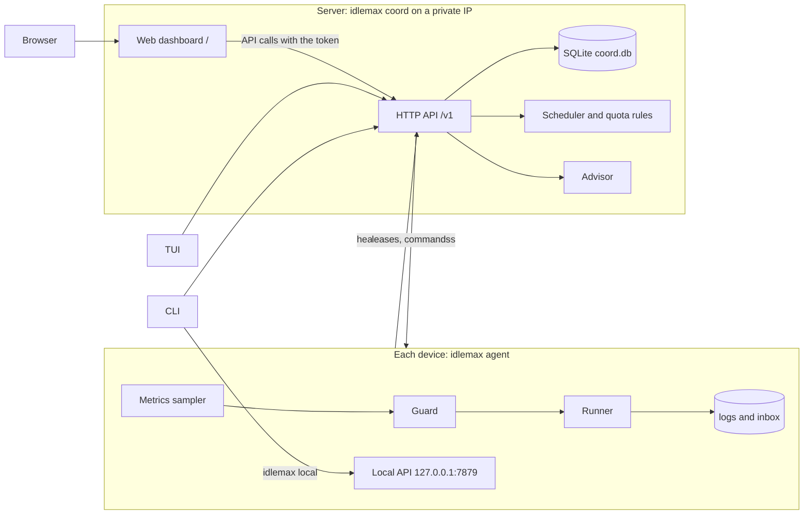

# idlemax

Run useful jobs on your devices' spare capacity, and spend your AI subscription quota before it resets, without getting in your way.

An expensive Mac sits idle all night.
A small server idles at a few percent CPU.
A Claude or Codex subscription resets with most of its quota unused, and that quota is gone.

idlemax is a job queue for your own devices.
You describe a job once: run the tests, rebuild an index, draft a review of a PR that is waiting on you.
A coordinator hands it to a device that is idle right now.
A guard on that device runs it at the lowest priority the OS offers, and stops it when you or your production services need the machine.
AI jobs spend only the quota above a reserve you choose, late in each window.

**Why it is safe to leave running**

- **It backs off when you come back.**
  Every device is checked every 30 seconds.
  The first sign of contention pauses jobs: you at the keyboard, battery power, thermal throttling, memory pressure, swap, load or low disk.
  A serious problem on two checks in a row kills them.
- **It keeps servers safe.**
  A server takes only light jobs (never CPU-heavy or AI), runs one at a time within 512 MiB, and pauses at a load average of 1.5.
  Every job also has a memory cap, a runtime cap and a command allowlist.
- **It treats your AI account carefully.**
  AI jobs launch only the official CLIs, with your own login, on the device where you logged in.
  idlemax never reads or copies credentials, never retries an AI job, and stops spending an account for the rest of the window after any limit message.
  Consumer terms still restrict automated use, so read the [ban-risk stance](#ai-quota-maximizer) before you enable it.
- **One file stops everything, even offline.**
  `touch $IDLEMAX_HOME/PAUSE` pauses every job on that device within seconds.

> **Status: v0.1.0.**
> Built and tested on macOS (Apple Silicon).
> The Linux server path and a live AI pass have not run yet, so treat both as unproven.
> Details are in [Status and limits](#status-and-limits).

<picture>
  <source media="(prefers-color-scheme: dark)" srcset="docs/assets/dashboard-dark.png">
  <source media="(prefers-color-scheme: light)" srcset="docs/assets/dashboard-light.png">
  
</picture>

The web dashboard follows your system theme.
This capture is a real coordinator fed by scripted demo agents, with the job history aged by hand, so no real machine or account appears in it.

## Quickstart

Try it on one machine with a throwaway state directory, so your real `~/.idlemax` is never touched.
You need a Rust toolchain (built with 1.95) on macOS or Linux.

1. Build and install the binary:

   ```sh
   git clone https://github.com/mrx-arafat/idlemax
   cd idlemax
   cargo install --path crates/idlemax
   ```

   Prebuilt binaries arrive with the first release.
   `scripts/install.sh` will then install one into `~/.local/bin` without sudo, after checking its sha256.
   Until a release exists the script stops with "no release has been published yet", so build from source for now.

2. Create a state directory with a demo config, then let `init` add the token and folders (it keeps an existing config):

   ```sh
   export IDLEMAX_HOME="$(mktemp -d)"
   cat > "$IDLEMAX_HOME/config.toml" <<'EOF'
   [agent]
   sample_secs = 5
   heartbeat_secs = 5
   command_allowlist = ["/bin/echo"]

   [guard]
   # Demo only: let jobs start while you are at the keyboard and on battery.
   user_idle_min_secs = 0
   require_ac_power = false
   min_battery_pct = 0.0
   EOF
   idlemax init
   ```

3. Start the coordinator and the agent:

   ```sh
   idlemax coord >"$IDLEMAX_HOME/logs/coord.log" 2>&1 &
   idlemax agent >"$IDLEMAX_HOME/logs/agent.log" 2>&1 &
   sleep 2
   idlemax status
   ```

4. Queue a job:

   ```sh
   cat > "$IDLEMAX_HOME/hello.toml" <<'EOF'
   name = "hello"
   command = ["/bin/echo", "hello from idlemax"]
   mem_mb = 64
   max_runtime_secs = 60
   EOF
   idlemax job add "$IDLEMAX_HOME/hello.toml"
   ```

5. Watch it with `idlemax jobs`, `idlemax tui` (press `2` for jobs, `q` to quit), or open `http://127.0.0.1:7878/` and paste the token from `$IDLEMAX_HOME/token`.
   If the job stays queued, ask why:

   ```sh
   idlemax why 1
   ```

   It lists every reason with its fix, for example a guard pause such as `disk free 13756.2 MiB < 15360 MiB`.
   That is the guard protecting a busy machine.
   For the demo, relax the key it names in `[guard]` (here `disk_free_mib_pause = 0` and `disk_free_mib_kill = 0`) and restart the agent.

6. Read the result, then try the kill switch:

   ```sh
   idlemax logs 1
   idlemax inbox
   idlemax inbox show 1
   idlemax stop-all --reason demo
   idlemax resume
   ```

   `idlemax logs 1` prints the job's output (the first line differs on Linux):

   ```text
   === idlemax job 1 attempt 1 started 2026-11-08T07:27:25.617+00:00 via taskpolicy ===
   hello from idlemax

   === idlemax: succeeded (exit 0) ===
   ```

7. Clean up, and unset `IDLEMAX_HOME` so the next section does not pick up the deleted directory:

   ```sh
   kill %1 %2
   rm -rf "$IDLEMAX_HOME"
   unset IDLEMAX_HOME
   ```

## Keep it running

The quickstart runs everything in your shell.
To keep the agent running in the background, let idlemax write the service file for your OS:

```sh
idlemax init                        # config.toml and the token, once
idlemax service install --dry-run   # prints the file and the exact launchctl or systemctl commands
idlemax service install             # writes it and starts the agent
idlemax service status
idlemax doctor                      # then check the whole setup
```

- **macOS** writes `~/Library/LaunchAgents/com.idlemax.agent.plist` and runs `launchctl bootstrap`.
  **Linux** writes the systemd user unit `~/.config/systemd/user/idlemax-agent.service` and runs `systemctl --user enable --now`.
- `idlemax service install coord` installs the coordinator instead, for a single-machine setup.
- The service runs the binary you ran the command with, so `cargo install` first.
  From a cargo `target/` directory the command warns, because a rebuild would break the service; `--bin /full/path/idlemax` pins another path.
- A service starts with a bare environment, so the file carries your `PATH` (the agent finds `claude`, `codex` and your job tools through it) and `IDLEMAX_HOME`, `CLAUDE_CONFIG_DIR` and `CODEX_HOME` when they are set.
  Change one and run `idlemax service install` again, which rewrites the file and reloads the service, so it restarts the agent and its running jobs.
- The agent's log is `<state dir>/logs/agent.log` on macOS and `journalctl --user -u idlemax-agent` on Linux.
- `idlemax service uninstall [agent|coord]` stops the service and deletes its file; with no name it removes every installed one.

Linux user units run while you are logged in; run `loginctl enable-linger $USER` yourself to run from boot.
Windows has no service command yet.
For a production coordinator on a server, use the system units in [Deploying across devices](#deploying-across-devices).

## Following a job

### Something is off

```sh
idlemax doctor
```

It checks this device and prints one line per check, `ok`, `warn` or `fail`, with the exact fix under every warn and fail:

```text
idlemax 0.1.0 doctor
ok    home         /Users/you/.idlemax (default)
ok    config       /Users/you/.idlemax/config.toml parses
fail  token        /Users/you/.idlemax/token is mode 0644: group and others can read it
                   fix: chmod 600 /Users/you/.idlemax/token
warn  coordinator  http://127.0.0.1:7878 is up; the token was not checked
                   fix: resolve the token check above, then run `idlemax doctor` again
...
```

- The checks are `home`, `config` (unknown keys are named), `token`, `coordinator` (reachable, accepts the token, same version), `agent`, `allowlist`, `disk`, `ai`, `gh` and `service`.
- It is read-only: it never runs `launchctl` or `systemctl` and starts nothing, and one broken check does not hide the others.
- The exit code is 1 when any check fails and 0 otherwise, so a warn alone does not fail a script; `--json` prints the report, and `--coord URL` checks another coordinator.
- It checks this device only, so run it on each one.

### My job is not running

Several rules can hold a queued job at once: a pause, the guard, a device's command allowlist, a missing tool, AI quota, a retry delay.
`idlemax why <job-id>` lists every one that applies right now, each with the fix:

```text
$ idlemax why 2
Job 2 (nightly-make) is queued but not starting.

Blocked on every device:
  - all jobs are paused
    fix: idlemax resume

my-laptop (online, heartbeat 2s ago):
  - "make" is not in my-laptop's agent.command_allowlist, so it would refuse the job
    fix: add "make" to agent.command_allowlist in config.toml on my-laptop and restart its agent
```

- Reasons that hold on every device come first, then each device's own reasons under its name.
- It covers every pause scope, offline or unknown devices, missing `requires` tools, the allowlist, AI accounts, each guard reason with the `[guard]` key that changes it, no free slot or RAM, quota, retry delays and parked jobs.
- `--json` prints the same data for scripts; the route is `GET /v1/jobs/{id}/why` in [docs/API.md](docs/API.md).
- Every agent reports its allowlist, so the scheduler never leases a job to a device that would refuse its command, and `idlemax job add` warns on stderr when no device allows it.
- Guard, slot and RAM verdicts are as of that device's last heartbeat (`agent.heartbeat_secs`, default 30), shown in its header.
  The TUI and dashboard have no `why` view yet.

### What did it do?

```sh
idlemax logs 1 --tail 20   # the last 20 lines of the job's output
idlemax logs 1 --follow    # stream it until the job finishes (-f)
idlemax inbox              # one row per finished job, newest first; --json for scripts
idlemax inbox show 1       # the note: start and finish, run time, exit code, throttle, output tail
```

`logs` reads `$IDLEMAX_HOME/logs/jobs/<id>.log` on this device.
If the job ran elsewhere it says so (`job 12 ran on server; run this there`).
Set `agent.notify = true` for a macOS notification with the job name and outcome when a job finishes.

## How it works



- **Coordinator** (`idlemax coord`): one per setup, usually on the server.
  It keeps the job queue, leases, device registry, quota ledger and advice in SQLite, and serves the HTTP API and the web dashboard.
  The systemd unit caps it at `MemoryMax=256M` and `CPUQuota=20%`.
- **Agent** (`idlemax agent`): one per device.
  It samples the machine, runs the guard, heartbeats to the coordinator, starts leased jobs under OS throttles and writes each result to an inbox note.
  Its local API on loopback keeps working while the coordinator is down.
- **Jobs are leased, not pushed.**
  A lease that a heartbeat does not renew within 120 s is re-queued with backoff, and a job that fails `max_attempts` times is parked for you to look at.
- **Job updates survive crashes.**
  The agent journals each update before sending it and replays what the coordinator never acknowledged, and the coordinator applies each update once.

## Safety model

The agent samples its device every 30 s, and the guard turns each sample into one verdict: run, hold, pause or kill.
A single breach pauses running jobs with SIGSTOP.
Kill-level breaches on 2 consecutive samples kill them (SIGTERM, then SIGKILL after 15 s).
After a pause or kill, jobs resume only after 2 clear samples.

The profile defaults to `macos_laptop` on macOS and `linux_server` elsewhere.
A server never takes `cpu_heavy` or `ai` jobs.
Each job sets `on_user_active`: `pause` (default), `continue` (only machine-health checks apply) or `kill`.

**How heavy is it?**
Measured over 10 minutes on one Apple Silicon Mac, idle, with no jobs: the coordinator and the agent each used about 0% CPU and 16 to 18 MB of memory (mean RSS; peaks of about 20 and 22 MB).
Each 30 s sample runs about 3.5 short macOS system probes (`ioreg`, `pmset` and `sysctl`), about 74 ms in total.
Linux and a busy machine have not been measured.

<details>
<summary>Every guard threshold and the config key that changes it</summary>

| Signal | `macos_laptop` pause | `macos_laptop` kill | `linux_server` pause | `linux_server` kill | `[guard]` keys |
|---|---|---|---|---|---|
| You are using the machine | idle < 600 s | | | | `user_idle_min_secs` |
| Power | on battery, or battery < 40% | | | | `require_ac_power`, `min_battery_pct` |
| Thermal throttling | any | | any | | `pause_on_thermal` |
| macOS memory pressure | warn | critical | | | `memory_pressure_pause`, `memory_pressure_kill` |
| Memory free | < 30% | < 20% | | | `mem_free_pct_pause`, `mem_free_pct_kill` |
| MemAvailable | | | < 1024 MiB | < 768 MiB | `mem_available_mib_pause`, `mem_available_mib_kill` |
| Swap growth | +256 MiB in 60 s | +1 GiB in 5 min | | | `swap_growth_pause`, `swap_growth_kill` |
| Swap used | | | > 1536 MiB | > 2048 MiB | `swap_used_mib_pause`, `swap_used_mib_kill` |
| Swap-in rate | | | > 100 pages/s for 60 s | | `swap_in_pages_per_sec_pause`, `swap_in_sustain_secs` |
| PSI memory | | | some avg10 > 5% | full avg10 > 1% | `psi_mem_some_pause`, `psi_mem_full_kill` |
| PSI I/O full avg10 | | | > 10% | > 25% | `psi_io_full_pause`, `psi_io_full_kill` |
| Load average, 1 min | > 6 | > 8 | > 1.5 | > 2.0 | `load_1m_pause`, `load_1m_kill` |
| Disk free | < 15 GiB | < 10 GiB | < 10 GB | < 5 GB | `disk_free_mib_pause`, `disk_free_mib_kill` |
| Capacity | 2 jobs, 1 GiB total | | 1 job, 512 MiB | | `max_jobs`, `ram_budget_mib` |

</details>

Every job runs in its own process group at the lowest priority the OS offers:

| OS | Wrapper | Memory cap |
|---|---|---|
| macOS | `taskpolicy -c background -d throttle -b -m <mem_mb> -P kill nice -n 20 <command>` | the runner kills the job when its process-tree RSS exceeds `mem_mb`, because the `taskpolicy` limit is soft |
| Linux, as root or with a reachable systemd user manager (its session bus or its private socket) | `systemd-run [--user] --scope --nice=19 -p CPUQuota=100% -p CPUWeight=10 -p IOWeight=10 -p MemoryMax=<mem_mb>M -p MemorySwapMax=0 -- <command>` | cgroup `MemoryMax` with no swap, so a job over its cap is killed and ends as "killed by the N MiB memory cap"; systemd 253 or newer also gets `-p OOMPolicy=kill`, so the whole job dies even when the kernel picks a child of a shell |
| Linux, otherwise | `nice -n 19 ionice -c3 <command>` | the runner's RSS check, plus the agent unit's cgroup caps |
| Windows | idle priority class | the runner's RSS check |

The runner also kills a job after `max_runtime_secs` (default 1800) of awake, unpaused time.
System sleep does not consume this runtime budget on macOS or Linux.

**Kill switch.**
`touch $IDLEMAX_HOME/PAUSE` pauses every job on that device within seconds and without the network, and deleting the file resumes them.
`idlemax local stop-all` kills every job on the device and holds new ones, even while the coordinator is down.

**Security.**

- One bearer token (32 random bytes as hex, file mode 0600) guards every API call except `/healthz` and `/`, and is compared in constant time.
- Anyone holding the token can run any allowlisted program with any arguments on your devices, so treat it like an SSH key and keep allowlists narrow: allowlisting `sh` or `python3` allows any code.
- The coordinator refuses to bind `0.0.0.0` or `[::]`.
  Its traffic is plain HTTP, so bind it to a private network such as a tailnet, which encrypts it.
- The local agent API listens on loopback only.
- Jobs run without a shell, as the agent's user, with `IDLEMAX_JOB_ID` but never the token, and loader variables (`LD_*`, `DYLD_*`) are refused.
- AI CLIs run only on devices that list the account, with the login already on that device.
- The web dashboard loads nothing remote, sends a strict Content-Security-Policy, writes every API string as text, never HTML, and keeps the token in the browser's local storage.
- Quota probes only read the CLIs' files.
- Report a vulnerability privately, as [SECURITY.md](SECURITY.md) describes, not in a public issue.

## AI quota maximizer

Each AI account lists its windows and the reserve kept for you:

| Provider | Default windows | Usage source |
|---|---|---|
| `claude` | 5-hour rolling (reserve 40%), weekly (reserve 30%) | Claude Code statusline capture |
| `codex` | weekly (reserve 30%), plus a 5-hour window if Codex reports one | newest Codex session file |
| `agy` | 5-hour rolling (40%), weekly (30%) | manual file |
| `api` | none | manual file |

The weekly reserve drops to 15% in the last 24 h before the reset.
An AI job runs only when all of these hold:

1. The device lists the account in `agent.ai_accounts`.
2. Every window is below `100 - reserve`, with headroom for the job's `token_class`.
3. The shortest window is in its final third, or the weekly reset is less than 24 h away.
4. You have not used that CLI interactively in the last 30 minutes.
5. No other AI job holds a lease on the account on any device.
6. No usage limit or HTTP 429 was seen in this window.
7. The usage data is less than 6 hours old, and no AI job started on the account in the last 5 hours.

`idlemax quota` shows each window and says why an account is or is not spendable (demo data):

```text
ACCOUNT     WINDOW  USED  RESERVE  HEADROOM  RESETS     SPEND  WHY
claude-max  5h      34%   40%      26%       in 1h19m   no     another AI job holds this account's lease; an AI job alre...
claude-max  week    41%   30%      29%       in 3d4h    no     another AI job holds this account's lease; an AI job alre...
codex-pro   week    31%   15%      54%       in 18h59m  yes    weekly window in its final third, resets in 18h 59m
```

**Ban-risk stance.**
idlemax only launches the unmodified official CLIs (`claude -p`, `codex exec`, `agy -p`) with your own login, on the device where you logged in.
It never copies credentials between devices, never fans out across devices or accounts, never retries an AI job, and stops spending an account for the rest of the window after any limit message.
That keeps automated use close to ordinary individual use, but consumer terms still restrict automated access, so the risk is reduced, not zero.
Metered API keys (`provider = "api"`) are the path providers designate for automation.

**Claude usage** comes from the JSON that Claude Code passes to its statusline command.
`idlemax statusline install` wraps your `statusLine` command so each render also saves that JSON to `$IDLEMAX_HOME/agent/claude-statusline.json`.
Until that file exists, Claude accounts are never spendable (fail closed).

```sh
idlemax statusline install --dry-run   # shows the diff, writes nothing
idlemax statusline install
idlemax statusline status              # is it wired, and when did the last capture land
idlemax statusline uninstall           # puts the original command back
```

It edits `settings.json` in `$CLAUDE_CONFIG_DIR`, else `~/.claude`, and nothing else:

- It copies the file to `settings.json.idlemax.bak` before every change.
- It changes only the `statusLine.command` string; every other key, the key order, the indentation and the line endings stay byte for byte.
- Your original command runs unchanged under `sh -c`, so the visible statusline is identical, and capture errors are ignored, so the statusline never breaks.
  With no `statusLine` yet, it adds one that runs the capture script alone.
- The capture script ships inside the binary; `install` writes it to `$IDLEMAX_HOME/bin/claude-statusline-capture.sh`.
  If `IDLEMAX_HOME` is set when you install, it goes into the command too, so Claude Code (which has no `IDLEMAX_HOME`) captures into the state dir the agent reads.
- Running `install` again changes nothing.
  `uninstall` restores the original command, and restores the backup byte for byte when the file is still exactly the backup plus idlemax's edit.
- It refuses, with the reason and without touching the file, when `settings.json` is not valid JSON, when `statusLine` is not an object with `"type": "command"` and a `command` string, or when `statusLine` appears twice.

`idlemax statusline status` shows the settings path, whether the command is wrapped, your original command and the age of the last capture.
It says "not written yet; open Claude Code so it renders the statusline" until the first capture lands.

## AI advisor

The advisor turns cluster state, your open PRs and review requests, and your recent sessions into recommendations.
You accept or dismiss each one, and nothing runs on the advisor's word alone, except templates listed in `advisor.auto_accept`.

- Each agent reads `gh` and the metadata of recent Claude and Codex sessions (never message text) on its own device every 15 minutes, and sends only that metadata to the coordinator.
  The coordinator can therefore run on a server that has neither.
- The rules engine runs every 15 minutes and on `idlemax advise refresh`.
  It flags parked or failed jobs, offline devices, idle devices with an empty queue, quota about to reset unused, PRs waiting on you for 2+ days, and unfinished sessions.
- An AI pass runs as an ordinary `ai` job through `claude -p` with a strict JSON schema, only when `advisor.ai_account` is spendable under the rules above.
  Its prompt travels on stdin instead of argv, and the run disables all hooks and starts none of your MCP servers.
- Suggested jobs can only name templates in `$IDLEMAX_HOME/jobs/`.
  To add one, write a spec to `$IDLEMAX_HOME/jobs/<name>.toml` on the coordinator, allowlist its `argv[0]` on the devices that should run it, and queue it with `idlemax job add` or let the advisor suggest it.
  The advisor queues a template without asking only if its name is in `advisor.auto_accept`.

## Controls

Every command reads `$IDLEMAX_HOME` (default `~/.idlemax`; set but empty is an error).
Coordinator commands accept `--coord URL` (or `IDLEMAX_COORD`), and `--json` prints JSON for scripts.

| Command | Does |
|---|---|
| `idlemax agent` | run the device agent |
| `idlemax coord` | run the coordinator |
| `idlemax init [--profile macos-laptop\|linux-server] [--coord-url URL] [--token-stdin]` | create the state dirs, `config.toml` and a 0600 token; never overwrites, and refuses the flags when a config already exists |
| `idlemax status` | cluster summary and devices |
| `idlemax jobs [--status S] [--limit N]` | list jobs (default limit 50) |
| `idlemax job add <spec.toml>` | validate and queue a job spec |
| `idlemax job cancel <id>` | cancel a job, killing it if it runs |
| `idlemax schedule add <spec.toml> [--every I] \| list \| pause <id> \| resume <id> \| rm <id>` | repeat a job on an interval, see [Recurring jobs](#recurring-jobs) |
| `idlemax doctor` | check this device's setup, with the fix for every problem; exit 1 on a failed check |
| `idlemax why <id>` | every reason a job is not running, with the fix for each |
| `idlemax logs <id> [--tail N] [-f]` | print a job's output from this device |
| `idlemax inbox [list \| show <id>]` | finished-job notes from this device (default `list`) |
| `idlemax pause [--device D \| --account A \| --job N] [--reason TEXT]` | pause the whole cluster or one scope |
| `idlemax resume [same flags]` | lift exactly that pause; resuming the cluster does not clear device, account or job pauses |
| `idlemax stop-all [same flags]` | kill the scope's running jobs and hold new ones until you resume |
| `idlemax quota` | windows, reserve, headroom, and why each account is or is not spendable |
| `idlemax events [--limit N]` | recent events (default limit 50) |
| `idlemax advise [list \| accept <id> \| dismiss <id> \| refresh]` | advisor recommendations (default `list`) |
| `idlemax service install \| uninstall \| status [agent\|coord]` | run the agent (or the coordinator) as a background service, see [Keep it running](#keep-it-running); `--dry-run` previews `install` and `uninstall` |
| `idlemax statusline install \| uninstall \| status` | wire Claude's statusline into the quota probe; `--dry-run` previews `install` and `uninstall` |
| `idlemax tui` | terminal dashboard |
| `idlemax local status \| pause \| resume \| stop-all` | this device's agent directly, on `agent.listen` |

**Terminal dashboard.**
The screen below is rendered with ratatui's `TestBackend` from placeholder data, with blank rows cropped:

```text
idlemax http://127.0.0.1:7878   running   updated 2s ago
coordinator 0.1.0 | global: running | jobs: 1 running, 1 queued | advice: 1 open
 1 Devices (2) │ 2 Jobs (3) │ 3 Quota (1) │ 4 Advice (1) │ 5 Events (0) │ 6 Schedules (0)
┌──────────────────────────────────────────────────────────────────────────────────────────────────┐
│  DEVICE  STATE   GUARD                  IDLE  CPU  LOAD  MEM FREE  SWAP  DISK    POWER  JOBS     │
│> laptop  online  run 1                  25m   9%   2.10  41% 5.0G  1.0G  120.0G  ac     1        │
│  server  online  hold: load 1.70 > 1.5  -     9%   1.70  52% 5.0G  1.0G  120.0G  -      0        │
│                                                                                                  │
└──────────────────────────────────────────────────────────────────────────────────────────────────┘
p/r pause/resume device laptop  P/R all  s stop-all  tab/1-6 switch  q quit
```

| Key | Action |
|---|---|
| `1`-`6`, `Tab`, `Left`, `Right` | switch between Devices, Jobs, Quota, Advice, Events and Schedules |
| `Up`, `Down` | select a row |
| `p`, `r` | pause or resume the selected device, job, account or schedule |
| `P`, `R` | pause or resume everything |
| `s` | stop-all everywhere (asks first) |
| `k` | cancel the selected job (asks first) |
| `a`, `d` | accept or dismiss the selected advice; on Schedules, `d` removes the selected schedule (asks first) |
| `f` | re-run the advisor (Advice tab) |
| `y`, `Enter` | confirm a prompt; any other key cancels it |
| `q`, `Esc`, `Ctrl-C` | quit |

**Web dashboard.**
The coordinator serves one self-contained page at `/` with no remote scripts, fonts or styles.
It asks for the token once and keeps it in that browser's local storage until you press "Forget token".
It refreshes every 5 s and shows devices with guard verdicts and metrics, schedules, jobs, AI quota per window, advice and events.
It follows the system light or dark theme, and on a phone the jobs table becomes stacked cards.
From it you can pause, resume, stop-all or cancel per scope, pause, resume or remove a schedule, and accept or dismiss advice.

**HTTP API.**
Every call except `GET /healthz` and `GET /` needs `Authorization: Bearer <token>`, and errors are `{"error": "..."}`.
The agent's local API (`agent.listen`, loopback only) uses the same token and keeps working while the coordinator is down.
Routes, wire formats and semantics are in [docs/API.md](docs/API.md).

```sh
curl -H "Authorization: Bearer $(cat "$IDLEMAX_HOME/token")" http://127.0.0.1:7878/v1/status
```

## Configuration

`config.toml` lives in `$IDLEMAX_HOME`, and every key is optional.
Worked examples: [examples/config.toml](examples/config.toml) (a macOS agent) and [examples/config.server.toml](examples/config.server.toml) (a server).

| Key | Default | Meaning |
|---|---|---|
| `coordinator.listen` | `127.0.0.1:7878` | bind address; `0.0.0.0` and `[::]` are refused |
| `coordinator.url` | `http://127.0.0.1:7878` | where agents and the CLI reach the coordinator |
| `coordinator.lease_secs` | `120` | a lease not renewed by a heartbeat in this time is re-queued with backoff |
| `coordinator.offline_after_secs` | `90` | a device is offline after this long without a heartbeat |
| `coordinator.metrics_retention_days` | `7` | days of per-minute device metrics kept |
| `agent.device_id` | short lowercase hostname | the name job specs use in `devices` |
| `agent.profile` | from the OS | `macos_laptop` or `linux_server` guard preset |
| `agent.listen` | `127.0.0.1:7879` | local agent API |
| `agent.sample_secs`, `agent.heartbeat_secs` | `30`, `30` | guard sample and heartbeat intervals |
| `agent.advisor_inputs_secs` | `900` | how often the agent sends its `gh` summary and session metadata to the advisor; `0` sends nothing |
| `agent.notify` | `false` | post a macOS notification with the job name and outcome when a job finishes; ignored on other systems |
| `agent.ai_accounts` | `[]` | AI accounts this device may spend |
| `agent.command_allowlist` | `[]` | exact `argv[0]` values a job may run; bare names resolve on the agent's PATH; empty denies all |
| `[guard]` | preset values | any key from the guard table above |
| `[[quota.accounts]]` | none | `name`, `provider` (`claude`, `codex`, `agy`, `api`), and optional `windows`, `probe` (`claude_statusline`, `codex_sessions`, `manual`) and `probe_path` |
| `advisor.enabled` | `true` | run the advisor |
| `advisor.ai_account` | none | account the AI pass spends; none runs the rules only |
| `advisor.auto_accept` | `[]` | template names queued without asking |

A window entry looks like `{ kind = "rolling", minutes = 300, reserve_pct = 40.0 }` or `{ kind = "weekly", reserve_pct = 30.0, final_day_reserve_pct = 15.0 }`.
TOML has no null, so a `[guard]` override cannot switch a check off; set a value that never trips instead.

Environment: `IDLEMAX_HOME` (state dir), `IDLEMAX_TOKEN` (overrides the token file), `IDLEMAX_COORD` (the CLI's coordinator URL), `RUST_LOG` (log filter, default `info`).

| State dir path | Holds |
|---|---|
| `config.toml`, `token` | config and the 0600 API token |
| `coord.db` | coordinator SQLite database, mode 0600: jobs, devices, quota ledger, advice and schedules |
| `PAUSE` | kill switch file |
| `jobs/*.toml` | job templates the advisor may suggest |
| `logs/jobs/<id>.log` | job output |
| `inbox/<date>-<id>-<name>.md` | one note per finished job |
| `agent/` | 24 h metrics ring, `outbox.jsonl` (job updates not yet acked by the coordinator), `claude-statusline.json` (the latest Claude statusline capture), `quota-<account>.json` manual usage files |
| `bin/claude-statusline-capture.sh` | the capture script `idlemax statusline install` writes |

### Job specs

A job spec is TOML, and `command` is an argv list that never goes through a shell.

```toml
name = "repo-health"
command = ["/path/to/examples/scripts/repo-health.sh", "/path/to/repo"]
cost = "cpu_heavy"          # cpu_light (default), cpu_heavy, io or ai
requires = ["cargo", "git"] # tools the device must have on PATH
devices = ["my-laptop"]     # device ids; empty means any device
priority = 3                # higher runs first
mem_mb = 1024               # default 512, counted against the device RAM budget
max_runtime_secs = 1500     # default 1800
on_user_active = "kill"     # pause (default), continue or kill
max_attempts = 3            # default 3; ai jobs always get 1

[env]
CARGO_BUILD_JOBS = "2"
```

AI jobs also set `ai_account` and `token_class` (`small`, `medium`, `large`).
Jobs get `IDLEMAX_JOB_ID` in their environment but never the API token, and `env` keys starting with `LD_` or `DYLD_` are refused.
Use `on_user_active = "kill"` for jobs that hold a lock you need (a cargo target dir, an index, a git clone), because a paused job keeps holding it.

[examples/jobs/](examples/jobs/) holds starter jobs, backed by scripts in [examples/scripts/](examples/scripts/):

| Spec | Runs | Cost |
|---|---|---|
| `kb-refresh.toml` | fast-forward a notes repo and list what changed | `cpu_light` |
| `index-refresh.toml` | `codegraph sync` over a list of repos | `cpu_heavy` |
| `repo-health-project-a.toml` | clippy, tests and `npm audit` for one repo, as an inbox report | `cpu_heavy` |
| `pr-review-drafts-claude.toml`, `pr-review-drafts-codex.toml` | draft reviews of PRs waiting on you; the AI gets the PR text on stdin, no tools, and posts nothing | `ai` |

Their paths (`/path/to/...`) and device id (`my-laptop`) are placeholders; replace them before use.

### Recurring jobs

`idlemax schedule` repeats a job, for example a nightly repo health check, so you stop re-queuing it by hand.
Each run is an ordinary job, so the guard still decides when it starts: "every day" means once a day, whenever the machine is idle.
A spec may carry `every = "1d"`; `schedule add` uses it, and `job add` ignores it and says so.

```sh
idlemax schedule add examples/jobs/repo-health-project-a.toml    # uses `every = "1d"` from the file
idlemax schedule add examples/jobs/kb-refresh.toml --every 12h   # the flag wins over the file
idlemax schedule list                                            # add --json for scripts
idlemax schedule pause 2
idlemax schedule resume 2
idlemax schedule rm 2
```

```text
ID  NAME                   EVERY  STATE         LAST RESULT
1   repo-health-project-a  1d     job 2 queued  -
2   kb-refresh             12h    job 3 queued  -
```

An interval is a whole number and one unit, `s`, `m`, `h` or `d`, from `1m` to `365d`: write `90m`, not `1.5h`.
`STATE` says what the schedule waits for: the job it queued (`job 2 queued`), `next in 5h41m`, `due now` or `paused`.
`LAST RESULT` is how the last finished job ended (`succeeded 4s ago`), or `-` before one has.

- A new schedule queues its first job at once.
  The coordinator checks every 15 s and queues the next job when the previous one has ended and a whole interval has passed since.
- A job that is still queued, leased, running or paused blocks the next one, so a machine that is never idle gets one job, not a backlog.
  After a coordinator outage you get one job, not one per missed period.
- A failed, killed or cancelled job does not stop the schedule; `schedule pause` does.
- Names are unique (the spec's `name`), and `schedule rm` leaves an already queued job alone and prints the `idlemax job cancel N` that stops it.
- A job that cannot be queued (for example its AI account left the config) shows as an `error` event in `idlemax events`, and the schedule tries again after the next interval.
  Each queued job also logs a `schedule_fired` event.

There is no cron-style "at 03:00": the interval counts from the end of the last run, and the guard picks the time of day.
The TUI (tab 6) and the web dashboard list schedules too, with pause, resume and remove.

## Deploying across devices

1. Run Tailscale (or another private network) on every device, and bind the coordinator to its private IP with `coordinator.listen = "<tailnet-ip>:7878"`.

2. Install the coordinator and a server agent on Linux:

   ```sh
   cargo build --release -p idlemax
   sudo install -m 0755 target/release/idlemax /usr/local/bin/idlemax
   sudo useradd --system --home-dir /var/lib/idlemax --shell /usr/sbin/nologin idlemax
   sudo install -d -o idlemax -g idlemax -m 0700 /var/lib/idlemax
   sudo install -o idlemax -g idlemax -m 0600 examples/config.server.toml /var/lib/idlemax/config.toml
   sudo -u idlemax env IDLEMAX_HOME=/var/lib/idlemax idlemax init
   sudo install -m 0644 packaging/linux/idlemax-coord.service packaging/linux/idlemax-agent.service /etc/systemd/system/
   sudo systemctl daemon-reload
   sudo systemctl enable --now idlemax-coord idlemax-agent
   ```

   Edit `listen`, `url` and `device_id` in `/var/lib/idlemax/config.toml` before enabling the units.

3. On every other device, share the coordinator's token and point the agent at it:

   ```sh
   ssh <server> sudo cat /var/lib/idlemax/token | idlemax init --coord-url http://<tailnet-ip>:7878 --token-stdin
   ```

   Then set `device_id`, `ai_accounts` and `command_allowlist` in `~/.idlemax/config.toml`, and keep `[[quota.accounts]]` identical on every host.

4. On a Mac (or a Linux desktop), run the agent as a per-user service with `idlemax service install`, as described in [Keep it running](#keep-it-running).
   It fills in your binary, `PATH` and state dir, which the templates in `packaging/` leave as placeholders.

| Unit | Caps and settings |
|---|---|
| `com.idlemax.agent.plist`, `com.idlemax.coord.plist` | `ProcessType` Background, `LowPriorityIO`, `LowPriorityBackgroundIO`, `Nice` 20, restart after a crash, logs in `<state dir>/logs/` |
| `idlemax-agent.user.service`, `idlemax-coord.user.service` | the system units' `MemoryMax`, `CPUQuota`, `Nice` and I/O class, applied only if your user manager delegates those cgroup controllers, and without the system units' sandbox |
| `idlemax-coord.service` | `MemoryHigh=192M`, `MemoryMax=256M`, `MemorySwapMax=0`, `CPUQuota=20%`, `CPUWeight=10`, `IOWeight=10`, a strict sandbox that writes only `/var/lib/idlemax`, restarts until the private IP exists |
| `idlemax-agent.service` | `MemoryMax=640M` for the agent plus its one job, `MemorySwapMax=0`, `CPUQuota=100%`, `CPUWeight=10`, `IOWeight=10`, `Nice=19`, idle I/O class; jobs write only `/var/lib/idlemax` and a private `/tmp` |

On the server, jobs run under `nice` and `ionice` inside the agent unit's cgroup unless the idlemax user has a systemd user manager.
Keep lingering off so every job stays inside those caps.
Add `ReadWritePaths=` with `systemctl edit idlemax-agent` if a job needs to write elsewhere.

## Status and limits

Verified on macOS (Apple Silicon): focused tests for the safety-critical rules, the end-to-end test (a coordinator and an agent running one job), live runs of the agent and coordinator in temporary state directories (including `why`, `logs`, `inbox`, `schedule` and `statusline` against them), and the web dashboard in Chrome.

| Area | Limit |
|---|---|
| Linux | not yet run on Linux: the Linux parsers are tested on macOS with fixtures, but the Linux metrics call site, `loginctl` idle, the `systemd-run` wrapper and the systemd system and user units have not run |
| Service install | `idlemax service install` is checked with `--dry-run` and against a stand-in `launchctl`, but has not driven a real launchd or systemd yet |
| Windows | code paths are neither compiled nor run; no idle, power or thermal signals, no pause, tree kill through `taskkill`, no packaging |
| AI pass | the advisor's `claude -p` pass has not run end to end, because that spends quota |
| Claude quota | needs `idlemax statusline install`; until the first capture lands, Claude accounts are never spendable |
| Schedules | no cron-style times; they live in `coord.db`, so an older idlemax refuses a database a newer one wrote, and the CLI and TUI should match the coordinator's release |
| macOS memory cap | `taskpolicy -m` is soft; the runner's RSS check every 5 s is the real cap, and a job child that daemonizes escapes its sum |
| Runtime limit | counts awake time only, tested with an injected clock; a real sleep test has not run |
| Job updates | journaled before sending and replayed after a crash; if the agent dies after a job exits and before it is reaped, the lease expires and the job runs again |
| Dashboard | checked in Chrome only; Safari, Firefox and phones have not been checked |

What comes next, with the reason and a "done when" for each item, is in [docs/ROADMAP.md](docs/ROADMAP.md).

## Architecture

```text
crates/idlemax-core/src/   domain: types, protocol, config, paths, guard, quota, scheduler, schedule,
                           control, reconcile, job_run, advice, explain, install, notify (pure, unit tested)
crates/idlemax/src/        adapters and delivery: agent/, coord/, advisor/, cli/, tui/, state.rs
crates/idlemax/assets/     dashboard.html
crates/idlemax/tests/      integration tests: e2e.rs (coordinator plus agent), examples.rs (example configs and specs)
examples/                  configs, job specs, job scripts
packaging/                 launchd plists, systemd units, Claude statusline capture script
scripts/                   install.sh, changelog.sh, verify-linux.sh
docs/                      API.md, ROLLOUT.md, RELEASING.md, ROADMAP.md
```

Dependencies point inward, and every decision is a pure function with unit tests:

| Layer | Where | Holds |
|---|---|---|
| Domain | `crates/idlemax-core` | types, wire protocol, config, guard, quota rules, scheduler, schedules, control semantics, agent reconcile, job-run, advice and why-not-running decisions; no I/O and no clock (time is a parameter) |
| Adapters | `crates/idlemax/src/{agent,coord,advisor}`, `state.rs` | OS metrics, process runner, SQLite store, HTTP server and client, `gh` and session readers, the `claude -p` job builder |
| Delivery | `cli.rs`, `tui/`, `coord/web.rs`, `main.rs` | argument parsing, one use-case call each, rendering |

Both crates are `#![forbid(unsafe_code)]`, errors are typed with `thiserror`, and `anyhow` appears only in `main.rs` and the CLI.
Deliberate shortcuts are marked `SHORTCUT:` in the code, and `grep -rnE '(#|//) ?SHORTCUT:' crates` lists them.

## Contributing

Pull requests and bug reports are welcome.
[CONTRIBUTING.md](CONTRIBUTING.md) covers the development loop, the gates a change must pass and the commit style.
Every change passes `cargo fmt --all --check`, `cargo clippy --workspace --all-targets -- -D warnings` and the focused tests for what it touches, and CI runs the full tests on macOS and Linux.

- To report a bug or ask for a feature, use the issue forms under [Issues](https://github.com/mrx-arafat/idlemax/issues/new/choose).
- For a security problem, do not open a public issue; follow [SECURITY.md](SECURITY.md).
- Run the agent or coordinator in a temp `HOME` and `IDLEMAX_HOME` during development, never your real state dir.
  The e2e test does this and refuses to start against your real one.

## Docs

- [docs/API.md](docs/API.md): wire formats, lease and control semantics
- [docs/ROLLOUT.md](docs/ROLLOUT.md): runbook to verify the Linux agent, then deploy the coordinator on a tailnet
- [docs/RELEASING.md](docs/RELEASING.md): how a release is cut
- [docs/ROADMAP.md](docs/ROADMAP.md): what comes next
- [CONTRIBUTING.md](CONTRIBUTING.md): development loop, gates and commit style
- [SECURITY.md](SECURITY.md): how to report a vulnerability, and what is in scope
- [CHANGELOG.md](CHANGELOG.md): release notes

## License

MIT, see [LICENSE](LICENSE).
