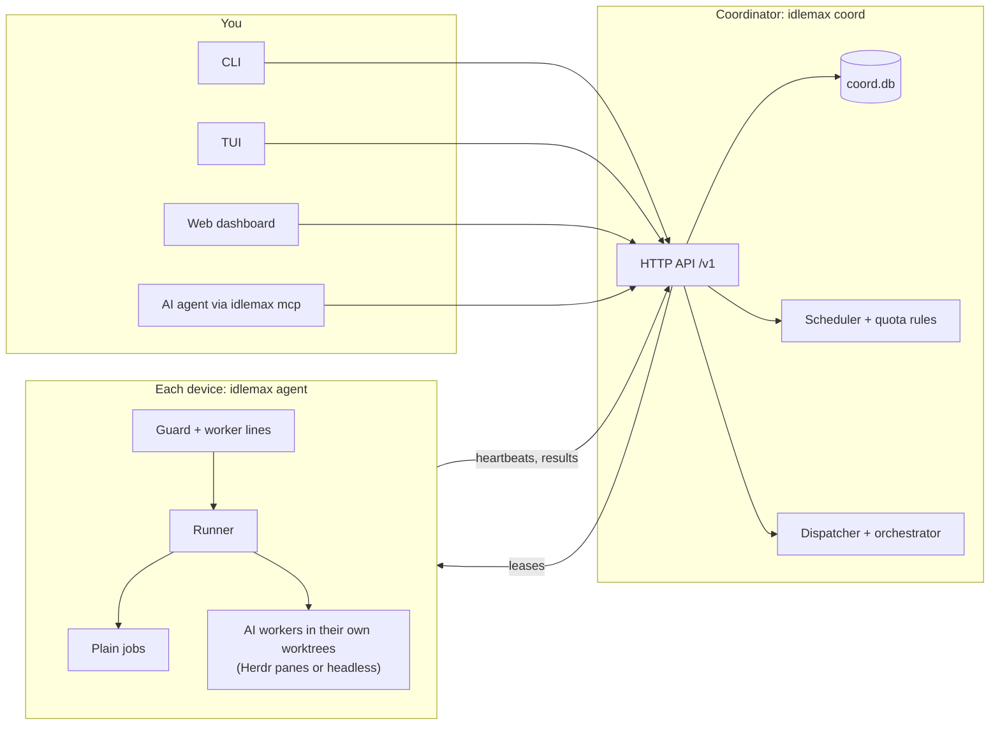

# idlemax

[](https://github.com/mrx-arafat/idlemax/actions/workflows/ci.yml)

**Put your idle machines and your unused AI quota to work, without ever getting in your way.**

An expensive Mac sits idle all night.
A small server idles at a few percent CPU.
A Claude or Codex subscription resets with most of its quota unused, and that quota is gone.
idlemax is a job queue and an AI work dispatcher for your own devices: you describe work once, and a coordinator hands it to a device that has room right now.
A guard on that device runs it at the lowest priority the OS offers and backs off the moment you or your services need the machine, while AI workers spend only the quota that would expire anyway.

<picture>
  <source media="(prefers-color-scheme: dark)" srcset="docs/assets/dashboard-dark.png">
  <source media="(prefers-color-scheme: light)" srcset="docs/assets/dashboard-light.png">
  
</picture>

<sub>A real coordinator fed by scripted demo agents, with the job history aged by hand, so no real machine or account appears in it.</sub>

> **Status: v0.2.0.**
> Built and tested on macOS (Apple Silicon) and Ubuntu 24.04; CI runs the full suite on both.
> It has run live with real AI on a Linux server (Ubuntu, `workbox` profile): real statusline quota readings, real Opus orchestrator passes on real repos (sending owner and infra items to needs you), about 60 real Claude Sonnet and Haiku workers in Herdr with checks and verdicts, stop and start, and review keep.
> A production server rollout and a real install on a Mac (`idlemax setup` with its launchd services) are still unproven.
> The details are in the [FAQ](docs/manual/12-faq.md#what-has-been-tested-and-what-has-not).

## How it works



- **The coordinator** (one for all your machines) keeps the queue, the devices, the quota ledger and the dispatcher's plan in SQLite, and serves the API and the dashboard.
- **The agent** (one per device) samples the machine every 30 seconds, decides whether now is a good moment, runs leased jobs under OS throttles, and keeps a local API that works while the coordinator is down.
- **Jobs are leased, not pushed.** A lease no heartbeat renews within 120 s goes back in the queue, and job updates are journaled so they survive crashes.
- **The dispatcher** finds leftover tasks in projects you switched on, a short orchestrator pass picks which ones fill the free room, and each worker runs in its own git worktree, commits locally only, and is checked before you hear about it.

## Why you would want it

- 💤 **Your idle hardware does real work:** test suites, index rebuilds, repo health checks, backups, overnight.
- ⏳ **Your AI quota stops expiring unused:** workers spend the surplus on small, checkable tasks, paced by a daily Budget.
- 🧑‍💻 **You never feel it:** jobs wait for you to step away, pause the second you come back, and run at the lowest priority.
- 🧾 **You stay in charge:** every project and device is off until you switch it on, nothing is pushed or merged, and you review every result.

## Quick start (5 minutes)

Works on macOS (Apple Silicon or Intel) and Linux (x86_64 or arm64).
New to the terminal? The [install guide](docs/manual/01-install.md) walks through every step.

**1. Install** the binary into `~/.local/bin`, no sudo:

```sh
curl -fsSL https://raw.githubusercontent.com/mrx-arafat/idlemax/main/scripts/install.sh | sh -s -- --dry-run   # look first
curl -fsSL https://raw.githubusercontent.com/mrx-arafat/idlemax/main/scripts/install.sh | sh
```

(Or from source with Rust 1.95 or newer: `git clone https://github.com/mrx-arafat/idlemax && cd idlemax && cargo install --path crates/idlemax`.)

**2. Set up this device** (config, token, background services, then a health check):

```sh
idlemax setup --dry-run --allow /bin/echo   # preview every file and command
idlemax setup --allow /bin/echo
```

`--allow` lists the programs jobs may run.
The list starts empty on purpose: no job can start until you name a program.

**3. Run your first job:**

```sh
idlemax job add --wait --timeout 60 -- /bin/echo "hello from idlemax"
```

```text
job 1 queued: echo
job 1 succeeded: echo
exit code: 0
ran: 1.0s on laptop
...
```

Still queued after a minute? That is the guard protecting you: on a Mac (profile `laptop`) it waits for 10 idle minutes on AC power, while Linux defaults to the `production` profile, which has no idle wait and holds only for machine health: load, memory or I/O pressure, swap-in, heat or low disk.
`idlemax why 1` says exactly what holds it and how to change it.

**4. Open the dashboard** at <http://127.0.0.1:7878/> and paste your token from `cat ~/.idlemax/token`.
Or stay in the terminal with `idlemax tui`.

**5. Your first dispatcher plan**, which launches nothing in the default `propose` mode:

```sh
idlemax device list                                           # find this device's id (its hostname)
idlemax device on <your-device-id>
idlemax config set agent.command_allowlist /bin/echo,git,cargo  # the check below runs cargo, so allow it
idlemax project add ~/code/app
idlemax project set app check -- cargo test
idlemax project on app
idlemax plan
```

Ready for workers? Read [the dispatcher chapter](docs/manual/05-dispatcher.md) before `idlemax mode auto`.

## The safety promise

- **Your own sessions always win.** idlemax never stops, edits or shares the folder of a session you started; under pressure it stops its own newest worker first and never closes your apps.
- **It backs off when you come back.** The first sign of contention (you at the keyboard, battery, heat, memory pressure, swap, load, low disk) pauses jobs; a serious problem on two checks in a row kills them.
- **Servers stay safe.** A `production` server takes only light jobs in a small capped share; every job has a memory cap, a runtime cap and a command allowlist.
- **Your AI account is treated carefully.** Only the official CLIs, with your own login, on the device where you logged in; no credential copying, no retries, and a full stop after any limit message.
  Consumer terms still restrict automated use, so read [the ban-risk stance](docs/manual/06-quota-and-budget.md) first.
- **Big red buttons, always:**

  ```sh
  idlemax stop                 # every AI worker, state saved, until `idlemax start`
  idlemax stop-all             # kill running jobs and hold new ones
  touch ~/.idlemax/PAUSE       # this device, within seconds, no network needed
  ```

The full story, including where the fences end, is in [Safety and privacy](docs/manual/14-safety-and-privacy.md).

## A quick tour

**Hand any command to idle capacity**, and make retries safe with a key:

```sh
idlemax job add --wait --key pr-42-tests -- cargo test -p core
```

**Repeat a job** once a day, whenever the machine is idle.
Copy a starter spec first: the examples hold placeholder paths, their script must be on the allowlist, and `repo-health` is `cpu_heavy`, which a Linux `production` device never takes.

```sh
cp examples/jobs/repo-health-project-a.toml my-health.toml   # edit the paths and device in it
idlemax schedule add my-health.toml --every 1d
```

**Ask why** a job is waiting, and get the fix:

```text
$ idlemax why 3
Job 3 (false) is queued but not starting.

laptop (online, heartbeat 0s ago):
  - "/usr/bin/false" is not in laptop's agent.command_allowlist, so it would refuse the job
    fix: on laptop, run `idlemax config set agent.command_allowlist <programs>` and list "/usr/bin/false" with every program it may already run
```

**See whether it helped:**

```text
$ idlemax report
today: 6 jobs ran (<1 job-min); guard held 6 min, all of it by memory pressure; queue was empty 12 min of idle time
...
```

**Spend leftover quota** with a daily Budget per account:

```text
$ idlemax quota
...
ACCOUNT     BUDGET  SPENT   LEFT    WORKERS  DAY ENDS  WHY
claude-max  8.2%    2.0%    6.2%    yes      in 4h00m  41% used, the owner's usual use holds 18%, margin 10%: 31% surplus over 4 days
```

**Review what workers did**, then keep, merge or discard:

```sh
idlemax review
idlemax review keep 12 --merge
```

**Change a setting** without opening a file; it applies at once:

```sh
idlemax config set guard.user_idle_min_secs 300
```

**Drive it from your AI agent** over MCP:

```sh
claude mcp add --scope user idlemax -- idlemax mcp
```

**Add a server** with its own credential, no owner token on the box:

```sh
idlemax device credential my-workbox --raw | ssh my-workbox idlemax setup --role agent --profile workbox --coord-url http://100.64.0.10:7878 --token-stdin
```

## The manual

| | Chapter | You will learn |
|---|---|---|
| 0 | [Index](docs/manual/00-index.md) | where everything is |
| 1 | [Install](docs/manual/01-install.md) | macOS and Linux, from scratch: Rust, building, PATH |
| 2 | [Your first run](docs/manual/02-first-run.md) | setup, the coordinator and agent, services, the token, the dashboard |
| 3 | [How idlemax thinks](docs/manual/03-concepts.md) | devices, jobs, the guard, profiles, lines, quota windows, the dispatcher |
| 4 | [Jobs and schedules](docs/manual/04-jobs.md) | every job flag and spec field, statuses, retries, schedules, reports |
| 5 | [The dispatcher](docs/manual/05-dispatcher.md) | modes, projects, `rules.md`, the orchestrator, workers, stop and start, review |
| 6 | [Quota and the Budget](docs/manual/06-quota-and-budget.md) | accounts, the statusline capture, the Budget, tiers, the measuring week |
| 7 | [Dashboard, TUI and MCP](docs/manual/07-dashboard-tui-mcp.md) | every screen and key, hooks, the skill, agent-readable output |
| 8 | [Servers](docs/manual/08-servers.md) | workbox and production, credentials, private network, rollout |
| 9 | [Configuration](docs/manual/09-configuration.md) | every setting, its default and when to change it |
| 10 | [CLI reference](docs/manual/10-cli-reference.md) | every command and flag |
| 11 | [Troubleshooting](docs/manual/11-troubleshooting.md) | real error messages and what to do |
| 12 | [FAQ](docs/manual/12-faq.md) | quick answers, and what has been tested |
| 13 | [Glossary](docs/manual/13-glossary.md) | every idlemax word |
| 14 | [Safety and privacy](docs/manual/14-safety-and-privacy.md) | what idlemax never does, and where its fences end |

More docs:

- [docs/API.md](docs/API.md): routes, wire formats, lease and control semantics
- [docs/DISPATCHER.md](docs/DISPATCHER.md): the dispatcher's design decisions
- [docs/ROLLOUT.md](docs/ROLLOUT.md): runbook to verify the Linux agent and deploy the coordinator on a tailnet
- [docs/WORKER-PROOF.md](docs/WORKER-PROOF.md): the manual checks a worker CLI passes before `auto`
- [docs/ROADMAP.md](docs/ROADMAP.md): what comes next
- [docs/RELEASING.md](docs/RELEASING.md): how a release is cut
- [skills/idlemax/SKILL.md](skills/idlemax/SKILL.md): the generated agent skill
- [CHANGELOG.md](CHANGELOG.md): release notes

## Under the hood

idlemax is one Rust binary, `idlemax`, that plays every role: coordinator, agent, CLI, TUI and MCP server.

```text
crates/idlemax-core/src/   domain: types, protocol, config, guard, quota, scheduler, schedule, control,
                           reconcile, job_run, advice, explain, install, notify, dispatch (pure, unit tested)
crates/idlemax/src/        adapters and delivery: agent/, coord/, advisor/, doctor/, cli/, tui/
crates/idlemax/assets/     dashboard.html, dashboard.js
crates/idlemax/tests/      integration tests that run the real binary in a temp home
examples/                  configs, job specs, job scripts
packaging/                 launchd plists, systemd units
scripts/                   install.sh, changelog.sh, verify-linux.sh, and their tests
```

| Layer | Where | Holds |
|---|---|---|
| Domain | `crates/idlemax-core` | every decision as a pure function with unit tests; no I/O and no clock (time is a parameter) |
| Adapters | `crates/idlemax/src/{agent,coord,advisor,doctor}` | OS metrics, the process runner, the SQLite store, HTTP server and client, `gh` and session readers |
| Delivery | `cli.rs`, `cli/`, `tui/`, `coord/web.rs`, `main.rs` | argument parsing, one use-case call each, rendering |

Both crates are `#![forbid(unsafe_code)]`, errors are typed with `thiserror`, and `anyhow` appears only in `main.rs` and the CLI.

## Contributing

Pull requests and bug reports are welcome.
[CONTRIBUTING.md](CONTRIBUTING.md) covers the development loop, the gates a change must pass and the commit style; every change passes `cargo fmt --all --check`, `cargo clippy --workspace --all-targets -- -D warnings` and the focused tests for what it touches.

- Use the issue forms under [Issues](https://github.com/mrx-arafat/idlemax/issues/new/choose) for bugs and features.
- For a security problem, do not open a public issue; follow [SECURITY.md](SECURITY.md).
- `skills/idlemax/SKILL.md` is generated: after you change the command list or the description, run `idlemax skill > skills/idlemax/SKILL.md` (CI runs `idlemax skill --check`).
- Run the agent or coordinator in a temp `HOME` and `IDLEMAX_HOME` during development, never your real state folder.

## License

MIT, see [LICENSE](LICENSE).
