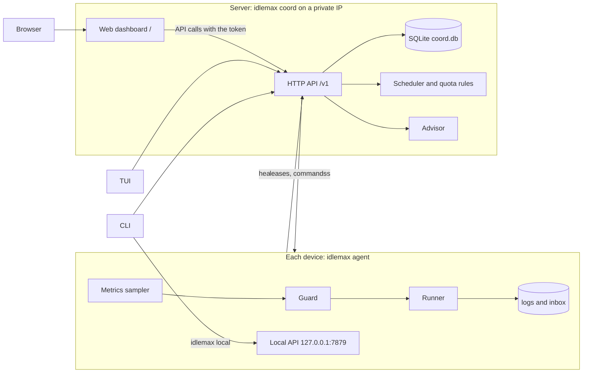

# idlemax

idlemax runs useful background jobs on your devices' spare capacity and spends AI subscription quota before it resets unused.

Laptops and small servers sit idle for hours, and subscription quota windows reset whether you used them or not.
idlemax queues work for those gaps (test suites, index rebuilds, draft reviews) and yields the moment you or your production services need the machine.

## Features

- One queue for every device: a coordinator leases jobs to per-device agents over your private network.
- A guard on every device that pauses jobs at the first sign of contention and kills them if it persists.
- Lowest-priority execution with hard caps: `taskpolicy` on macOS, a `systemd-run` cgroup scope on Linux.
- An AI quota maximizer that spends only what is above your reserve, late in each window, one job per account.
- An advisor that turns cluster state, open PRs and recent sessions into recommendations you accept or dismiss.
- Four controls: CLI, terminal dashboard, web dashboard, and a kill switch file that works offline.

## How it stays safe

The agent samples its device every 30 s, and the guard turns each sample into one verdict: run, hold, pause or kill.
A single breach pauses running jobs with SIGSTOP; kill-level breaches on 2 consecutive samples kill them (SIGTERM, then SIGKILL after 15 s).
After a pause or kill, jobs resume only after 2 clear samples.

| Signal | `macos_laptop` pause | `macos_laptop` kill | `linux_server` pause | `linux_server` kill | `[guard]` keys |
|---|---|---|---|---|---|
| You are using the machine | idle < 600 s | | | | `user_idle_min_secs` |
| Power | on battery, or battery < 40% | | | | `require_ac_power`, `min_battery_pct` |
| Thermal throttling | any | | any | | `pause_on_thermal` |
| macOS memory pressure | warn | critical | | | `memory_pressure_pause`, `memory_pressure_kill` |
| Memory free | < 30% | < 20% | | | `mem_free_pct_pause`, `mem_free_pct_kill` |
| MemAvailable | | | < 1024 MiB | < 768 MiB | `mem_available_mib_pause`, `mem_available_mib_kill` |
| Swap growth | +256 MiB in 60 s | +1 GiB in 5 min | | | `swap_growth_pause`, `swap_growth_kill` |
| Swap used | | | > 1536 MiB | > 2048 MiB | `swap_used_mib_pause`, `swap_used_mib_kill` |
| Swap-in rate | | | > 100 pages/s for 60 s | | `swap_in_pages_per_sec_pause`, `swap_in_sustain_secs` |
| PSI memory | | | some avg10 > 5% | full avg10 > 1% | `psi_mem_some_pause`, `psi_mem_full_kill` |
| PSI I/O full avg10 | | | > 10% | > 25% | `psi_io_full_pause`, `psi_io_full_kill` |
| Load average, 1 min | > 6 | > 8 | > 1.5 | > 2.0 | `load_1m_pause`, `load_1m_kill` |
| Disk free | < 15 GiB | < 10 GiB | < 10 GB | < 5 GB | `disk_free_mib_pause`, `disk_free_mib_kill` |
| Capacity | 2 jobs, 1 GiB total | | 1 job, 512 MiB | | `max_jobs`, `ram_budget_mib` |

The profile defaults to `macos_laptop` on macOS and `linux_server` elsewhere.
A server never takes `cpu_heavy` or `ai` jobs.
Each job sets `on_user_active`: `pause` (default), `continue` (only machine-health checks apply) or `kill`.

Kill switch: `touch $IDLEMAX_HOME/PAUSE` pauses every job on that device without the network, and deleting the file resumes them.
`idlemax local stop-all` kills every job on the device and holds new ones, even while the coordinator is down.

Every job runs in its own process group at the lowest priority the OS offers:

| OS | Wrapper | Memory cap |
|---|---|---|
| macOS | `taskpolicy -c background -d throttle -b -m <mem_mb> -P kill nice -n 20 <command>` | the runner kills the job when its process-tree RSS exceeds `mem_mb`, because the `taskpolicy` limit is soft |
| Linux, as root or with a systemd user bus | `systemd-run [--user] --scope --nice=19 -p CPUQuota=100% -p CPUWeight=10 -p IOWeight=10 -p MemoryHigh=<75%> -p MemoryMax=<mem_mb>M -p MemorySwapMax=0 -- <command>` | cgroup `MemoryMax`, no swap |
| Linux, otherwise | `nice -n 19 ionice -c3 <command>` | the runner's RSS check, plus the agent unit's cgroup caps |
| Windows | idle priority class | the runner's RSS check |

The runner also kills a job after `max_runtime_secs` (default 1800) of awake, unpaused time.
System sleep does not consume this runtime budget on macOS or Linux.

## AI quota maximizer

Each AI account lists its windows and the reserve kept for you:

| Provider | Default windows | Usage source |
|---|---|---|
| `claude` | 5-hour rolling (reserve 40%), weekly (reserve 30%) | Claude Code statusline capture |
| `codex` | weekly (reserve 30%), plus a 5-hour window if Codex reports one | newest Codex session file |
| `agy` | 5-hour rolling (40%), weekly (30%) | manual file |
| `api` | none | manual file |

The weekly reserve drops to 15% in the last 24 h before the reset.
An AI job runs only when all of these hold:

1. The device lists the account in `agent.ai_accounts`.
2. Every window is below `100 - reserve`, with headroom for the job's `token_class`.
3. The shortest window is in its final third, or the weekly reset is less than 24 h away.
4. You have not used that CLI interactively in the last 30 minutes.
5. No other AI job holds a lease on the account on any device.
6. No usage limit or HTTP 429 was seen in this window.
7. The usage data is less than 6 hours old, and no AI job started on the account in the last 5 hours.

Ban-risk stance: idlemax only launches the unmodified official CLIs (`claude -p`, `codex exec`, `agy -p`) with your own login, on the device where you logged in.
It never copies credentials between devices, never fans out across devices or accounts, never retries an AI job, and stops spending an account for the rest of the window after any limit message.
That keeps automated use close to ordinary individual use, but consumer terms still restrict automated access, so the risk is reduced, not zero.
Metered API keys (`provider = "api"`) are the path providers designate for automation.

Claude usage comes from the JSON that Claude Code passes to its statusline command.
Put `packaging/claude-statusline-capture.sh` in front of your statusline in `~/.claude/settings.json`.
Until it has written `$IDLEMAX_HOME/agent/claude-statusline.json`, Claude accounts are never spendable (fail closed).

To install it, add or update the `statusLine` block in `~/.claude/settings.json`.
Prepend the absolute path to `packaging/claude-statusline-capture.sh` in front of your existing command:

```json
{
  "statusLine": {
    "type": "command",
    "command": "/path/to/claude-statusline-capture.sh <your existing statusline command>"
  }
}
```

If you do not already run a custom statusline command, pass the wrapper alone:

```json
{
  "statusLine": {
    "type": "command",
    "command": "/path/to/claude-statusline-capture.sh"
  }
}
```

The wrapper saves the snapshot atomically to `$IDLEMAX_HOME/agent/claude-statusline.json` before piping stdin through to your wrapped command.
The visible output is byte-identical to the wrapped command, and capture errors are ignored so the statusline never breaks.

## AI advisor

The advisor reads coordinator state, your open PRs and review requests through `gh`, and metadata of recent Claude and Codex sessions (never message text).
Each agent reads `gh` and the session files on its own device every 15 minutes and sends only that metadata to the coordinator, so the coordinator can run on a server that has neither.
Its rules engine runs every 15 minutes and on `idlemax advise refresh`.
It flags parked or failed jobs, offline devices, idle devices with an empty queue, quota about to reset unused, PRs waiting on you for 2+ days, and unfinished sessions.
An AI pass runs as an ordinary `ai` job through `claude -p` with a strict JSON schema, only when `advisor.ai_account` is spendable under the rules above.
Its prompt travels on stdin instead of argv; the run disables all hooks and starts none of your MCP servers.
Suggested jobs can only name templates in `$IDLEMAX_HOME/jobs/`.
Accepting a recommendation queues its job; nothing runs on the advisor's word alone, except templates listed in `advisor.auto_accept`.

## Architecture



Dependencies point inward, and every decision is a pure function with unit tests:

| Layer | Where | Holds |
|---|---|---|
| Domain | `crates/idlemax-core` | types, wire protocol, config, guard, quota rules, scheduler, control semantics, agent reconcile, job-run and advice decisions; no I/O and no clock (time is a parameter) |
| Adapters | `crates/idlemax/src/{agent,coord,advisor}`, `state.rs` | OS metrics, process runner, SQLite store, HTTP server and client, `gh` and session readers, the `claude -p` job builder |
| Delivery | `cli.rs`, `tui/`, `coord/web.rs`, `main.rs` | argument parsing, one use-case call each, rendering |

Both crates are `#![forbid(unsafe_code)]`, errors are typed with `thiserror`, and `anyhow` appears only in `main.rs` and the CLI.

## Quickstart on one machine

You need a Rust toolchain (built with 1.95) on macOS or Linux.
Everything below lives in a throwaway state dir, so your real `~/.idlemax` is never touched.

1. Build and install the binary:

   ```sh
   cargo install --path crates/idlemax
   ```

2. Create a state dir with a demo config, then let `init` add the token and directories (it keeps an existing config):

   ```sh
   export IDLEMAX_HOME="$(mktemp -d)"
   cat > "$IDLEMAX_HOME/config.toml" <<'EOF'
   [agent]
   sample_secs = 5
   heartbeat_secs = 5
   command_allowlist = ["/bin/echo"]

   [guard]
   # Demo only: let jobs start while you are at the keyboard and on battery.
   user_idle_min_secs = 0
   require_ac_power = false
   EOF
   idlemax init
   ```

3. Start the coordinator and the agent:

   ```sh
   idlemax coord >"$IDLEMAX_HOME/logs/coord.log" 2>&1 &
   idlemax agent >"$IDLEMAX_HOME/logs/agent.log" 2>&1 &
   idlemax status
   ```

4. Queue a job:

   ```sh
   cat > "$IDLEMAX_HOME/hello.toml" <<'EOF'
   name = "hello"
   command = ["/bin/echo", "hello from idlemax"]
   mem_mb = 64
   max_runtime_secs = 60
   EOF
   idlemax job add "$IDLEMAX_HOME/hello.toml"
   ```

5. Watch it with `idlemax tui` (press `2` for jobs, `q` to quit), or open `http://127.0.0.1:7878/` and paste the token from `$IDLEMAX_HOME/token`.
   If the job stays queued, the GUARD column of `idlemax status` says why, for example `pause: disk free 13756.2 MiB < 15360 MiB`.
   That is the guard protecting a busy machine; for the demo, relax that one key in `[guard]` (here `disk_free_mib_pause = 0` and `disk_free_mib_kill = 0`) and restart the agent.

6. Read the result, then try the kill switch:

   ```sh
   cat "$IDLEMAX_HOME"/inbox/*.md
   idlemax stop-all --reason demo
   idlemax resume
   ```

7. Clean up:

   ```sh
   kill %1 %2
   rm -rf "$IDLEMAX_HOME"
   ```

The terminal dashboard, rendered with ratatui's `TestBackend` (placeholder data, blank rows cropped):

```text
idlemax http://127.0.0.1:7878   running   updated 2s ago
coordinator 0.1.0 | global: running | jobs: 1 running, 1 queued | advice: 1 open
 1 Devices (2) │ 2 Jobs (3) │ 3 Quota (1) │ 4 Advice (1) │ 5 Events (0)
┌──────────────────────────────────────────────────────────────────────────────────────────────────┐
│  DEVICE  STATE   GUARD                  IDLE  CPU  LOAD  MEM FREE  SWAP  DISK    POWER  JOBS     │
│> laptop  online  run 1                  25m   9%   2.10  41% 5.0G  1.0G  120.0G  ac     1        │
│  server  online  hold: load 1.70 > 1.5  -     9%   1.70  52% 5.0G  1.0G  120.0G  -      0        │
│                                                                                                  │
└──────────────────────────────────────────────────────────────────────────────────────────────────┘
p/r pause/resume device laptop  P/R all  s stop-all  tab/1-5 switch  q quit
```

## Controls reference

### CLI

Every command reads `$IDLEMAX_HOME` (default `~/.idlemax`; set but empty is an error).
Coordinator commands accept `--coord URL` (or `IDLEMAX_COORD`) and `--json`.

| Command | Does |
|---|---|
| `idlemax agent` | run the device agent |
| `idlemax coord` | run the coordinator |
| `idlemax init [--profile macos-laptop\|linux-server] [--coord-url URL] [--token-stdin]` | create the state dirs, `config.toml` and a 0600 token; never overwrites, and refuses the flags when a config already exists |
| `idlemax status` | cluster summary and devices |
| `idlemax jobs [--status S] [--limit N]` | list jobs (default limit 50) |
| `idlemax job add <spec.toml>` | validate and queue a job spec |
| `idlemax job cancel <id>` | cancel a job, killing it if it runs |
| `idlemax pause [--device D \| --account A \| --job N] [--reason TEXT]` | pause the whole cluster or one scope |
| `idlemax resume [same flags]` | lift exactly that pause; resuming the cluster does not clear device, account or job pauses |
| `idlemax stop-all [same flags]` | kill the scope's running jobs and hold new ones until you resume |
| `idlemax quota` | windows, reserve, headroom, and why each account is or is not spendable |
| `idlemax events [--limit N]` | recent events (default limit 50) |
| `idlemax advise [list \| accept <id> \| dismiss <id> \| refresh]` | advisor recommendations (default `list`) |
| `idlemax tui` | terminal dashboard |
| `idlemax local status \| pause \| resume \| stop-all` | this device's agent directly, on `agent.listen` |

### TUI keys

| Key | Action |
|---|---|
| `1`-`5`, `Tab`, `Left`, `Right` | switch between Devices, Jobs, Quota, Advice and Events |
| `Up`, `Down` | select a row |
| `p`, `r` | pause or resume the selected device, job or account |
| `P`, `R` | pause or resume everything |
| `s` | stop-all everywhere (asks first) |
| `k` | cancel the selected job (asks first) |
| `a`, `d` | accept or dismiss the selected advice |
| `f` | re-run the advisor (Advice tab) |
| `y`, `Enter` | confirm a prompt; any other key cancels it |
| `q`, `Esc`, `Ctrl-C` | quit |

### HTTP API

Every call except `GET /healthz` and `GET /` needs `Authorization: Bearer <token>`, and errors are `{"error": "..."}`.
Wire formats and semantics are in [docs/API.md](docs/API.md).

| Method | Path | Body | Returns |
|---|---|---|---|
| GET | `/healthz` | | `ok`, no auth |
| GET | `/` | | web dashboard, no auth |
| POST | `/v1/agent/heartbeat` | `Heartbeat` | `HeartbeatReply` |
| POST | `/v1/agent/job-update` | `JobUpdate` | `JobUpdateReply` |
| GET | `/v1/status` | | `ClusterStatus` |
| GET | `/v1/jobs?status=&limit=` | | `[Job]` |
| POST | `/v1/jobs` | `JobSpec` | `Job` (201) |
| POST | `/v1/jobs/{id}/cancel` | | `Job` |
| GET | `/v1/quota` | | `[QuotaView]` |
| POST | `/v1/control` | `ControlRequest` | `ClusterStatus` |
| GET | `/v1/events?limit=` | | `[Event]` |
| GET | `/v1/advice` | | `[Recommendation]`, open first |
| POST | `/v1/advice/refresh` | | `[Recommendation]` |
| POST | `/v1/advice/{id}/accept` | | `Job` |
| POST | `/v1/advice/{id}/dismiss` | | `Recommendation` |

### Local agent API

The agent serves these on `agent.listen` (default `127.0.0.1:7879`, loopback only) with the same bearer token, and they keep working while the coordinator is down:

| Method | Path | Body | Returns |
|---|---|---|---|
| GET | `/healthz` | | `ok`, no auth |
| GET | `/v1/local/status` | | `LocalStatus` |
| POST | `/v1/local/control` | `ControlRequest` with global scope: `pause`, `resume` or `stop_all` | `LocalStatus` |

### Web dashboard

The coordinator serves one self-contained page at `/` with no remote scripts, fonts or styles.
It asks for the token once and keeps it in that browser's local storage until you press "Forget token".
It refreshes every 5 s, rebuilding a section only when its data changed, and shows devices with guard verdicts and metrics, jobs, AI quota per window, advice and events.
It follows the system light or dark theme, and on a phone the jobs table becomes stacked cards.
From it you can pause, resume, stop-all or cancel per scope, and accept or dismiss advice.

## Configuration reference

`config.toml` lives in `$IDLEMAX_HOME`, and every key is optional.
Worked examples: [examples/config.toml](examples/config.toml) (a macOS agent) and [examples/config.server.toml](examples/config.server.toml) (a server).

| Key | Default | Meaning |
|---|---|---|
| `coordinator.listen` | `127.0.0.1:7878` | bind address; `0.0.0.0` and `[::]` are refused |
| `coordinator.url` | `http://127.0.0.1:7878` | where agents and the CLI reach the coordinator |
| `coordinator.lease_secs` | `120` | a lease not renewed by a heartbeat in this time is re-queued with backoff |
| `coordinator.offline_after_secs` | `90` | a device is offline after this long without a heartbeat |
| `coordinator.metrics_retention_days` | `7` | days of per-minute device metrics kept |
| `agent.device_id` | short lowercase hostname | the name job specs use in `devices` |
| `agent.profile` | from the OS | `macos_laptop` or `linux_server` guard preset |
| `agent.listen` | `127.0.0.1:7879` | local agent API |
| `agent.sample_secs`, `agent.heartbeat_secs` | `30`, `30` | guard sample and heartbeat intervals |
| `agent.advisor_inputs_secs` | `900` | how often the agent sends its `gh` summary and session metadata to the advisor; `0` sends nothing |
| `agent.ai_accounts` | `[]` | AI accounts this device may spend |
| `agent.command_allowlist` | `[]` | exact `argv[0]` values a job may run; bare names resolve on the agent's PATH; empty denies all |
| `[guard]` | preset values | any key from the guard table above |
| `[[quota.accounts]]` | none | `name`, `provider` (`claude`, `codex`, `agy`, `api`), and optional `windows`, `probe` (`claude_statusline`, `codex_sessions`, `manual`) and `probe_path` |
| `advisor.enabled` | `true` | run the advisor |
| `advisor.ai_account` | none | account the AI pass spends; none runs the rules only |
| `advisor.auto_accept` | `[]` | template names queued without asking |

A window entry looks like `{ kind = "rolling", minutes = 300, reserve_pct = 40.0 }` or `{ kind = "weekly", reserve_pct = 30.0, final_day_reserve_pct = 15.0 }`.
TOML has no null, so a `[guard]` override cannot switch a check off; set a value that never trips instead.

Environment: `IDLEMAX_HOME` (state dir), `IDLEMAX_TOKEN` (overrides the token file), `IDLEMAX_COORD` (the CLI's coordinator URL), `RUST_LOG` (log filter, default `info`).

| State dir path | Holds |
|---|---|
| `config.toml`, `token` | config and the 0600 API token |
| `coord.db` | coordinator SQLite database, mode 0600 |
| `PAUSE` | kill switch file |
| `jobs/*.toml` | job templates the advisor may suggest |
| `logs/jobs/<id>.log` | job output |
| `inbox/<date>-<id>-<name>.md` | one note per finished job |
| `agent/` | 24 h metrics ring, `outbox.jsonl` (job updates not yet acked by the coordinator), Claude statusline capture, `quota-<account>.json` manual usage files |

### Job specs

A job spec is TOML, and `command` is an argv list that never goes through a shell.

```toml
name = "repo-health"
command = ["/path/to/examples/scripts/repo-health.sh", "/path/to/repo"]
cost = "cpu_heavy"          # cpu_light (default), cpu_heavy, io or ai
requires = ["cargo", "git"] # tools the device must have on PATH
devices = ["my-laptop"]     # device ids; empty means any device
priority = 3                # higher runs first
mem_mb = 1024               # default 512, counted against the device RAM budget
max_runtime_secs = 1500     # default 1800
on_user_active = "kill"     # pause (default), continue or kill
max_attempts = 3            # default 3; ai jobs always get 1

[env]
CARGO_BUILD_JOBS = "2"
```

AI jobs also set `ai_account` and `token_class` (`small`, `medium`, `large`).
Jobs get `IDLEMAX_JOB_ID` in their environment but never the API token, and `env` keys starting with `LD_` or `DYLD_` are refused.
Use `on_user_active = "kill"` for jobs that hold a lock you need (a cargo target dir, an index, a git clone), because a paused job keeps holding it.

[examples/jobs/](examples/jobs/) holds starter jobs, backed by scripts in [examples/scripts/](examples/scripts/):

| Spec | Runs | Cost |
|---|---|---|
| `kb-refresh.toml` | fast-forward a notes repo and list what changed | `cpu_light` |
| `index-refresh.toml` | `codegraph sync` over a list of repos | `cpu_heavy` |
| `repo-health-project-a.toml` | clippy, tests and `npm audit` for one repo, as an inbox report | `cpu_heavy` |
| `pr-review-drafts-claude.toml`, `pr-review-drafts-codex.toml` | draft reviews of PRs waiting on you; the AI gets the PR text on stdin, no tools, and posts nothing | `ai` |

Their paths (`/path/to/...`) and device id (`my-laptop`) are placeholders; replace them before use.

## Deploying across devices

1. Run Tailscale (or another private network) on every device, and bind the coordinator to its private IP with `coordinator.listen = "<tailnet-ip>:7878"`.

2. Install the coordinator and a server agent on Linux:

   ```sh
   cargo build --release -p idlemax
   sudo install -m 0755 target/release/idlemax /usr/local/bin/idlemax
   sudo useradd --system --home-dir /var/lib/idlemax --shell /usr/sbin/nologin idlemax
   sudo install -d -o idlemax -g idlemax -m 0700 /var/lib/idlemax
   sudo install -o idlemax -g idlemax -m 0600 examples/config.server.toml /var/lib/idlemax/config.toml
   sudo -u idlemax env IDLEMAX_HOME=/var/lib/idlemax idlemax init
   sudo install -m 0644 packaging/linux/idlemax-coord.service packaging/linux/idlemax-agent.service /etc/systemd/system/
   sudo systemctl daemon-reload
   sudo systemctl enable --now idlemax-coord idlemax-agent
   ```

   Edit `listen`, `url` and `device_id` in `/var/lib/idlemax/config.toml` before enabling the units.

3. On every other device, share the coordinator's token and point the agent at it:

   ```sh
   ssh <server> sudo cat /var/lib/idlemax/token | idlemax init --coord-url http://<tailnet-ip>:7878 --token-stdin
   ```

   Then set `device_id`, `ai_accounts` and `command_allowlist` in `~/.idlemax/config.toml`, and keep `[[quota.accounts]]` identical on every host.

4. On macOS, render the LaunchAgent with your binary, home and PATH (launchd starts agents with a bare PATH, and jobs need yours), then load it:

   ```sh
   sed -e "s|@BIN@|$(command -v idlemax)|g" -e "s|@HOME@|$HOME|g" -e "s|@PATH@|$PATH|g" \
     packaging/macos/com.idlemax.agent.plist > ~/Library/LaunchAgents/com.idlemax.agent.plist
   plutil -lint ~/Library/LaunchAgents/com.idlemax.agent.plist
   launchctl bootstrap gui/$(id -u) ~/Library/LaunchAgents/com.idlemax.agent.plist
   ```

   Stop it with `launchctl bootout gui/$(id -u)/com.idlemax.agent`.
   `packaging/macos/com.idlemax.coord.plist` runs the coordinator the same way for a Mac-only setup.

| Unit | Caps and settings |
|---|---|
| `com.idlemax.agent.plist`, `com.idlemax.coord.plist` | `ProcessType` Background, `LowPriorityIO`, `LowPriorityBackgroundIO`, `Nice` 20, restart after a crash, logs in `~/.idlemax/logs/` |
| `idlemax-coord.service` | `MemoryHigh=192M`, `MemoryMax=256M`, `MemorySwapMax=0`, `CPUQuota=20%`, `CPUWeight=10`, `IOWeight=10`, a strict sandbox that writes only `/var/lib/idlemax`, restarts until the private IP exists |
| `idlemax-agent.service` | `MemoryMax=640M` for the agent plus its one job, `MemorySwapMax=0`, `CPUQuota=100%`, `CPUWeight=10`, `IOWeight=10`, `Nice=19`, idle I/O class; jobs write only `/var/lib/idlemax` and a private `/tmp` |

On the server, jobs run under `nice` and `ionice` inside the agent unit's cgroup unless the idlemax user has a systemd user manager; keep lingering off so every job stays inside those caps.
Add `ReadWritePaths=` with `systemctl edit idlemax-agent` if a job needs to write elsewhere.

## Security model

- One bearer token (32 random bytes as hex, file mode 0600) guards every API call except `/healthz` and `/`, and is compared in constant time.
- Anyone holding the token can run any allowlisted program with any arguments on your devices, so treat it like an SSH key and keep allowlists narrow: allowlisting `sh` or `python3` allows any code.
- The coordinator refuses to bind `0.0.0.0` or `[::]`; its traffic is plain HTTP, so bind it to a private network such as a tailnet, which encrypts it.
- The local agent API listens on loopback only.
- Jobs run without a shell, as the agent's user, with `IDLEMAX_JOB_ID` but never the token, and loader variables (`LD_*`, `DYLD_*`) are refused.
- AI CLIs run only on devices that list the account, with the login already on that device; idlemax never reads or copies AI credentials.
- The web dashboard loads nothing remote, sends a strict Content-Security-Policy, writes every API string as text, never HTML, and keeps the token in the browser's local storage.
- Quota probes only read the CLIs' files.

## Development

```text
crates/idlemax-core/src/   domain: types, protocol, config, paths, guard, quota, scheduler,
                           control, reconcile, job_run, advice (pure, unit tested)
crates/idlemax/src/        adapters and delivery: agent/, coord/, advisor/, cli/, tui/, state.rs
crates/idlemax/assets/     dashboard.html
crates/idlemax/tests/      e2e.rs (coordinator plus agent), examples.rs (example configs and specs)
examples/                  configs, job specs, job scripts
packaging/                 launchd plists, systemd units, Claude statusline capture
docs/                      API.md, ROADMAP.md
```

Every change passes this gate:

```sh
cargo fmt --all --check
cargo clippy --workspace --all-targets -- -D warnings
cargo test -p idlemax-core <module>       # focused tests for the module you changed
cargo test -p idlemax --test e2e          # init, coordinator and agent run one job in a temp IDLEMAX_HOME
cargo test -p idlemax --test examples     # example configs and job specs stay valid
```

The e2e test sets temp `HOME` and `IDLEMAX_HOME` and refuses to start against your real state dir; do the same whenever you run the agent or coordinator during development.

To add a job template, write a spec to `$IDLEMAX_HOME/jobs/<name>.toml` on the coordinator, allowlist its `argv[0]` on the devices that should run it, and queue it with `idlemax job add` or let the advisor suggest it.
The advisor queues a template without asking only if its name is in `advisor.auto_accept`.

## Status and limits

Verified on macOS (Apple Silicon): focused tests for the safety-critical rules, the e2e test, and live runs of the agent and coordinator in temp state dirs.

| Area | Limit |
|---|---|
| Linux | not yet run on Linux: the Linux parsers are tested on macOS with fixtures, but the Linux metrics call site, `loginctl` idle, the `systemd-run` wrapper and the systemd units have not run |
| Windows | code paths are neither compiled nor run; no idle, power or thermal signals, no pause, tree kill through `taskkill`, no packaging |
| macOS memory cap | `taskpolicy -m` is soft; the runner's RSS check every 5 s is the real cap |
| Claude quota | needs the statusline capture wrapper; until it writes data, Claude accounts are never spendable |
| Advisor | the AI pass has not run end to end, because that spends quota |
| Runtime limit | measured on the wall clock, so a laptop that sleeps past it kills the job on wake |
| Job updates | queued in agent memory only; after an agent crash the lease expires and the job is retried |

## Docs

- [docs/API.md](docs/API.md): wire formats, lease and control semantics
- [docs/ROADMAP.md](docs/ROADMAP.md): what comes next
- [CHANGELOG.md](CHANGELOG.md): release notes

## License

MIT, as declared in `Cargo.toml`.
