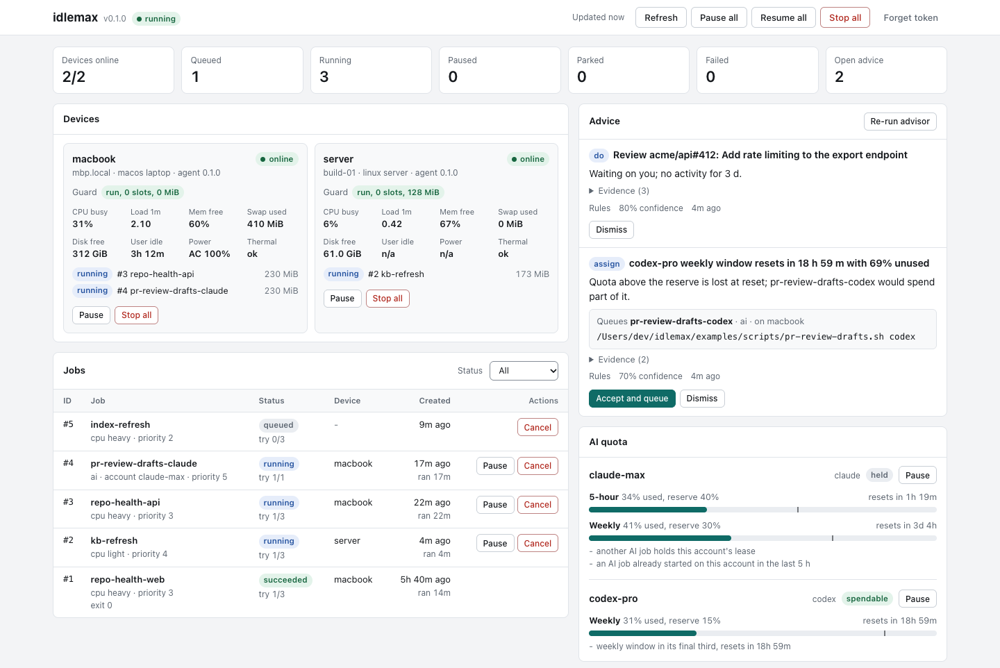
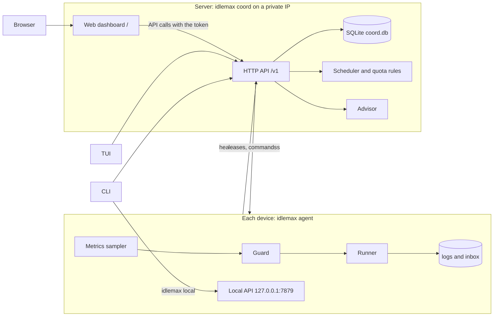

# idlemax

[](https://github.com/mrx-arafat/idlemax/actions/workflows/ci.yml)

Run useful jobs on your devices' spare capacity, and spend your AI subscription quota before it resets, without getting in your way.

An expensive Mac sits idle all night.
A small server idles at a few percent CPU.
A Claude or Codex subscription resets with most of its quota unused, and that quota is gone.

idlemax is a job queue for your own devices.
You describe a job once: run the tests, rebuild an index, draft a review of a PR that is waiting on you.
A coordinator hands it to a device that is idle right now.
A guard on that device runs it at the lowest priority the OS offers, and stops it when you or your production services need the machine.
AI jobs spend only the quota above a reserve you choose, late in each window.

**Why it is safe to leave running**

- **It backs off when you come back.**
  Every device is checked every 30 seconds.
  The first sign of contention pauses jobs: you at the keyboard, battery power, thermal throttling, memory pressure, swap, load or low disk.
  A serious problem on two checks in a row kills them.
- **It keeps servers safe.**
  A server takes only light jobs (never CPU-heavy or AI), keeps small hosts at the 1-job/512-MiB reference, and targets a site reserve as capacity grows.
  Every job also has a memory cap, a runtime cap and a command allowlist.
- **It treats your AI account carefully.**
  AI jobs launch only the official CLIs, with your own login, on the device where you logged in.
  idlemax never reads or copies credentials, never retries an AI job, and stops spending an account for the rest of the window after any limit message.
Workers rest the same way: one limit message stops that account's workers with their state saved until the used-up window resets, and a second one while it rests changes nothing.
  Consumer terms still restrict automated use, so read the [ban-risk stance](#ai-quota-maximizer) before you enable it.
- **One file stops everything, even offline.**
  `touch $IDLEMAX_HOME/PAUSE` pauses every job on that device within seconds.

> **Status: v0.2.0.**
> Built and tested on macOS (Apple Silicon) and on Ubuntu 24.04, and CI runs the full suite on both.
> A live AI pass and a production server rollout have not run yet, so treat both as unproven.
> Details are in [Status and limits](#status-and-limits).

<picture>
  <source media="(prefers-color-scheme: dark)" srcset="docs/assets/dashboard-dark.png">
  <source media="(prefers-color-scheme: light)" srcset="docs/assets/dashboard-light.png">
  
</picture>

The web dashboard follows your system theme.
This capture is a real coordinator fed by scripted demo agents, with the job history aged by hand, so no real machine or account appears in it.

## Quickstart

It runs on macOS (Apple Silicon or Intel) and Linux (x86_64 or arm64).

1. Install the binary into `~/.local/bin`, without sudo:

   ```sh
   curl -fsSL https://raw.githubusercontent.com/mrx-arafat/idlemax/main/scripts/install.sh | sh -s -- --dry-run   # first look
   curl -fsSL https://raw.githubusercontent.com/mrx-arafat/idlemax/main/scripts/install.sh | sh
   ```

   The script picks the latest release for this machine, checks its sha256 and finishes by telling you to run `idlemax setup`.
   Prebuilt Linux binaries need a recent glibc; on an older distribution or on musl (Alpine), build from source with a Rust toolchain (built with 1.95):

   ```sh
   git clone https://github.com/mrx-arafat/idlemax
   cd idlemax
   cargo install --path crates/idlemax
   ```

2. Set this device up with one command:

   ```sh
   idlemax setup --dry-run --allow /bin/echo   # preview, including the program used below
   idlemax setup --allow /bin/echo
   ```

   `setup` creates `~/.idlemax/config.toml` and a token, installs the coordinator and the agent as background services (a LaunchAgent on macOS, systemd user units on Linux), and runs `idlemax doctor`.
   It keeps existing settings and tokens, so running it again is safe and says `already done`.
   [Set up a device](#set-up-a-device) has the roles, the flags and the output.

3. Review which programs jobs may run.
   The setup command above allows `/bin/echo` for the example below.
   Without `--allow`, the list starts empty on purpose and no job can start until you name a program.
   To replace it later, one command saves the list and the running agent picks it up at once with no restart:

   ```sh
   idlemax config set agent.command_allowlist /bin/echo
   ```

   To choose programs during setup instead, use `idlemax setup --allow git,cargo` (add `--dry-run` to preview).
   When the list is empty, setup names `idlemax config set agent.command_allowlist git,cargo` as the first next step.

4. Queue a job and wait for it:

   ```sh
   idlemax job add --wait --timeout 60 -- /bin/echo "hello from idlemax"
   ```

   On an idle machine it prints the result within seconds (the first log line differs on Linux):

   ```text
   job 1 queued: echo
   job 1 succeeded: echo
   exit code: 0
   ran: 1.0s on laptop
   log (last 20 lines):
   === idlemax job 1 attempt 1 started 2026-11-08T08:56:30.195+00:00 via taskpolicy ===
   hello from idlemax

   === idlemax: succeeded (exit 0) ===
   ```

   The guard may hold the job instead: you are at the keyboard, the laptop is on battery, or the machine is busy.
   After 60 seconds the command exits with code 124 and the job keeps its place in the queue.
   Ask why:

   ```sh
   idlemax why 1
   ```

   It lists every reason with its fix, for example a guard hold such as `disk free 1500.0 MiB < 2048 MiB`.
   That is the guard protecting a busy machine.
   To see the demo through anyway, relax the key it names in `[guard]` (here `disk_free_mib_pause = 0` and `disk_free_mib_kill = 0`) and restart the agent.

5. Look around, then try the kill switch:

   ```sh
   idlemax jobs
   idlemax tui               # 2 for jobs, w for a job's reasons, q to quit
   idlemax logs 1
   idlemax inbox show 1
   idlemax stop-all --reason demo
   idlemax resume
   ```

   The web dashboard is at `http://127.0.0.1:7878/`: paste the token from `~/.idlemax/token`.

<details>
<summary>Try it first in a throwaway directory, with no service</summary>

This leaves your real `~/.idlemax` alone and runs the coordinator and the agent in your shell.
The demo config relaxes the guard so the job can start while you are at the keyboard.

```sh
export IDLEMAX_HOME="$(mktemp -d)"
cat > "$IDLEMAX_HOME/config.toml" <<'EOF'
[agent]
sample_secs = 5
heartbeat_secs = 5
command_allowlist = ["/bin/echo"]

[guard]
# Demo only: let jobs start while you are at the keyboard and on battery.
user_idle_min_secs = 0
require_ac_power = false
min_battery_pct = 0.0
EOF
idlemax init
idlemax coord >"$IDLEMAX_HOME/logs/coord.log" 2>&1 &
idlemax agent >"$IDLEMAX_HOME/logs/agent.log" 2>&1 &
sleep 2
idlemax status
idlemax job add --wait --timeout 60 -- /bin/echo "hello from idlemax"
```

If the job stays queued, `idlemax why 1` names the `[guard]` key that holds it.
Relax that key in the config and restart the agent.

Clean up, and unset `IDLEMAX_HOME` so later commands do not pick up the deleted directory:

```sh
kill %1 %2
rm -rf "$IDLEMAX_HOME"
unset IDLEMAX_HOME
```

</details>

## Set up a device

`idlemax setup` takes a device from an installed binary to a working one:

After starting services, setup waits up to 10 seconds for the agent's first successful coordinator connection before running doctor.
If startup is still pending, it reports `starting` and asks you to run `idlemax doctor` to re-check.

```sh
idlemax setup [--role agent|coord|both] [--coord-url URL] [--token-stdin] [--allow git,cargo] [--statusline] [--no-service] [--dry-run]
```

It runs `init` (never overwriting), writes `config.toml` for the role, installs the services through the same code as `idlemax service install`, optionally wires the Claude Code statusline, and runs `idlemax doctor`.
Every step is `done`, `already done`, `skipped`, `would do` (a dry run), `starting` or `FAILED`, with the exact command that does the same by hand:

```text
$ idlemax setup --dry-run
dry run: nothing is written or run
idlemax setup, role both
would do      config          coordinator.url http://127.0.0.1:7878, coordinator.listen 127.0.0.1:7878, agent.profile laptop
                              would write: ~/.idlemax/config.toml
                              by hand: idlemax init
would do      token           a new random token, mode 0600
                              would write: ~/.idlemax/token
                              by hand: idlemax init
would do      service coord   new, then started
                              would write: ~/Library/LaunchAgents/com.idlemax.coord.plist
                              would run: launchctl bootout gui/501/com.idlemax.coord  # a failure here is fine
                              would run: launchctl bootstrap gui/501 ~/Library/LaunchAgents/com.idlemax.coord.plist
                              by hand: idlemax service install coord
would do      service agent   new, then started
                              ...
skipped       statusline      not asked for: add --statusline
                              by hand: idlemax statusline install
would do      doctor          waits up to 10s for services to connect, then checks the whole setup
                              would run: idlemax doctor
                              by hand: idlemax doctor

dry run only; no job can start while agent.command_allowlist is empty; next: idlemax config set agent.command_allowlist git,cargo
```

| Role | What it does | Services installed |
|---|---|---|
| `both` (default) | A coordinator and an agent on this device | coordinator, then agent |
| `coord` | The queue only; this device runs no jobs | coordinator |
| `agent` | Runs jobs for a coordinator on another device | agent |

```sh
idlemax setup --role coord --coord-url http://100.64.0.10:7878
ssh <server> cat ~/.idlemax/token | idlemax setup --role agent --coord-url http://100.64.0.10:7878 --token-stdin
```

- `--coord-url` is the address agents and the CLI use to reach the coordinator, and a coordinator listens there too: the example above makes it listen on `100.64.0.10:7878`.
  Without it the coordinator listens on `127.0.0.1:7878`.
- An agent needs `--coord-url` (not a loopback address) and the coordinator's token on stdin with `--token-stdin`.
  Without them it stops with exit code 2 and the fix, before it writes anything.
- `--statusline` also runs `idlemax statusline install`, for the roles that run an agent.
  `--no-service` writes the files but installs no service.
- `--allow git,cargo` sets the programs jobs may run in the same setup, preserving config comments and backing up the old file.
  It replaces the list; include every program the agent should allow.
  An existing running agent reloads the change, while a newly started service reads it at startup.
- The guard profile comes from the OS: `laptop` on macOS and `production` on Linux, with `workbox` set with `--profile workbox` for dedicated work servers.
- With `--role coord` or `--role both` the `--coord-url` host must be an IP address (or `localhost`), because the coordinator binds it; a name such as a MagicDNS host is refused with that advice.
- Existing settings and tokens are kept; `--allow` edits only `agent.command_allowlist`.
  A `--coord-url` that disagrees with the existing `config.toml`, or a `--token-stdin` token that differs from the existing token file, is refused with the fix.
- A service file is rewritten and the service restarted only when its content would change, for example after the binary moved.
  A current file whose service is not running is started, so a re-run after a failed start fixes it.
- The first failing step stops the run, and the steps after it say they were not run.
  After it installs services it waits up to 10 seconds for the agent's coordinator connection (or just the coordinator for a coordinator-only role), then runs doctor.
  Pending startup reports `starting` with `idlemax doctor` as the next check.
- Exit code 1 means a step failed, or services were asked for and doctor still finds a failing check.
  With `--no-service` doctor's findings are printed but do not change the exit code, because nothing is running yet by design.
  Exit code 2 means flags that cannot work.
- `--json` prints one report with `steps[]`, `changed`, `ok`, `needs_allowlist`, `next` and doctor's report.

Without `--allow`, setup leaves `agent.command_allowlist` as it is.
If it is empty on an agent role, the result and first help line name `idlemax config set agent.command_allowlist git,cargo` before suggesting any jobs.
`agent.ai_accounts` and `[[quota.accounts]]` remain your decisions, and doctor says what is missing.
`idlemax init` cannot set `coordinator.listen`, so the by-hand command for a coordinator on a non-default address needs that one line added to `config.toml`; the report says so.

## Keep it running

`idlemax setup` already installs the services.
These are the commands underneath, for installing, checking or removing one by hand.
idlemax writes the service file for your OS:

```sh
idlemax init                        # config.toml and the token, once (setup does this too)
idlemax service install --dry-run   # prints the file and the exact launchctl or systemctl commands
idlemax service render agent --cpus 4 --memory-mib 4096 --format table # offline Linux root unit from explicit target facts
idlemax service install             # writes it and starts the agent
idlemax service status
idlemax doctor                      # then check the whole setup
```

- **macOS** writes `~/Library/LaunchAgents/com.idlemax.agent.plist` and runs `launchctl bootstrap`.
  **Linux** writes the systemd user unit `~/.config/systemd/user/idlemax-agent.service` and runs `systemctl --user enable` and `restart` (`start` when the file did not change, so a re-run leaves a running agent alone).
- `idlemax service install coord` installs the coordinator instead, for a single-machine setup.
- The service runs the binary you ran the command with, so `cargo install` first.
  From a cargo `target/` directory the command warns, because a rebuild would break the service; `--bin /full/path/idlemax` pins another path.
- A service starts with a bare environment, so the file carries your `PATH` (the agent finds `claude`, `codex` and your job tools through it) and `IDLEMAX_HOME`, `CLAUDE_CONFIG_DIR` and `CODEX_HOME` when they are set.
  Change one and run `idlemax service install` again, which rewrites the file and reloads the service, so it restarts the agent and its running jobs.
- The agent's log is `<state dir>/logs/agent.log` on macOS and `journalctl --user -u idlemax-agent` on Linux.
- `idlemax service uninstall [agent|coord]` stops the service and deletes its file; with no name it removes every installed one.
  If a loaded service cannot be stopped, the file is kept and the command says what failed; a service that is not loaded is simply removed.

Linux user units run while you are logged in; run `loginctl enable-linger $USER` yourself to run from boot.
Windows has no service command yet.
For a production coordinator on a server, use the system units in [Deploying across devices](#deploying-across-devices).

## Following a job

### Did it help?

```sh
idlemax report           # today and the last 7 days
idlemax report --days 30 # one period, 1 to 30 days
idlemax report --json    # the numbers for a script
```

The first line of each period is the answer, then the numbers behind it (a demo run):

```text
today: 6 jobs ran (<1 job-min); guard held 6 min, all of it by memory pressure; queue was empty 12 min of idle time
  jobs    6 ran: 6 succeeded, 0 failed, 0 killed, 0 cancelled; <1 job-min
  held    6 min of 19 min tracked: memory pressure 6 min, you using the machine 6 min
  idle    jobs running 14 s, queue empty 12 min, work waiting 0 s
  longest 6 min from 11-10 16:44 to 11-10 16:50: held by memory pressure
  quota   no AI accounts are configured
```

When nothing ran, the line says why, with the hours: `0 jobs ran today: held 7.9 h by memory pressure`, or `0 jobs ran today: the queue was empty`.

- `jobs` counts the jobs that ran at some point in the period and how the ones that ended in it ended.
  The job minutes are wall-clock time from start to finish.
- `held` is the time the guard held new work, split by reason: `the PAUSE file`, `a local pause`, `a pause you set`, `you using the machine`, `idle time it cannot read`, `battery`, `thermal limits`, `memory pressure`, `low disk space`, `load`, `recovering after a breach`.
  One verdict can have several reasons, so the parts can add up to more than the total.
- `away` (shown when it is not zero) is time with no heartbeat for longer than `coordinator.offline_after_secs`: the machine slept, or the agent or coordinator was down.
- `idle` splits the awake time that no hold covers: jobs running, the queue empty, and work that waited more than two minutes with a device idle that could take it (`idlemax why <id>` says why).
  A job pinned to another machine does not count against an idle laptop, and AI work that waits for quota is counted apart.
  A queued job that no device can run as it is configured, such as a command missing from every allowlist, is named by its id instead of reading as an empty queue.
- `longest` is the longest unbroken stretch with nothing running while the machine was awake, and what it mostly was.
- `quota` lists AI quota windows that reset in the period and what they left unused, when `[[quota.accounts]]` is configured.
  The unused share is an upper bound: use between the last probe and the reset is not seen, and quota history is kept for `coordinator.metrics_retention_days` (7), so a longer report says it counts only that much.
- Device time adds up across devices, so two devices give 48 hours of tracked time for 24 hours of period.
- The coordinator keeps the history from the first heartbeat after it was upgraded to this version, for 30 days, so a new install shows `tracked` time shorter than the period for a while.

The TUI shows the same lines in a "Did it help?" panel above the devices, and the web dashboard in a card at the top of its left column.

### How much is used right now?

`idlemax report` answers what happened over the day.
`idlemax status` answers what is happening now: for each device, how much of its allowance is in use and why it is not using more.

```text
$ idlemax status | cat
...
devices[1]{id,state,slots,ram,why}:
  my-laptop,online,1/2,256M/1.0G,"1 queued job cannot run here: no docker"
accounts: "0 AI accounts configured ([[quota.accounts]] in config.toml)"
```

- `slots` is the jobs holding a slot (running, paused, or leased and about to start) out of the most the guard lets the device hold, `guard.max_jobs`.
  `ram` is the memory those jobs budget (`mem_mb`) out of `guard.ram_budget_mib`.
  While the guard holds new work the limit is not known, so only the used part shows.
- `why` is the main reason the device is not using more:
  `all 2 slots in use, 1 queued job waiting` (it works as hard as it may),
  `starting 2 queued jobs on the next heartbeat`,
  `queue empty`,
  `held: memory pressure` (the same labels as `idlemax report`),
  `2 queued jobs cannot run here: no git` (a missing tool, a job limited to other devices, the allowlist or the profile's cost classes),
  `1 queued job waiting: AI quota`,
  or `the smallest queued job needs 4096 MiB but only 1024 MiB of the RAM budget is free`.
  It uses the scheduler's own checks, so it never disagrees with `idlemax why <job-id>`, and you do not have to run that per job.
- With `[[quota.accounts]]` configured, an `accounts` table lists each AI account: whether idlemax may spend it now (`spend`), the quota left above the reserve before the limiting window resets (`left`, shown even while spending is held, `-` when that window has no data yet), that window and when it resets.
- `--fields guard,jobs` adds the raw guard verdict and the job count, `--json` prints the same data as `GET /v1/status` (see [docs/API.md](docs/API.md)), and a coordinator older than this field shows only the running count and no accounts list.
- A `dispatcher` block follows the devices: the mode and each device's line state with its reason, a table of the workers (`STATE  PROJECT  TASK  MODEL  AGE  SUMMARY`, where the state is the label the dashboard and the TUI show, such as `working`, `checking` or `back in queue`), and the counts `needs you` and `waiting for review` (finished tasks ready for review or needing you; a rejected task keeps its branch but is not counted).
  `--json` adds the whole view as `dispatcher` ([docs/API.md](docs/API.md#the-dispatcher-view)); a coordinator without the dispatcher leaves the block out, and a view that fails is one note on stderr while the rest still prints.

The TUI's Devices tab shows the same columns with an "AI quota" panel under them, and each device card on the web dashboard shows slot and RAM meters, the reason and the AI accounts that device may spend.

### Something is off

```sh
idlemax doctor
```

It checks this device and prints one line per check, `ok`, `warn` or `fail`, with the exact fix under every warn and fail:

```text
idlemax 0.2.0 doctor
ok    home         /Users/you/.idlemax (default)
ok    config       /Users/you/.idlemax/config.toml parses
fail  token        /Users/you/.idlemax/token is mode 0644: group and others can read it
                   fix: chmod 600 /Users/you/.idlemax/token
warn  coordinator  http://127.0.0.1:7878 is up; the token was not checked
                   fix: resolve the token check above, then run `idlemax doctor` again
...
```

- The checks are `home`, `config` (unknown keys are named), `token`, `coordinator` (reachable, accepts the token, same version), `agent`, `allowlist`, `disk`, `ai`, `login` (for agent CLIs your accounts need), `gh` and `service`.
- It is read-only: it never runs `launchctl` or `systemctl` and starts nothing, and one broken check does not hide the others.
- The exit code is 1 when any check fails and 0 otherwise, so a warn alone does not fail a script; `--json` prints the report, and `--coord URL` checks another coordinator.
- It checks this device only, so run it on each one.

### My job is not running

Several rules can hold a queued job at once: a pause, the guard, a device's command allowlist, a missing tool, AI quota, a retry delay.
`idlemax why <job-id>` lists every one that applies right now, each with the fix:

```text
$ idlemax why 2
Job 2 (nightly-make) is queued but not starting.

Blocked on every device:
  - all jobs are paused
    fix: idlemax resume

my-laptop (online, heartbeat 2s ago):
  - "make" is not in my-laptop's agent.command_allowlist, so it would refuse the job
    fix: on my-laptop, run `idlemax config set agent.command_allowlist <programs>` and list "make" with every program it may already run
```

- Reasons that hold on every device come first, then each device's own reasons under its name.
- It covers every pause scope, offline or unknown devices, missing `requires` tools, the allowlist, AI accounts, each guard reason with the `[guard]` key that changes it, no free slot or RAM, quota, retry delays and parked jobs.
- `--json` prints the same data for scripts; the route is `GET /v1/jobs/{id}/why` in [docs/API.md](docs/API.md).
- Every agent reports its allowlist, so the scheduler never leases a job to a device that would refuse its command, and `idlemax job add` warns on stderr when no device allows it.
- Guard, slot and RAM verdicts are as of that device's last heartbeat (`agent.heartbeat_secs`, default 30), shown in its header.
- For a job that already ended it says how, for example `Job 4 (sh) failed (exit 3). It will not run again by itself.`
- You do not have to ask.
  The web dashboard puts a `waiting:` line with the headline reason on every queued, leased or paused job, and opens it to the full list.
  The TUI's Jobs tab does the same in its last column and with `w`, see [Controls](#controls).
  Both read `GET /v1/why`, which answers for every waiting job in one request, and fetch the full list for one job only when you ask.

### What a job's status means

| Status | Meaning |
|---|---|
| `queued` | Waiting for a device. `idlemax why <id>` says what for. After a retryable ending it waits out a backoff first. |
| `leased` | A device has claimed it and is about to start it. |
| `running` | The process is running. |
| `paused` | Stopped (SIGSTOP) because the machine is busy or you paused it. It resumes by itself. |
| `succeeded` | The process exited 0. |
| `failed` | The process ended on its own with a non-zero exit, a signal or a crash. It is final and is not run again. |
| `killed` | idlemax stopped it for its own limits (the `mem_mb` cap, `max_runtime_secs`) or because you ran `stop-all`. It is final. |
| `cancelled` | You cancelled it with `idlemax job cancel`. |
| `parked` | It was interrupted `max_attempts` times in a row (default 3) for reasons that are not its fault. It needs you to look and queue it again. |

`idlemax status` prints a count for each of parked, failed and killed when there are any.

A job's own result is final, and only an ending that is not the job's fault is retried, after a backoff of 2 minutes, then 4, 8 and so on (at most 1 hour):

- Retried: the lease was lost or expired (the agent is gone, the device went offline, the coordinator restarted), the guard killed the job because you came back or the machine came under pressure, the agent was shutting down or restarted, or the agent could not start the process.
- Not retried: a non-zero exit, a signal or a crash (`failed`), a kill for the job's own memory cap or runtime limit (`killed`), `stop-all` and `job cancel`.
  A failing test suite has given its answer, and running it again would waste the spare capacity idlemax exists to use.
- AI jobs (`cost = "ai"`) get one attempt: their own failure ends `failed`, and an interruption parks them at once.

To run a failing job again on purpose, queue it again with `idlemax job add`.
Upgrade agents together with the coordinator: an older agent cannot mark its guard kills or start failures as retryable, so with a newer coordinator they end `killed` or `failed` instead of being retried.

### What did it do?

```sh
idlemax logs 1 --tail 20   # the last 20 lines of the job's output
idlemax logs 1 --follow    # stream it until the job finishes (-f)
idlemax inbox              # one row per finished job, newest first; --json for scripts
idlemax inbox show 1       # the note: start and finish, run time, exit code, throttle, output tail
```

`logs` reads `$IDLEMAX_HOME/logs/jobs/<id>.log` on this device.
If the job ran elsewhere it says so (`job 12 ran on server; run this there`).
Three things interrupt you, and nothing else does: finished tasks (dispatcher workers that finished as ready for review or needing you, and plain jobs that succeeded, failed, were killed or parked, gathered so tasks that finish within 10 minutes of each other share one message), something that needs you (a task, an account out of quota past today, a device over the emergency line), and one summary of the day after 09:00.
Each arrives on every device as an inbox note, `<date>-n<id>-<kind>.md`, listed by `idlemax inbox` with `n<id>` in the JOB column and printed by `idlemax inbox show n<id>`.
Set `agent.notify = true` to also get a macOS notification for each; a worker's job writes no job note of its own, because its notice is the note.

## Use it from an AI agent

idlemax is built to be driven from a shell by an agent such as Claude Code or Codex.
Nothing here is required, and each piece removes a guess the agent would otherwise make.

- **A home view.**
  `idlemax` with no arguments prints live state instead of a usage error: each device with its guard verdict, job counts, open advice, which AI accounts are spendable now, and the next commands that fit what it sees.
  It waits at most 3 seconds for the coordinator and exits 0.
  When the device is not set up or the coordinator is down it prints one note with the fix (`idlemax setup`, `idlemax coord`, `idlemax doctor`).
  On a terminal it prints text, through a pipe it prints [TOON](#output-an-agent-can-read), and `--json` prints JSON.
- **A session hook.**
  `idlemax hooks install` makes every Claude Code, Codex and OpenCode session start with a few lines of that state, so the agent knows what is running before it does anything.
  It runs only when you ask, never from another command.
- **A skill.**
  `skills/idlemax/SKILL.md` is a generated [Agent Skill](https://agentskills.io) for agents without hooks, or for anyone who prefers loading it on demand.
  The hook and the skill reach the same goal, so you need only one.
- **One line to hand work to idle capacity:** `idlemax job add --wait -- <command>`.
- **An MCP server.**
  `idlemax mcp` speaks the Model Context Protocol on stdin and stdout and is a thin client of the coordinator, with six tools: `status` (what `idlemax status` prints), `start` and `stop` (the dispatcher's workers), `project_on` and `project_off` (by project name) and `finished_work` (the tasks waiting for your review).
  Add it once per agent CLI with one of `claude mcp add --scope user idlemax -- idlemax mcp`, `codex mcp add idlemax -- idlemax mcp`, `opencode mcp add --global idlemax -- idlemax mcp` or `agy mcp add idlemax idlemax mcp`.
  A job or worker that idlemax started gets no `start` or `project_on` from it, and the coordinator refuses those again (see [Who may switch idlemax on](#who-may-switch-idlemax-on)).

### Output an agent can read

Every command prints in one of three formats, chosen with the global `--format table|toon|json`:

| Format | Default when | For |
|---|---|---|
| `table` | stdout is a terminal | people; the tables look as they always did |
| `toon` | stdout is a pipe or a file | agents and scripts that read text |
| `json` | you ask; `--json` is the same as `--format json` | scripts that parse; the API body, unchanged |

[TOON](https://toonformat.dev) states a table's shape once instead of repeating every key, which takes about 40% fewer tokens than the same data as JSON:

```text
$ idlemax jobs | cat
count: 5
jobs[5]{id,name,status,device}:
  5,sh,failed,laptop
  4,sh,failed,laptop
  3,echo,succeeded,laptop
  2,echo,succeeded,laptop
  1,echo,succeeded,laptop
help[3]:
  - Run `idlemax why <id>` to see why a job is not running
  - Run `idlemax logs <id>` to read a job's output
  - Run `idlemax job cancel <id>` to stop a job
```

- Lists show a few columns: `--fields cost,age,result` adds some and `--fields all` adds every one.
- A list longer than what is shown says so (`count: 2 of 8` for `idlemax jobs --limit 2`), and an empty list says what is empty (`jobs: 0 queued jobs`).
- Text longer than 500 characters is cut and ends with `(truncated, 700 chars total)`; `--full` prints it all.
- `help[N]:` lists complete next commands, with `<id>` standing for a value you choose.
  Tables never show hints, and `--json` prints the API body untouched.
- `idlemax logs <id>` and `idlemax inbox show <id>` print the file as it is, whatever the format.
- `--format`, `--json`, `--fields`, `--full` and `--utc` are global flags and work before or after the command.

Errors are two lines, with the command that fixes them, and go to stdout in `toon` and `json` so the reader of the output sees them (in `table` they go to stderr):

```text
$ idlemax status | cat
error: "coordinator unreachable at http://127.0.0.1:7878"
help: idlemax coord (or pass --coord <URL> for a running one); `idlemax local stop-all` works without it
```

A mistyped flag or command lists the valid ones in the same reply, so one more call is not needed.

| Exit code | Meaning |
|---|---|
| 0 | success, including "nothing to do" |
| 1 | runtime error: the server is down, the job is not found, the command failed |
| 2 | usage error: an unknown flag or command, a missing argument, a bad `--fields` |

`idlemax job add --wait` keeps its own exit codes, which mirror the job (below).

Repeating a command is safe: doing what is already done is not an error.
It answers `already <state> (no-op)` and exits 0:

```text
$ idlemax pause | grep result
result: paused global
$ idlemax pause | grep result
result: already paused (no-op)
```

This covers `pause`, `resume` and `stop-all` (also under `local`), `job cancel` on a finished job, `advise dismiss` on dismissed advice, `schedule pause` and `resume`, and `job add --key` on a key that is already queued.
`idlemax -V`, `-v` and `--version` print the bare version (`0.2.0`).

### Session hooks and the skill

```sh
idlemax hooks install --dry-run   # shows the diff, writes nothing
idlemax hooks install
idlemax hooks status              # per agent: installed, stale, not installed or not found
idlemax hooks uninstall           # removes only idlemax's entry
idlemax skill --check             # exit 1, with the fix, when skills/idlemax/SKILL.md is stale
```

| Agent | File | What is added |
|---|---|---|
| Claude Code | `~/.claude/settings.json` (or `$CLAUDE_CONFIG_DIR`) | a `hooks.SessionStart` entry running `idlemax hooks summary` |
| Codex | `~/.codex/hooks.json` (or `$CODEX_HOME`) | the same entry, plus `[features] hooks = true` in `config.toml` |
| OpenCode | `~/.config/opencode/plugins/idlemax.js` | a managed plugin that adds the summary to the system prompt |

OpenCode hooks use `$OPENCODE_CONFIG_DIR/plugins` when the override is non-empty, then `$XDG_CONFIG_HOME/opencode/plugins` for an absolute XDG path, otherwise `$HOME/.config/opencode/plugins`.
`hooks status` reports managed copies left in the HOME/XDG global locations, and `hooks install` writes the selected target before removing those legacy copies; `hooks uninstall` removes both selected and detected legacy copies.
Dry-runs preview the migration, and files without idlemax's managed marker stay untouched.
Before moving between arbitrary custom directories, uninstall with the previous environment: idlemax cannot discover a custom path no longer named by any variable.

- With no flag `hooks install` acts on the agents whose config directory exists and names the others as skipped; `--claude`, `--codex` and `--opencode` act on exactly the ones you name.
- It edits only its own entry, byte for byte, and keeps the old file as `<file>.idlemax.bak`.
  Running it again changes nothing, and it repairs the command if the binary moved.
- A file it cannot understand (invalid JSON, a `hooks` key that is not an object) is reported as `refused` and left alone, and the exit code is 1.
- `hooks summary` is what the hook prints: a few lines, always exit 0, and one line with the fix when idlemax is not running.
- The hook command is the bare `idlemax hooks summary` when `idlemax` on `PATH` is this very executable, and the absolute path otherwise.
- `idlemax skill` prints the skill, and `idlemax skill > skills/idlemax/SKILL.md` regenerates it from the same description and command list as the home view.
  CI runs `idlemax skill --check`, so the committed skill cannot drift from the CLI.

### Run a command on idle capacity

```sh
idlemax job add --wait --timeout 600 --key pr-42-tests -- /bin/echo "tests passed"
```

Replace `/bin/echo` with your command, for example `cargo test` once it is in `agent.command_allowlist`.
The command after `--` is argv: it runs directly, never through a shell, so use `-- sh -c '...'` for pipes or `&&`.

| Flag | Meaning | Default |
|---|---|---|
| `--name N` | Job name | the command's file name |
| `--cost cpu_light\|cpu_heavy\|io\|ai` | Kind of load | `cpu_light`, or `ai` with `--ai-account` |
| `--device D` | Run only on this device, repeatable | any device |
| `--requires X` | Tool the device must have, repeatable | none |
| `--mem MIB` | Memory the job may use | 512 |
| `--max-runtime SECS` | Longest run before it is killed | 1800 |
| `--priority P` | Higher runs first, may be negative | 0 |
| `--ai-account A` | AI account to spend, from `[[quota.accounts]]` | none |
| `--cwd PATH` | Directory to run in | the device's default |
| `--key K` | Idempotency key, see below | none |
| `--wait` | Wait for the result | off |
| `--timeout SECS` | With `--wait`, stop waiting after this long | no limit |

- `--cwd .` becomes an absolute path on the machine where you type the command, and it must exist on the device that runs the job: pair it with `--device` when the checkout exists on one machine only.
- Flags that describe the job (`--name` through `--cwd`) cannot be combined with a spec file or `-`; mixing them, or `--cost ai` without `--ai-account`, is a usage error with exit code 2.
  `--key`, `--wait` and `--timeout` work with a spec file and with stdin (`idlemax job add - [flags]`) too.
- Flags cannot set `env`, `stdin`, `on_user_active` or `max_attempts`; use a [spec file](#job-specs) for those.

With `--wait` the command blocks until the job ends, prints how it went, and exits with a code that mirrors the job.
The queued line and the progress lines go to stderr, and the result goes to stdout, with the end of the log when it is on this device.
A coordinator that is down for up to 2 minutes is waited out.
If every eligible device reports an allowlist that refuses the command, waiting exits 1 immediately with the fix; the job remains queued.

| Exit code | Meaning |
|---|---|
| 0 | the job succeeded |
| 1 | the job ended any other way (failed, killed, cancelled, parked), or idlemax itself failed |
| 2 | usage error |
| 124 | `--timeout` passed first; the job stays queued and keeps its place |

Piped, the reply is TOON, and the result is the first line:

```text
$ idlemax job add --wait --mem 64 -- /bin/echo "hello from idlemax" | cat
result: succeeded
job:
  id: 1
  name: echo
  status: succeeded
  device: laptop
exit_code: 0
ran: 1.0s on laptop
log_tail[4]{line}:
  "=== idlemax job 1 attempt 1 started 2026-11-08T09:01:45.874+00:00 via taskpolicy ==="
  hello from idlemax
  ""
  "=== idlemax: succeeded (exit 0) ==="
help[1]:
  - Run `idlemax jobs` to list the remaining jobs
```

A timeout reads `result: still running after waiting 2s` and exits 124.
`--wait --json` prints one object: `{"job": {...}, "log_tail": [...], "timed_out": false}`.

Agents retry, so a key keeps a retry from queueing a duplicate:

```text
$ idlemax job add --key pr-42-tests -- /bin/sleep 20 | grep result
result: queued
$ idlemax job add --key pr-42-tests -- /bin/sleep 20 | grep result
result: already queued (no-op)
```

While a job with the key is queued, leased, running or paused, adding the same key returns that job and exits 0, even with different flags.
Once it has finished the key is free again.
A key is 1 to 128 characters; a spec file sets it with `key = "..."`.

## How it works



- **Coordinator** (`idlemax coord`): one per setup, usually on the server.
  It keeps the job queue, leases, device registry, quota ledger and advice in SQLite, and serves the HTTP API and the web dashboard.
  The systemd unit caps it at `MemoryMax=256M` and `CPUQuota=20%`.
- **Agent** (`idlemax agent`): one per device.
  It samples the machine, runs the guard, heartbeats to the coordinator, starts leased jobs under OS throttles and writes each result to an inbox note.
  When a job ends, it refreshes the guard budget and requests more work without waiting for the periodic heartbeat.
  Its local API on loopback keeps working while the coordinator is down.
- **Jobs are leased, not pushed.**
  A lease that a heartbeat does not renew within 120 s is re-queued with backoff.
  A job that fails or exceeds its own limits is final (`failed`, `killed`), while a job interrupted `max_attempts` times for reasons that are not its fault (lease lost, guard kill, agent shutdown) is parked for you to look at, see [job states](#what-a-jobs-status-means).
- **Job updates survive crashes.**
  The agent journals each update before sending it and replays what the coordinator never acknowledged, and the coordinator applies each update once.

## Safety model

The agent samples its device every 30 s, and the guard turns each sample into one verdict: run, hold, pause or kill.
A single breach pauses running jobs with SIGSTOP.
Kill-level breaches on 2 consecutive samples kill them (SIGTERM, then SIGKILL after 15 s).
After a pause or kill, jobs resume only after 2 clear samples.

The profile defaults to `laptop` on macOS and `production` elsewhere.
A production server never takes `cpu_heavy` or `ai` jobs.
Each job sets `on_user_active`: `pause` (default), `continue` (only machine-health checks apply) or `kill`.
The dispatcher's own jobs (its orchestrator pass and a project's setup and check commands) follow the worker lines instead of the idle-user and memory-pressure rules, so they can run while you work.
The kill switch, every pause and `stop-all` still stop them, and no job you add can ask for that admission.
A server gets a credential of its own with `idlemax device credential <id> --raw | ssh <server> idlemax setup --role agent --coord-url <url> --token-stdin`.
It opens only the routes an agent uses and speaks only for that device, so a server set up this way keeps no owner token, and nothing a job finds on it opens an owner route of the coordinator.
The dispatcher holds a server until its agent uses its own credential; a laptop keeps the owner token, which your own commands need there anyway.

AI workers follow the same worker lines, never the guard: a worker starts only while the line state is `run`, and the guard never pauses or kills one, so it keeps working while you type.
The kill switch, a local pause and `stop-all` still hold and stop workers like any job.
At `shed` idlemax stops one worker at a time, the most recently started first, then the lowest-priority project, then the biggest memory user, and keeps going until the device reads `run` again; a stopped worker goes back in the queue and continues by itself when there is room.
At `emergency` every worker stops at once, with its state saved.
Either way the reason names the biggest memory users outside idlemax; idlemax never closes your apps.
While a worker runs the agent samples and heartbeats every 5 s.
Your own `idlemax review keep` and `discard` are never held by a line, a pause or the kill switch.

idlemax checks every finished task itself before it tells you: a `clean` verdict means the diff stayed in the paths the task named, broke no check that passed before, and was reviewed by another provider when it was large or touched core code.
Whether the task was done well is still your review; `needs_you` names the exact concern and `rejected` keeps the branch but never reports the task as done.

**How heavy is it?**
Measured over 10 minutes on one Apple Silicon Mac, idle, with no jobs: the coordinator and the agent each used about 0% CPU and 16 to 18 MB of memory (mean RSS; peaks of about 20 and 22 MB).
Each 30 s sample runs about 3.5 short macOS system probes (`ioreg`, `pmset` and `sysctl`), about 74 ms in total.
Linux and a busy machine have not been measured.

<details>
<summary>Every guard threshold and the config key that changes it</summary>

| Signal | `laptop` pause | `laptop` kill | `workbox` pause | `workbox` kill | `production` pause | `production` kill | `[guard]` keys |
|---|---|---|---|---|---|---|---|
| You are using the machine | idle < 600 s | | | | | | `user_idle_min_secs` |
| Power | on battery, or battery < 40% | | | | | | `require_ac_power`, `min_battery_pct` |
| Thermal throttling | any | | any | | any | | `pause_on_thermal` |
| macOS memory pressure | warn | critical | | | | | `memory_pressure_pause`, `memory_pressure_kill` |
| Memory free | < 30% | < 20% | | | | | `mem_free_pct_pause`, `mem_free_pct_kill` |
| MemAvailable | | | < 1024 MiB | < 768 MiB | < 1024 MiB | < 768 MiB | `mem_available_mib_pause`, `mem_available_mib_kill` |
| Swap growth | +256 MiB in 60 s | +1 GiB in 5 min | | | | | `swap_growth_pause`, `swap_growth_kill` |
| Swap used (off) | | | | | | | `swap_used_mib_pause`, `swap_used_mib_kill` |
| Swap-in rate | | | > 100 pages/s for 60 s | | > 100 pages/s for 60 s | | `swap_in_pages_per_sec_pause`, `swap_in_sustain_secs` |
| PSI memory | | | some avg10 > 10% | full avg10 > 5% | some avg10 > 5% | full avg10 > 1% | `psi_mem_some_pause`, `psi_mem_full_kill` |
| PSI I/O full avg10 | | | > 10% | > 25% | > 10% | > 25% | `psi_io_full_pause`, `psi_io_full_kill` |
| Load per CPU, outside the jobs | > 1.0 | > 2.0 | | | > 0.75 | > 1.5 | `load_per_cpu_pause`, `load_per_cpu_kill` |
| Disk free | < 2 GiB (no new jobs) | < 1 GiB | < 2 GiB (no new jobs) | < 1 GiB | < 2 GiB (no new jobs) | < 1 GiB | `disk_free_mib_pause`, `disk_free_mib_kill` |
| Capacity | half the CPUs, a quarter of the RAM (at least 2 jobs, 1 GiB) | | all CPUs but one, all RAM but 1024 MiB reserve and 128 MiB agent overhead (at least 1 job, 512 MiB) | | spare CPUs bounded by RAM slots; quarter-RAM target with a 512-MiB floor | | `max_jobs`, `ram_budget_mib` |

The laptop sizes its capacity to the machine when the agent starts: a 10 core Mac with 16 GiB runs up to 5 jobs and 4 GiB of job memory, and setting `max_jobs` or `ram_budget_mib` pins that value.
The server targets a reserve of one CPU and 1536 MiB for sites plus 128 MiB for the agent, and limits job RAM to a quarter of host RAM within that reserve.
Small hosts retain the old 512-MiB minimum so default jobs still fit; on those hosts the fixed RAM reserve is best-effort and the existing contention guard still applies.
Slots are bounded by both spare CPUs and the RAM budget divided by the default 512-MiB job size, with at least one slot unless explicitly disabled.
A 4-vCPU VPS reporting 1950 MiB keeps 1 job and 512 MiB; a 16-CPU/16-GiB server gets 8 job slots and 4096 MiB.
Unset capacity keys show `auto` in `idlemax config list --all`; explicit values pin the corresponding setting.
Generated Linux units use the same budget: `MemoryHigh` adds 64 MiB, `MemoryMax` adds 128 MiB for the agent, and `CPUQuota` is 100% per job slot.
After changing capacity settings, regenerate the unit and restart it.
At Linux agent startup, the effective minimum through its cgroup ancestors (`memory.max` on v2, `memory.limit_in_bytes` on v1/hybrid) clamps even a pinned RAM budget to that cap minus 128 MiB.
An explicitly unlimited hierarchy adds no clamp; an undetermined hierarchy on a Linux server fails closed at no more than the old 1-job/512-MiB reference, preserving stricter overrides.
`status` and `why` show both reductions and unknown-limit fallback; a config reload preserves the startup result.
Off-host root rendering requires both `--cpus` and `--memory-mib`, uses server defaults, and accepts a target config only through `--config <path>`.
Without explicit facts it runs only on Linux with a server profile and uses that host/config; every rendered unit names its facts and config source.
Explicit facts use `/var/lib/idlemax` as the target state directory unless `--state-dir <path>` is supplied, and do not copy the build host's PATH or config-home variables.
Disk is the least free space of `/`, the state dir and the working directory of each running job, because a job fills the filesystem it runs on.
Below the first disk line nothing new starts and running jobs go on, since pausing a job gives no disk back; below the kill line running jobs are killed.
Load is the 1 minute load average minus what the running jobs use themselves (their measured CPU, so a busy job never pauses itself), divided by the number of CPUs.
`load_1m_pause` and `load_1m_kill` add an absolute limit on the raw average; they are off in the presets.
Swap in use is off on both presets: Linux keeps cold pages in swap for days, so it says nothing about pressure, and the growth, swap-in and PSI rows measure that.
Set `swap_used_mib_pause` and `swap_used_mib_kill` to switch it on.

</details>

Every job runs in its own process group at the lowest priority the OS offers:

| OS | Wrapper | Memory cap |
|---|---|---|
| macOS | `taskpolicy -c background -d throttle -b -m <mem_mb> -P kill nice -n 20 <command>` | the runner kills the job when its process-tree RSS exceeds `mem_mb`, because the `taskpolicy` limit is soft |
| Linux, as root or with a reachable systemd user manager (its session bus or its private socket) | `systemd-run [--user] --scope --nice=19 -p CPUQuota=100% -p CPUWeight=10 -p IOWeight=10 -p MemoryMax=<mem_mb>M -p MemorySwapMax=0 -- <command>` | cgroup `MemoryMax` with no swap, so a job over its cap is killed and ends as "killed by the N MiB memory cap"; systemd 253 or newer also gets `-p OOMPolicy=kill`, so the whole job dies even when the kernel picks a child of a shell; systemd 254 or newer also gets `--expand-environment=no`, so `${VAR}` and `$$` in the job's argv reach it unchanged (systemd 258 made expansion the default) |
| Linux, otherwise | `nice -n 19 ionice -c3 <command>` | the runner's RSS check, plus the agent unit's cgroup caps |
| Windows | idle priority class | the runner's RSS check |

The runner also kills a job after `max_runtime_secs` (default 1800) of awake, unpaused time.
System sleep does not consume this runtime budget on macOS or Linux.

**Kill switch.**
`touch $IDLEMAX_HOME/PAUSE` pauses every job on that device within seconds and without the network, and deleting the file resumes them.
`idlemax local stop-all` kills every job on the device and holds new ones, even while the coordinator is down.

**Security.**

- One bearer token (32 random bytes as hex, file mode 0600) guards every API call except `/healthz` and `/`, and is compared in constant time.
- Anyone holding the token can run any allowlisted program with any arguments on your devices, so treat it like an SSH key and keep allowlists narrow: allowlisting `sh` or `python3` allows any code.
- The coordinator refuses to bind `0.0.0.0` or `[::]`.
  Its traffic is plain HTTP, so bind it to a private network such as a tailnet, which encrypts it.
- The local agent API listens on loopback only.
- Jobs run without a shell, as the agent's user, with `IDLEMAX_JOB_ID` but never the token, and loader variables (`LD_*`, `DYLD_*`) are refused.
- AI CLIs run only on devices that list the account, with the login already on that device.
- The web dashboard loads nothing remote, sends a strict Content-Security-Policy, writes every API string as text, never HTML, and keeps the token in the browser's local storage.
- Quota probes only read the CLIs' files.
- Report a vulnerability privately, as [SECURITY.md](SECURITY.md) describes, not in a public issue.

**Who may switch idlemax on.**
A job that idlemax started can stop and pause work, but it cannot resume it, reload the agent's settings, switch the dispatcher out of `off`, add, switch on or change a project, change a limit, ask for an orchestrator pass, start the workers you stopped, or keep, merge or discard a finished task, even when it reads the token file.
The CLI refuses those commands when its own environment has `IDLEMAX_JOB_ID`, and the coordinator and the agent answer 403 when the calling process, or any process above it, carries the marker of this idlemax home.
Run them from your own terminal, the dashboard or the TUI.
The lock stops accidents and a launched process that tries the documented switches; it is not a sandbox.

What the lock does not stop:

- A write to `config.toml` in the state dir: every `[dispatcher]`, `[workers]` and quota key, the mode included, applies at once, because each daemon re-reads those keys when the file's mtime changes; every other key applies at the next reload or start.
- A write to `rules.md`, the store or the token file, or deleting the `PAUSE` file: it is the same OS user.
- Detaching: one line such as `( env -u IDLEMAX_JOB_ID curl ... & )` leaves a caller with a clean environment under pid 1.
- A call to a coordinator on another machine: a caller that is not on the coordinator's host is judged by the token alone.
- Acting through the owner's own session: a shell start-up file, a git hook or a service file that the owner's session runs later, or a script that drives the owner's browser.
- Replacing the `idlemax` binary.

## AI quota maximizer

Each AI account lists its windows and the reserve kept for you:

| Provider | Default windows | Usage source |
|---|---|---|
| `claude` | 5-hour rolling (reserve 40%), weekly (reserve 30%) | Claude Code statusline capture |
| `codex` | weekly (reserve 30%), plus a 5-hour window if Codex reports one | newest Codex session file |
| `agy` | 5-hour rolling (40%), weekly (30%) | manual file |
| `opencode` | none | manual file |
| `api` | none | manual file |

The weekly reserve drops to 15% in the last 24 h before the reset.
An old AI job (`cost = "ai"` with no `worker` section, such as the advisor's pass) and a dispatcher worker follow different rules:

| Rule (where it lives) | Old AI job | Worker |
|---|---|---|
| The device lists the account in `agent.ai_accounts` | applies | applies: the plan picks only an account the device lists |
| `idlemax pause --account` | applies | applies, basis `paused`; a running worker is frozen in place |
| Usage data is trusted and under 6 hours old | applies | applies to a start, basis `no_data` |
| A usage limit or HTTP 429 was seen | blocked until the window that saw it resets | rests until the used-up window resets, basis `resting`; running workers stop |
| Reserve of 40% per 5-hour window, 30% weekly, 15% in the final day | applies | replaced by the surplus, the 5-hour stop at 60% (running workers stop too) and the last-day floor of 15% |
| Only in the final third of the shortest window or within 24 h of the weekly reset | applies | does not apply: the Budget paces by account day |
| Hold for 30 minutes after interactive use | applies | does not apply; accounts you are not using are preferred instead |
| One AI lease per account | applies among old AI jobs | does not apply, in either direction |
| One AI job per account per 5 hours | applies among old AI jobs | does not apply, and a worker start does not begin the span |
| Headroom for the job's `token_class` | applies, with the fixed figures 3, 8 and 20% | replaced by: the Run's estimated cost fits in what is left of today's Budget |

The dispatcher's orchestrator pass is an old AI job that skips the headroom row.

One account name means one login on every device, and one login has one name, so two devices on the same login share one Budget and different logins never do.
The coordinator checks this from the logins the agents report (`claude auth status --json`, no token is read) and closes what breaks it for workers; `idlemax quota` prints each problem with its fix under the table, and the plan names each closed device and account pair.
A Claude account is closed on a device that lists it and reports a logged-out login, or no login it can read (`cannot tell whether`: run `idlemax doctor` there); an account name with two different logins is closed everywhere (give one login its own `[[quota.accounts]]` entry); and when two names resolve to one login every name after the first is closed (use one name on every device).
For Codex, the name you give in `agent.ai_accounts` on each device is the account; list the same name on every device where that login is used. Two Codex names whose weekly readings reset within 5 minutes and read within 1 point of each other raise a warning that they may be one login.
An account that only servers list (no laptop lists it, and for Claude no laptop reports or may report the same login) is a server-only account: its Budget holds only `quota.server_only_margin_pct` for you and learns nothing about your use, and its surplus is paced evenly over the days to the reset.
A laptop that has `claude` but reports no login keeps the full reserve and raises an `OwnerMayUse` warning; add a `[[quota.accounts]]` entry for the laptop's own Claude account so its agent reports the login.
Old AI jobs keep the device rule they have.

A worker's Budget is the account's surplus: what of the weekly window would expire unused at the reset, given your usual daily use (learned from the last 7 account days, with half the week reserved for you until then) and a 10% safety margin, spread over the account days left.
An account day is a 24-hour slot counted back from the weekly reset.
`agy` and `opencode` accounts have no usage reading, so they run on `daily_cap_runs`, a fixed number of worker Runs per UTC day that you set in `[[quota.accounts]]`; without it no worker starts on them.

`idlemax quota` shows each window and says why an account is or is not spendable for old AI jobs (the `SPEND` and `WHY` columns), and under it each account's budget for today (demo data):

```text
ACCOUNT     WINDOW  USED  RESERVE  HEADROOM  RESETS     SPEND  WHY
claude-max  5h      34%   40%      26%       in 1h19m   no     another AI job holds this account's lease; an AI job alre...
claude-max  week    41%   30%      29%       in 3d4h    no     another AI job holds this account's lease; an AI job alre...
codex-pro   week    31%   15%      54%       in 18h59m  yes    weekly window in its final third, resets in 18h 59m

ACCOUNT     BUDGET  SPENT   LEFT    WORKERS  DAY ENDS  WHY
claude-max  7.3%    2.0%    5.3%    yes      in 5h10m  41% used, the owner's usual use holds 18%, margin 10%: 31% surplus over 4 days
agy-main    5 runs  3 runs  2 runs  yes      in 9h02m  daily cap: 3 of 5 runs used today
```

The budget is what dispatcher workers may spend on the account today: its share of the quota that would expire unused at the reset, after your usual use and a safety margin.
`SPENT` is what idlemax's Runs that ended today cost, `LEFT` what is still free after the running ones, and `WORKERS` says whether a worker may start now, with the reason under `WHY`.
On an `agy` or `opencode` account the budget is counted in Runs per day, from `daily_cap_runs`.

**Ban-risk stance.**
idlemax only launches the unmodified official CLIs (`claude -p`, `codex exec`, `agy -p`) with your own login, on the device where you logged in.
It never copies credentials between devices, never fans out across devices or accounts, never retries an AI job, and stops spending an account for the rest of the window after any limit message; a worker that meets one stops the account's other workers, and they rest the same way.
That keeps automated use close to ordinary individual use, but consumer terms still restrict automated access, so the risk is reduced, not zero.
Metered API keys (`provider = "api"`) are the path providers designate for automation.

**Claude usage** comes from the JSON that Claude Code passes to its statusline command.
`idlemax statusline install` wraps your `statusLine` command so each render also saves that JSON to `$IDLEMAX_HOME/agent/claude-statusline.json`.
Until that file exists, Claude accounts are never spendable (fail closed).

```sh
idlemax statusline install --dry-run   # shows the diff, writes nothing
idlemax statusline install
idlemax statusline status              # is it wired, and when did the last capture land
idlemax statusline uninstall           # puts the original command back
```

It edits `settings.json` in `$CLAUDE_CONFIG_DIR`, else `~/.claude`, and nothing else:

- It copies the file to `settings.json.idlemax.bak` before every change.
- It changes only the `statusLine.command` string; every other key, the key order, the indentation and the line endings stay byte for byte.
- Your original command runs unchanged under `sh -c`, so the visible statusline is identical, and capture errors are ignored, so the statusline never breaks.
  With no `statusLine` yet, it adds one that runs the capture script alone.
- The capture script ships inside the binary; `install` writes it to `$IDLEMAX_HOME/bin/claude-statusline-capture.sh`.
  If `IDLEMAX_HOME` is set when you install, it goes into the command too, so Claude Code (which has no `IDLEMAX_HOME`) captures into the state dir the agent reads.
- Running `install` again changes nothing.
  `uninstall` restores the original command, and restores the backup byte for byte when the file is still exactly the backup plus idlemax's edit.
- It refuses, with the reason and without touching the file, when `settings.json` is not valid JSON, when `statusLine` is not an object with `"type": "command"` and a `command` string, or when `statusLine` appears twice.

`idlemax statusline status` shows the settings path, whether the command is wrapped, your original command and the age of the last capture.
It says "not written yet; open Claude Code so it renders the statusline" until the first capture lands.

## AI advisor

The advisor turns cluster state, your open PRs and review requests, and your recent sessions into recommendations.
You accept or dismiss each one, and nothing runs on the advisor's word alone, except templates listed in `advisor.auto_accept`.

- Each agent reads `gh` and the metadata of recent Claude and Codex sessions (never message text) on its own device every 15 minutes, and sends only that metadata to the coordinator.
  The coordinator can therefore run on a server that has neither.
- The rules engine runs every 15 minutes and on `idlemax advise refresh`.
  It flags parked or failed jobs, offline devices, idle devices with an empty queue, quota about to reset unused, PRs waiting on you for 2+ days, and unfinished sessions.
- An AI pass runs as an ordinary `ai` job through `claude -p` with a strict JSON schema, only when `advisor.ai_account` is spendable under the rules above.
  Its prompt travels on stdin instead of argv, and the run disables all hooks and starts none of your MCP servers.
- Suggested jobs can only name templates in `$IDLEMAX_HOME/jobs/`.
  To add one, write a spec to `$IDLEMAX_HOME/jobs/<name>.toml` on the coordinator, allowlist its `argv[0]` on the devices that should run it, and queue it with `idlemax job add` or let the advisor suggest it.
  The advisor queues a template without asking only if its name is in `advisor.auto_accept`.
- The dispatcher's orchestrator pass is also an AI job, and the rule of one AI job per account per 5 hours counts it, so on the same account the advisor's own pass waits behind it.
  Set `advisor.ai_account` to a different account than the one the dispatcher uses.

## The dispatcher

The dispatcher puts AI coding workers on the leftover tasks of your own projects.
It plans in `propose` mode and launches nothing until you switch it to `auto`.

A project is a git repository on a device.
Every project is off until you switch it on, and idlemax writes nothing into your repositories; its settings live in the coordinator's database.

```sh
idlemax project add ~/code/app                     # add a checkout (it starts off)
idlemax project list                               # every project, on or off, per device
idlemax project on app                             # let the dispatcher plan work there
idlemax project off app                            # take it out of the pool
idlemax project set app base main                  # the base branch tasks start from
idlemax project set app check -- cargo test -p core   # the focused check, as argv
```

`set` also takes `setup -- <argv>`, `priority <n>`, `off-limits <paths>` and `core-paths <paths>`; no value clears a setting.

The dispatcher has three modes, switched with `idlemax mode`:

```sh
idlemax plan            # which workers it would launch now, on what, and why
idlemax mode off        # plan nothing
idlemax mode propose    # show what it would launch, and launch nothing (the default)
idlemax mode auto       # launch the planned workers, one at a time
```
Every device is off for the dispatcher too, the Mac included, until you switch it on, and upgrading to this version leaves every known device off; both the device and the project must be on before the dispatcher plans work there:

```sh
idlemax device list     # every device and whether the dispatcher may use it
idlemax device on mac   # let the dispatcher use this device
idlemax device off mac  # stop its workers (state saved) and dispatcher jobs; plain jobs keep running
```

`add` sets the base branch to the local branch `origin/HEAD` names, else to the branch checked out now; change it with `project set <name> base <branch>`.
`--device <id>` picks a device when the same name exists on more than one.

Every minute each agent tells the coordinator which git repositories its Herdr panes are in, whether one of your agent sessions is working there, and, for projects you switched on, the base commit, the roadmap items and your changed files.
A repository Herdr shows becomes a project that is off.
These feeds carry full project paths, unlike the advisor's.
Set `agent.dispatch_inputs_secs` to `0` to send nothing.

For a switched-on project the dispatcher finds tasks in the order of the design: a failing focused check on the base branch, items of `ROADMAP.md` (or `docs/ROADMAP.md`) on the base branch that have a "Done when" line, open GitHub issues assigned to you, and your recent sessions with failing tests or an interrupted turn.
A task without a base branch or without a check that proves it done, a roadmap item that says it needs the owner, and session work in a project you are active in go on a "needs you" list with the reason.

To learn whether the check fails, the agent keeps a detached checkout of the base commit at `$IDLEMAX_HOME/checks/<project id>`, never your own folder, and the coordinator runs the project's setup and check commands there as dispatcher jobs named `dispatch-setup:<project>` and `dispatch-check:<project>`.
The checkout is made or moved only while the worker room is `run` and no pause or kill switch is set, with repository hooks off.
When a device has no quota left for today (every account it lists is spent or at its 5-hour stop) and the mode is `auto`, the same check runs again on each of its switched-on projects whose last check finished more than 24 hours ago, so the next day starts with a list of what is broken.
The repeat check costs no quota: it is an ordinary dispatcher job, held by the lines, any pause and the kill switch, and a stored owner stop.
The orchestrator is one short `claude -p --model opus` job that reads a compact summary of the offered tasks, projects and usable accounts plus the rules in `$IDLEMAX_HOME/rules.md`, and answers with picks: task, account, model, scope paths and a one-sentence reason, and the tasks it sends to "needs you".
It runs with no tools, no hooks and no MCP servers, only when its inputs changed (at most once an hour by itself) or on `idlemax plan --refresh`, and only on a Claude account whose Budget is usable, while some account has room for one more Run today.
It decides which task, provider and model fill a slot; it cannot decide whether a slot exists, and a pick naming anything it was not offered is dropped.
A task it sends to "needs you" stays there until the task changes.
Edit `rules.md` to change how it judges; the hard limits are not in that file.
After a task you rejected or discarded, a pass may propose one line for `rules.md` with its reason; the line waits for you in `GET /v1/proposals` and the dispatcher view, and only your approval (`POST /v1/proposals/<id>/approve`) appends it to the file, while rejecting leaves the file as it is ([docs/API.md](docs/API.md#rule-proposals)).
Nothing is ever picked without the orchestrator: a ready task no orchestrator pass has seen is listed under "not judged by the orchestrator" and fills no slot.
An AI account may be used while its Budget for today is usable (see [AI quota maximizer](#ai-quota-maximizer)); the Budget replaced the earlier simple rule of a 5-hour window under 60 percent and a 10 percent cap.

Each task runs on a model tier.
A task whose type is in `quota.small_task_types` (by default only `broken_check`) starts on the small tier (`quota.claude_small_model`, `haiku`), every other task on the standard tier (`quota.claude_standard_model`, `sonnet`).
A task that failed its checks once is tried once more on the standard tier, in a new Run and a fresh session; after a second failure it goes on the "needs you" list with `failed its checks twice`.
The orchestrator names the account; the model follows from the tier and that account's provider, and a provider whose tier model is not set gets no worker for that tier.

It shows up in `git worktree list` of that repository; switching the project off leaves it in place, and `git worktree remove <dir>` removes it.

### Auto mode

In `auto` idlemax launches each orchestrator pick by itself, with no approval per launch (D3).
On each 15-second sweep, per device, it first continues the oldest worker that was shed, then starts the next pick, and only when:

- the device is online with no pause or kill switch, the account is not paused, and the worker room reads `run` with an open slot;
- no worker on the device is still starting, and the last launch there is `workers.settle_secs` old (60 s), so memory settles between launches;
- the worker CLI is listed in `workers.clis` (empty by default, so nothing starts until you list one) and the account is usable;
- the project has fewer than `workers.review_cap` (3) tasks waiting for your review or in flight.

A task that already has a Run is not launched again until that Run is discarded, and a task whose last two Runs were rejected or discarded never is.
Each worker gets its own branch `idlemax/<task>` in its own worktree under `$IDLEMAX_HOME/worktrees`, never your checkout, and a pane in the Herdr workspace `idlemax workers`.
Every launch is an event that names the project, the task, the provider, the model and the reason it was picked.
When an account's Budget rests after a usage limit or reaches the 5-hour stop (`quota.five_hour_stop_pct`, 60 by default), its workers stop with their state saved and continue by themselves once the Budget is usable again; a day that is merely spent starts no new worker but lets running ones finish.

What fences a worker:

| Fence | How |
|---|---|
| No personal MCP servers | Claude starts with `--strict-mcp-config`; Codex gets `enabled=false` for each configured server |
| No idlemax token, no credential variables | the pane gets them empty, and a worker whose real environment still holds one is never briefed |
| No untracked files of yours such as `.env` | a fresh worktree holds tracked files only |
| No `git push` | every remote gets a dead push address and no credential helper, for the agent and for the setup and check commands |
| Codex writes and network | Codex's own `workspace-write` sandbox, approval `never` |
| No pull requests, deploys, databases, messages or spending | the brief and `rules.md` say so, and the credential variables are missing |

What is not fenced: a worker runs as your user, so credentials on disk or in the keychain (ssh keys, the `gh` login, cloud CLI logins), the idlemax token file and `coord.db` stay readable to a worker that goes looking, and the push block can be undone on purpose.
Switch on `auto` only after the checks of `docs/WORKER-PROOF.md` passed for the CLI you list in `workers.clis`.

### The worker lines

Each agent sets a line state from every sample: `run` lets a worker start, `hold` starts none, `shed` stops the newest and `emergency` stops them all.
On macOS memory reads the percent Activity Monitor shows and swap-in must stay low for a minute.
On Linux memory reads the percent of what idlemax may fill that is in use: the memory free above the reserve, out of all memory but the reserve, capped by the share on a `production` host; memory pressure (PSI) takes the place of swap-in.

| Line | `laptop` | `workbox` | `production` |
|---|---|---|---|
| Reserve kept for the system or services (Linux) | 0 | 1024 MiB | 1536 MiB |
| Share idlemax may fill (Linux) | none | none | the guard's `ram_budget_mib`, a quarter of memory |
| Hold, shed, emergency at memory used | 90, 95, 98 % | the same | the same, of the share |
| Hold at memory pressure `some avg10` (Linux) | 5 % | 10 % | 5 % |
| Shed at memory pressure `full avg10` (Linux) | 1 % | 5 % | 1 % |
| Free disk for hold, shed, emergency | 4, 2, 1 GiB | the same | the same |

A reading that cannot be taken only holds, and pressure never raises an emergency.
With nothing of idlemax's running, a Linux memory line above `hold` reads `hold`, since there is nothing to stop.
Linux needs PSI (`psi=1` on the kernel command line where it is off); without it the room holds.

## Controls

Every command reads `$IDLEMAX_HOME` (default `~/.idlemax`; set but empty is an error).
Coordinator commands accept `--coord URL` (or `IDLEMAX_COORD`).
Output flags work on every command: `--format table|toon|json` (`--json` is `--format json`), `--fields` and `--full` for agents ([details](#output-an-agent-can-read)), and `--utc` to show event times in UTC instead of this machine's zone.

| Command | Does |
|---|---|
| `idlemax` | live state and the next commands to try, see [Use it from an AI agent](#use-it-from-an-ai-agent) |
| `idlemax setup [--role agent\|coord\|both] [--coord-url URL] [--token-stdin] [--allow git,cargo] [--statusline] [--no-service] [--dry-run]` | set this device up in one command and run `doctor`, see [Set up a device](#set-up-a-device) |
| `idlemax agent` | run the device agent |
| `idlemax coord` | run the coordinator |
| `idlemax init [--profile macos-laptop\|linux-server] [--coord-url URL] [--token-stdin]` | create the state dirs, `config.toml` and a 0600 token; never overwrites, and refuses the flags when a config already exists |
| `idlemax config [list [--all] \| get KEY \| set KEY VALUE \| unset KEY]` | show or change a setting in `config.toml` and apply it to the running agent without a restart; see [Change a setting](#change-a-setting) |
| `idlemax status` | cluster summary, per device the slots and RAM budget in use and why it is not using more, and the dispatcher's workers with their labels, see [How much is used right now?](#how-much-is-used-right-now) |
| `idlemax report [--days N]` | what idlemax did today and in the last 7 days, or in the last N days, and what held it back, see [Did it help?](#did-it-help) |
| `idlemax jobs [--status S] [--limit N]` | list jobs (default limit 50) |
| `idlemax job add [flags] -- <argv...> \| <spec.toml> \| -` | queue a job from flags, a spec file or stdin; `--wait [--timeout S]` waits for the result and `--key K` makes a retry safe, see [Run a command on idle capacity](#run-a-command-on-idle-capacity) |
| `idlemax job cancel <id>` | cancel a job, killing it if it runs |
| `idlemax schedule add <spec.toml> [--every I] \| list \| pause <id> \| resume <id> \| rm <id>` | repeat a job on an interval, see [Recurring jobs](#recurring-jobs) |
| `idlemax doctor` | check this device's setup, with the fix for every problem; exit 1 on a failed check |
| `idlemax why <id>` | every reason a job is not running, with the fix for each |
| `idlemax logs <id> [--tail N] [-f]` | print a job's output from this device |
| `idlemax inbox [list \| show <id \| n<id>>]` | finished-job notes and notices on this device (default `list`) |
| `idlemax device list \| on <id> \| off <id>` | whether the dispatcher may use each device; every device starts off, and `off` stops only the dispatcher's own jobs there |
| `idlemax device credential <id> [--raw \| --revoke]` | make a server its own credential, shown once, which opens only the agent routes; `--raw` prints it alone for a pipe, `--revoke` removes it |
| `idlemax pause [--device D \| --account A \| --job N] [--reason TEXT]` | pause the whole cluster or one scope |
| `idlemax resume [same flags]` | lift exactly that pause; resuming the cluster does not clear device, account or job pauses |
| `idlemax stop-all [same flags]` | kill the scope's running jobs and hold new ones until you resume; a worker it stops keeps its state and continues only after `idlemax start` |
| `idlemax stop [--reason TEXT]` | stop every AI worker within seconds with its state saved; nothing launches, also after a reboot, until `idlemax start` |
| `idlemax start` | let the workers `stop` stopped continue their sessions, one at a time, after memory and quota are checked again; it names any pause still in force |
| `idlemax review` | every finished task per project with its verdict and concern, a one-line summary, the diff size and the branch, and how many workers are stopped or wait to restart |
| `idlemax review keep <run> [--merge]` | keep the task's branch and remove its worktree folder; `--merge` first merges the branch into your current branch, only when your checkout is clean and there is no conflict |
| `idlemax review discard <run> [--yes]` | delete the task's branch and worktree after one confirmation (`--yes` with no terminal); git refuses while work is left in the folder, and nothing is deleted |
| `idlemax quota` | windows, reserve, headroom, and why each account is or is not spendable |
| `idlemax mode off\|propose\|auto` | what the dispatcher does with its plan, see [Auto mode](#auto-mode) |
| `idlemax events [--limit N]` | recent events (default limit 50) |
| `idlemax advise [list \| accept <id> \| dismiss <id> \| refresh]` | advisor recommendations (default `list`) |
| `idlemax service install \| uninstall \| status [agent\|coord]` | run the agent (or the coordinator) as a background service, see [Keep it running](#keep-it-running); `--dry-run` previews `install` and `uninstall` |
| `idlemax service render [agent\|coord]` | offline root unit; off-host use `--cpus N --memory-mib N` and optional `--config <target-config>`; `--format table` prints raw text; `--bin` chooses the target executable |
| `idlemax statusline install \| uninstall \| status` | wire Claude's statusline into the quota probe; `--dry-run` previews `install` and `uninstall` |
| `idlemax hooks install \| uninstall \| status [--claude] [--codex] [--opencode]` | start every agent session with idlemax's state, see [Session hooks and the skill](#session-hooks-and-the-skill); `--dry-run` previews |
| `idlemax skill [--check]` | print the generated agent skill, or check the committed copy is current |
| `idlemax tui` | terminal dashboard |
| `idlemax mcp` | MCP server on stdio for an agent CLI, see [Use it from an AI agent](#use-it-from-an-ai-agent) |
| `idlemax local status \| pause \| resume \| stop-all` | this device's agent directly, on `agent.listen` |

**Terminal dashboard.**
The screens below are rendered with ratatui's `TestBackend` from placeholder data, with blank rows cropped.
The layout is built for 80x24 and up: long names and errors are cut with an ellipsis, narrow screens drop the least useful columns first, and Japanese text and emoji are measured in terminal cells.

```text
idlemax http://127.0.0.1:7878   running   updated 2s ago
coordinator 0.1.0 | global: running | jobs: 1 running, 1 queued | advice: 1 open
 1 Devices │ 2 Jobs │ 3 Quota │ 4 Advice │ 5 Events │ 6 Schedules │ 7 Dispatch
┌──────────────────────────────────────────────────────────────────────────────────────────────────┐
│  DEVICE  STATE   GUARD                  IDLE  CPU  LOAD  MEM FREE  SWAP  DISK    POWER  JOBS     │
│> laptop  online  run 1                  25m   9%   2.10  41% 5.0G  1.0G  120.0G  ac     1        │
│  server  online  hold: load 1.70 > 1.5  -     9%   1.70  52% 5.0G  1.0G  120.0G  -      0        │
└──────────────────────────────────────────────────────────────────────────────────────────────────┘
p/r pause/resume device laptop  x stop workers  P/R all  s stop-all  tab/1-7 switch  q quit
```

The last Jobs column, `RESULT / WHY`, says why a waiting job waits.
`w` opens the full reasons for the selected job under the table, with the fix for each, and `PgUp` and `PgDn` scroll a long list:

```text
┌──────────────────────────────────────────────────────────────────────────────────────────────────┐
│  ID  NAME           STATUS     DEVICE  COST       PRIO  TRIES  AGE     RESULT / WHY              │
│> 3   nightly-make   queued     -       cpu_light  0     0/3    3m ago  "make" is not in laptop'… │
│  2   index-refresh  running    laptop  cpu_light  0     1/3    2m ago  running 12m               │
│  1   repo-health    succeeded  laptop  cpu_light  0     0/3    1m ago  exit 0                    │
└──────────────────────────────────────────────────────────────────────────────────────────────────┘
┌ why job 3 (nightly-make) ────────────────────────────────────────────────────────────────────────┐
│Job 3 (nightly-make) is queued but not starting.                                                  │
│                                                                                                  │
│laptop (online, heartbeat 2s ago):                                                                │
│  - "make" is not in laptop's agent.command_allowlist, so it would refuse the job                 │
│    fix: on laptop, run `idlemax config set agent.command_allowlist <programs>` and list "make" w…│
│  - all 1 job slots are taken, by job 2 (index-refresh)                                           │
│                                                                                                  │
│server (online, heartbeat 3s ago):                                                                │
│  - load per CPU 0.85 > 0.75 (guard pause)                                                        │
│    fix: wait for the load outside the jobs to drop; threshold is guard.load_per_cpu_pause        │
└──────────────────────────────────────────────────────────────────────────────────────────────────┘
p/r pause/resume job 3  k cancel job  w close  PgUp/PgDn scroll  x stop workers  s stop-all  q quit
```

The pane asks for one job's reasons only when it opens, when you move to another job, or when that job's headline changed in the last refresh.
An empty tab says what to run next, for example `idlemax job add <spec.toml>`.

The Dispatch tab shows one pane at a time, and `v` moves to the next: workers, would launch (then the ready tasks the orchestrator did not judge), needs you, review, budget, projects, devices (on or off, line state and reason), limits (headed with the device whose `config.toml` they change; every other device's own limits are listed read-only) and rules.
The pane's title carries the dispatcher mode and each device's line state, and the box under it explains the selected row.
A coordinator without the dispatcher view gets one line saying so, and no key on that tab sends anything.

| Key | Action |
|---|---|
| `1`-`7`, `Tab`, `Left`, `Right` | switch between Devices, Jobs, Quota, Advice, Events, Schedules and Dispatch |
| `Up`, `Down` | select a row |
| `p`, `r` | pause or resume the selected device, job, account or schedule; everything on Advice, Events and Dispatch |
| `P`, `R` | pause or resume everything |
| `s` | stop-all everywhere (asks first) |
| `x` | stop every worker on any tab (asks first); they continue only after `g` or `idlemax start` |
| `k` | cancel the selected job (asks first) |
| `w` | on the Jobs tab, show or hide the reasons for the selected waiting job |
| `PgUp`, `PgDn` | scroll the reasons |
| `a`, `d` | accept or dismiss the selected advice; on Schedules, `d` removes the selected schedule (asks first) |
| `f` | re-run the advisor (Advice tab) |
| `v` | on Dispatch, show the next pane |
| `m` | on Dispatch, move to the next mode: off, propose, auto (asks first, except toward off) |
| `g` | on Dispatch, start the stopped workers (asks first) |
| `t` | on the projects or devices pane, switch the selected project or device (on asks first; a device switched off stops its workers with their state saved) |
| `e` | on the limits pane, type a new value in the footer: `Enter` saves, the word `default` puts back the default (an empty value sends nothing), `Esc` closes |
| `a`, `d` | on the rules pane, approve (asks first) or reject the selected proposal |
| `k`, `M`, `D` | on the review pane, keep, keep and merge, or discard the selected finished task (each asks first and names the branch) |
| `y`, `Enter` | confirm a prompt; any other key cancels it |
| `q`, `Esc`, `Ctrl-C` | quit |

**Web dashboard.**
The coordinator serves one self-contained page at `/` with no remote scripts, fonts or styles.
It asks for the token once and keeps it in that browser's local storage until you press "Forget token".
It refreshes every 5 s and shows devices with guard verdicts and metrics, schedules, jobs, AI quota per window, advice and events.
Every queued, leased or paused job carries a `waiting:` line with its headline reason (`+N more` when there are others); click it to open the full list of reasons and fixes across the job's whole row, with the devices that could take the job first.
The page reads `GET /v1/why` once per refresh for all of them and asks for one job's full list only when you open it.
It follows the system light or dark theme, and on a phone the jobs table becomes stacked cards.
From it you can pause, resume, stop-all or cancel per scope, pause, resume or remove a schedule, and accept or dismiss advice.
The Dispatcher card comes first: the mode switch (`off`, `propose`, `auto`, which asks first), each device's line state and reason, `Stop workers` (and `Start` while a worker is stopped by you; a coordinator without the worker stop gets a stop-all instead, which `Resume` lifts), the workers with their label, summary, model and a `why` line, what would launch next and who picked it.
Beside it are the cards Needs you, Waiting for review (Keep, Merge and Discard per task, each asking first, the same as `idlemax review keep` and `discard`), Budget (today's spend of the day's share per account, then the earlier days), Projects (each device's switch, then each project's; on asks first, off does not), Limits (headed with the device whose `config.toml` it changes: each owner limit with its default, Save and `default`, then every other device's own limits read-only) and Rule proposals (Approve asks first).
A coordinator without the dispatcher view shows none of these cards.

**HTTP API.**
Every call except `GET /healthz` and `GET /` needs `Authorization: Bearer <token>`, and errors are `{"error": "..."}`.
The agent's local API (`agent.listen`, loopback only) uses the same token and keeps working while the coordinator is down.
Routes, wire formats and semantics are in [docs/API.md](docs/API.md).

```sh
curl -H "Authorization: Bearer $(cat "$IDLEMAX_HOME/token")" http://127.0.0.1:7878/v1/status
```

## Configuration

`config.toml` lives in `$IDLEMAX_HOME`, and every key is optional.

### Change a setting

You do not have to edit the file by hand:

```sh
idlemax config                                    # what you changed
idlemax config list --all                         # every setting, its default and where the value comes from
idlemax config get guard.require_ac_power
idlemax config set guard.require_ac_power false   # run on battery too; the 40% battery floor still applies
idlemax config set agent.command_allowlist git,cargo
idlemax config unset guard.require_ac_power       # back to the default
```

`set` checks the value the way startup does and refuses one that would stop the agent from starting, keeps your comments, saves the previous file as `config.toml.idlemax.bak`, and asks the running agent to reload.
Every `[guard]` key, `agent.command_allowlist`, `agent.notify`, `agent.keep_awake`, every `[dispatcher]` key, every `[workers]` key and every `[quota]` setting other than `quota.accounts` apply at once.
Every `[dispatcher]` key applies without a restart on both the agent and the coordinator.
The reply says when a setting is read only at start, and which process to restart.
The dispatcher's limits (the `dispatcher.*` memory, disk and swap-in lines, the review cap and your quota share) can also be read and changed through the coordinator with `GET` and `POST /v1/limits` ([docs/API.md](docs/API.md#limits)); that changes the file of the coordinator's own machine, so a device's limits are changed on that device, and the dashboard shows the other devices' limits read-only.
`set` replaces a list, so name every program the device may run.
`[[quota.accounts]]` is a list of tables and stays a hand edit.
Worked examples: [examples/config.toml](examples/config.toml) (a macOS agent) and [examples/config.server.toml](examples/config.server.toml) (a server).

On a Mac with a sleep timer shorter than the guard's idle wait, run `idlemax config set agent.keep_awake ac` to let queued work reach idle time while plugged in.
The display may still sleep.
The assertion releases when work drains, the charger disconnects, or the resource guard or a pause control holds work.
`idlemax status` and `idlemax why <job-id>` show a separate `keep-awake: holding (queued work, on AC)` line, or the reason it is not holding, when the agent reports this state.
Use `idlemax config set agent.keep_awake off` to disable it; Linux sleep inhibition is not implemented yet.

| Key | Default | Meaning |
|---|---|---|
| `coordinator.listen` | `127.0.0.1:7878` | bind address; `0.0.0.0` and `[::]` are refused |
| `coordinator.url` | `http://127.0.0.1:7878` | where agents and the CLI reach the coordinator |
| `coordinator.allowed_hosts` | `[]` | host names it answers to besides IP addresses, `localhost` and the host of `url`, such as a MagicDNS name; any other `Host` header gets 421 |
| `coordinator.lease_secs` | `120` | a lease not renewed by a heartbeat in this time is re-queued with backoff |
| `coordinator.offline_after_secs` | `90` | a device is offline after this long without a heartbeat |
| `coordinator.metrics_retention_days` | `7` | days of per-minute device metrics kept |
| `agent.device_id` | short lowercase hostname | the name job specs use in `devices` |
| `agent.profile` | from the OS | `laptop`, `workbox` or `production` guard preset |
| `agent.listen` | `127.0.0.1:7879` | local agent API |
| `agent.sample_secs`, `agent.heartbeat_secs` | `30`, `30` | guard sample and heartbeat intervals |
| `agent.dispatch_inputs_secs` | `60` | how often the agent sends the paths of its git repositories, owner activity, roadmap items and the owner's changed files of switched-on projects to the coordinator; `0` sends nothing |
| `agent.advisor_inputs_secs` | `900` | how often the agent sends its `gh` summary and session metadata to the advisor; `0` sends nothing |
| `agent.notify` | `false` | post a macOS notification for each notice (finished tasks, something that needs you, the daily summary); the inbox note is written either way, and other systems get only the note |
| `agent.keep_awake` | `off` | `ac` prevents idle system sleep on macOS while eligible queued or running work exists on AC power; applies live |
| `agent.ai_accounts` | `[]` | AI accounts this device may spend |
| `agent.command_allowlist` | `[]` | exact `argv[0]` values a job may run; bare names resolve on the agent's PATH; empty denies all |
| `[guard]` | preset values | any key from the guard table above |
| `quota.owner_reserve_pct` | `50.0` | percent of weekly quota reserved for the owner |
| `quota.safety_margin_pct` | `10.0` | safety margin percent subtracted from surplus |
| `quota.five_hour_stop_pct` | `60.0` | 5-hour window usage percent at which workers stop |
| `quota.last_day_floor_pct` | `15.0` | minimum weekly reserve on the day before reset |
| `quota.server_only_margin_pct` | `5.0` | weekly percent held for you on an account only servers use |
| `quota.seed_small_pct` | `3.0` | seed estimate for an unmeasured small run (weekly %) |
| `quota.seed_standard_pct` | `8.0` | seed estimate for an unmeasured standard run (weekly %) |
| `quota.small_task_types` | `["broken_check"]` | task sources eligible for the small tier |
| `quota.claude_small_model` | `haiku` | Claude small tier model |
| `quota.claude_standard_model` | `sonnet` | Claude standard tier model |
| `quota.codex_small_model` | none | Codex small tier model |
| `quota.codex_standard_model` | none | Codex standard tier model |
| `quota.agy_small_model` | none | agy small tier model |
| `quota.agy_standard_model` | none | agy standard tier model |
| `quota.opencode_small_model` | none | OpenCode small tier model |
| `quota.opencode_standard_model` | none | OpenCode standard tier model |
| `[[quota.accounts]]` | none | `name`, `provider` (`claude`, `codex`, `agy`, `opencode`, `api`), optional `daily_cap_runs` (agy/opencode only), and optional `windows`, `probe` (`claude_statusline`, `codex_sessions`, `manual`) and `probe_path` |
| `advisor.enabled` | `true` | run the advisor |
| `advisor.ai_account` | none | account the AI pass spends; none runs the rules only |
| `advisor.auto_accept` | `[]` | template names queued without asking |
| `dispatcher.mode` | `propose` | `off` plans nothing; `propose` shows what the dispatcher would launch and launches nothing; `auto` launches the planned workers |
| `dispatcher.hold_mem_used_pct` | `90.0` | at this memory used percent no new worker starts |
| `dispatcher.shed_mem_used_pct` | `95.0` | at this memory used percent idlemax stops its newest worker |
| `dispatcher.emergency_mem_used_pct` | `98.0` | at this memory used percent every idlemax worker stops |
| `dispatcher.hold_disk_free_mib` | `4096` | below this free disk no new worker starts |
| `dispatcher.shed_disk_free_mib` | `2048` | below this free disk idlemax stops its newest worker |
| `dispatcher.emergency_disk_free_mib` | `1024` | below this free disk every idlemax worker stops |
| `dispatcher.swap_in_low_pages_per_sec` | `10.0` | swap-in must stay at or under this for a minute before a worker starts |
| `dispatcher.swap_in_high_pages_per_sec` | `100.0` | swap-in above this for a minute sheds a worker |
| `dispatcher.worker_mem_mib` | `512` | memory one worker is expected to take; sets how many workers fit under the hold line |
| `dispatcher.linux_reserve_mib` | the profile's | Linux: memory kept for the system or services, outside what workers may fill |
| `dispatcher.linux_psi_some_hold_pct` | the profile's | Linux: at this memory pressure `some avg10` no new worker starts |
| `dispatcher.linux_psi_full_shed_pct` | the profile's | Linux: at this memory pressure `full avg10` idlemax stops its newest worker |
| `workers.clis` | `[]` | agent CLIs that may run workers, `claude` or `codex`; empty means no worker starts |
| `workers.reviewers` | `[]` | agent CLIs that may review a high-risk diff, `claude` or `codex` |
| `workers.review_cap` | `3` | finished tasks per project that may wait for your review before idlemax moves on |
| `workers.settle_secs` | `60` | seconds between two worker launches on one device, so memory can settle |
| `workers.max_runtime_secs` | `3600` | awake seconds one worker launch may run before it is stopped |
| `workers.blocked_secs` | `120` | seconds a worker may wait for input before it is stopped |
| `workers.review_diff_lines` | `300` | a diff of more added plus removed lines gets an independent review |
| `workers.setup_secs` | `900` | limit for a project's setup command in a worker's worktree |
| `workers.check_secs` | `600` | limit for a project's check command in a worker's worktree |

A window entry looks like `{ kind = "rolling", minutes = 300, reserve_pct = 40.0 }` or `{ kind = "weekly", reserve_pct = 30.0, final_day_reserve_pct = 15.0 }`.
TOML has no null, so a `[guard]` override cannot switch a check off; set a value that never trips instead.

Environment: `IDLEMAX_HOME` (state dir), `IDLEMAX_TOKEN` (overrides the token file), `IDLEMAX_COORD` (the CLI's coordinator URL), `RUST_LOG` (log filter, default `info`).

| State dir path | Holds |
|---|---|
| `config.toml`, `token` | config and the 0600 API token |
| `coord.db` | coordinator SQLite database, mode 0600: jobs, devices, quota ledger, advice and schedules |
| `PAUSE` | kill switch file |
| `rules.md` | the dispatcher orchestrator's judgment rules; written once with defaults, yours to edit, read on every pass |
| `checks/<project id>` | the dispatcher's detached checkout of a project's base commit, where its focused check runs |
| `jobs/*.toml` | job templates the advisor may suggest |
| `logs/jobs/<id>.log` | job output |
| `inbox/<date>-<id>-<name>.md` | one note per finished job |
| `agent/` | 24 h metrics ring, `outbox.jsonl` (job updates not yet acked by the coordinator), `claude-statusline.json` (the latest Claude statusline capture), `quota-<account>.json` manual usage files |
| `bin/claude-statusline-capture.sh` | the capture script `idlemax statusline install` writes |

### Job specs

A job spec is TOML, and `command` is an argv list that never goes through a shell.
`job add` and `schedule add` reject unknown spec keys with exit code 2, so a misspelled resource limit cannot silently use the default.
Use `mem_mb` and `max_runtime_secs` in files; `--mem` and `--max-runtime` are CLI flags.

```toml
name = "repo-health"
command = ["/path/to/examples/scripts/repo-health.sh", "/path/to/repo"]
cost = "cpu_heavy"          # cpu_light (default), cpu_heavy, io or ai
requires = ["cargo", "git"] # tools the device must have on PATH
devices = ["my-laptop"]     # device ids; empty means any device
priority = 3                # higher runs first
mem_mb = 1024               # default 512, counted against the device RAM budget
max_runtime_secs = 1500     # default 1800
on_user_active = "kill"     # pause (default), continue or kill
max_attempts = 3            # default 3: tries for interruptions that are not the job's fault; a failing command is never retried; ai jobs always get 1
key = "repo-health-a"       # optional: adding the same key again returns the job that holds it

[env]
CARGO_BUILD_JOBS = "2"
```

AI jobs also set `ai_account` and `token_class` (`small`, `medium`, `large`).
A job starts from a minimal environment, not the agent's: only `PATH`, `HOME`, `USER`, `LOGNAME`, `SHELL`, `LANG`, `LC_*`, `TZ`, `TMPDIR`, `IDLEMAX_HOME`, `CLAUDE_CONFIG_DIR`, `CODEX_HOME`, the `XDG_*` base dirs and `DBUS_SESSION_BUS_ADDRESS` carry over, then the spec's `env`, `IDLEMAX_JOB_ID`, and `IDLEMAX_HOME` set to the agent's state dir whatever the spec says.
So API keys, tokens and the ssh-agent socket in the agent's environment never reach a job; put what a job needs in its `env`.
Jobs never get the API token, and `env` keys starting with `LD_` or `DYLD_` are refused.
Use `on_user_active = "kill"` for jobs that hold a lock you need (a cargo target dir, an index, a git clone), because a paused job keeps holding it.

[examples/jobs/](examples/jobs/) holds starter jobs, backed by scripts in [examples/scripts/](examples/scripts/):

| Spec | Runs | Cost |
|---|---|---|
| `kb-refresh.toml` | fast-forward a notes repo and list what changed | `cpu_light` |
| `index-refresh.toml` | `codegraph sync` over a list of repos | `cpu_heavy` |
| `repo-health-project-a.toml` | clippy, tests and `npm audit` for one repo, as an inbox report | `cpu_heavy` |
| `pr-review-drafts-claude.toml`, `pr-review-drafts-codex.toml` | draft reviews of PRs waiting on you; the AI gets the PR text on stdin, no tools, and posts nothing | `ai` |

Their paths (`/path/to/...`) and device id (`my-laptop`) are placeholders; replace them before use.

### Recurring jobs

`idlemax schedule` repeats a job, for example a nightly repo health check, so you stop re-queuing it by hand.
Each run is an ordinary job, so the guard still decides when it starts: "every day" means once a day, whenever the machine is idle.
A spec may carry `every = "1d"`; `schedule add` uses it, and `job add` ignores it and says so.

```sh
idlemax schedule add examples/jobs/repo-health-project-a.toml    # uses `every = "1d"` from the file
idlemax schedule add examples/jobs/kb-refresh.toml --every 12h   # the flag wins over the file
idlemax schedule list                                            # add --json for scripts
idlemax schedule pause 2
idlemax schedule resume 2
idlemax schedule rm 2
```

```text
ID  NAME                   EVERY  STATE         LAST RESULT
1   repo-health-project-a  1d     job 2 queued  -
2   kb-refresh             12h    job 3 queued  -
```

An interval is a whole number and one unit, `s`, `m`, `h` or `d`, from `1m` to `365d`: write `90m`, not `1.5h`.
`STATE` says what the schedule waits for: the job it queued (`job 2 queued`), `next in 5h41m`, `due now` or `paused`.
`LAST RESULT` is how the last finished job ended (`succeeded 4s ago`), or `-` before one has.

- A new schedule queues its first job at once.
  The coordinator checks every 15 s and queues the next job when the previous one has ended and a whole interval has passed since.
- A job that is still queued, leased, running or paused blocks the next one, so a machine that is never idle gets one job, not a backlog.
  After a coordinator outage you get one job, not one per missed period.
- A failed, killed or cancelled job does not stop the schedule; `schedule pause` does.
- Names are unique (the spec's `name`), and `schedule rm` leaves an already queued job alone and prints the `idlemax job cancel N` that stops it.
- A job that cannot be queued (for example its AI account left the config) shows as an `error` event in `idlemax events`, and the schedule tries again after the next interval.
  Each queued job also logs a `schedule_fired` event.

There is no cron-style "at 03:00": the interval counts from the end of the last run, and the guard picks the time of day.
The TUI (tab 6) and the web dashboard list schedules too, with pause, resume and remove.

## Deploying across devices

For rolling out the coordinator and dispatcher across servers, see [docs/ROLLOUT.md](docs/ROLLOUT.md#8-the-dispatcher-on-servers).

1. Run Tailscale (or another private network) on every device, and bind the coordinator to its private IP with `coordinator.listen = "<tailnet-ip>:7878"`.

2. Install the coordinator and a server agent on Linux:

   ```sh
   cargo build --release -p idlemax
   sudo install -m 0755 target/release/idlemax /usr/local/bin/idlemax
   sudo useradd --system --home-dir /var/lib/idlemax --shell /usr/sbin/nologin idlemax
   sudo install -d -o idlemax -g idlemax -m 0700 /var/lib/idlemax
   sudo install -o idlemax -g idlemax -m 0600 examples/config.server.toml /var/lib/idlemax/config.toml
   sudo -u idlemax env IDLEMAX_HOME=/var/lib/idlemax idlemax init
   sudo -u idlemax env IDLEMAX_HOME=/var/lib/idlemax idlemax service render agent --bin /usr/local/bin/idlemax --format table > idlemax-agent.service
   sudo install -m 0644 packaging/linux/idlemax-coord.service idlemax-agent.service /etc/systemd/system/
   sudo systemctl daemon-reload
   sudo systemctl enable --now idlemax-coord idlemax-agent
   ```

   Edit `listen`, `url` and `device_id` in `/var/lib/idlemax/config.toml` before enabling the units.
   Render on the destination host after editing capacity settings; `service render` is offline and never calls systemctl.
   The shipped static `packaging/linux/idlemax-agent.service` remains a valid 1-job/512-MiB reference; pin those two guard keys when using it directly.

3. On every other device, share the coordinator's token and point the agent at it, which also installs the agent as a per-user service (macOS LaunchAgent, Linux systemd user unit):

   ```sh
   ssh <server> sudo cat /var/lib/idlemax/token | idlemax setup --role agent --coord-url http://<tailnet-ip>:7878 --token-stdin
   ```

   Add `--dry-run` first to see every file and command.
   A device joins with the dispatcher off; run `idlemax device on <id>` when it should take dispatcher work.
   Then set `device_id`, `ai_accounts` and `command_allowlist` in `~/.idlemax/config.toml`, keep `[[quota.accounts]]` identical on every host, and restart the agent with `idlemax service install agent`.

4. `setup` fills in your binary, `PATH` and state dir, which the templates in `packaging/` leave as placeholders; [Keep it running](#keep-it-running) describes the service commands it uses.
   On a machine that should run the coordinator for production, keep the system units from step 2 instead: `idlemax setup --role coord` installs a per-user service.

| Unit | Caps and settings |
|---|---|
| `com.idlemax.agent.plist`, `com.idlemax.coord.plist` | `ProcessType` Background, `LowPriorityIO`, `LowPriorityBackgroundIO`, `Nice` 20, restart after a crash, logs in `<state dir>/logs/` |
| `idlemax-agent.user.service`, `idlemax-coord.user.service` | the system units' `MemoryMax`, `CPUQuota`, `Nice` and I/O class, applied only if your user manager delegates those cgroup controllers, and without the system units' sandbox |
| `idlemax-coord.service` | `MemoryHigh=192M`, `MemoryMax=256M`, `MemorySwapMax=0`, `CPUQuota=20%`, `CPUWeight=10`, `IOWeight=10`, a strict sandbox that writes only `/var/lib/idlemax`, restarts until the private IP exists |
| `idlemax-agent.service` | shipped reference: `MemoryMax=640M` for one 512-MiB job plus the agent, `CPUQuota=100%`; `service render agent` sizes these limits from the host/config budget; both retain no swap, low CPU/I/O weight, `Nice=19`, idle I/O class and the write sandbox |

On the server, jobs run under `nice` and `ionice` inside the agent unit's cgroup unless the idlemax user has a systemd user manager.
Keep lingering off so every job stays inside those caps.
Add `ReadWritePaths=` with `systemctl edit idlemax-agent` if a job needs to write elsewhere.

## Status and limits

Verified on macOS (Apple Silicon): focused tests for the safety-critical rules, the end-to-end test (a coordinator and an agent running one job), live runs of the agent and coordinator in temporary state directories (including `job add --wait`, `why`, `logs`, `inbox`, `schedule`, `statusline`, `hooks` and `setup` against them), the TUI in a terminal emulator at 80x24 and 120x40, and the web dashboard in Chrome.

| Area | Limit |
|---|---|
| Linux | verified on one Ubuntu 24.04 host with systemd 255 (`scripts/verify-linux.sh`: kernel signals, capped user scopes, a memory hog killed at `MemoryMax`, a CPU job held to its quota, `systemd-analyze verify` on both units), and CI runs the full suite on Ubuntu; a production server rollout has not run |
| Service install | `idlemax service install` and `idlemax setup` are checked with `--dry-run` and against a stand-in service manager, but have not driven a real launchd or systemd yet |
| Agent integrations | `idlemax hooks install` ran against temp copies of the Claude Code and Codex files; the OpenCode plugin passes `node --check` and ran under a fake plugin host, but OpenCode itself was not driven; installing the skill with `npx skills add` has not run |
| Windows | code paths are neither compiled nor run; no idle, power or thermal signals, no pause, tree kill through `taskkill`, no packaging |
| AI pass | the advisor's `claude -p` pass has not run end to end, because that spends quota |
| Claude quota | needs `idlemax statusline install`; until the first capture lands, Claude accounts are never spendable |
| Schedules | no cron-style times; they live in `coord.db`, so an older idlemax refuses a database a newer one wrote, and the CLI and TUI should match the coordinator's release |
| macOS memory cap | `taskpolicy -m` is soft; the runner's RSS check every 5 s is the real cap, and a job child that daemonizes escapes its sum |
| Runtime limit | counts awake time only, tested with an injected clock; a real sleep test has not run |
| Job updates | journaled before sending and replayed after a crash; a supervisor records the job's exit, so a job that ends while the agent is down is reported with its real result; without the supervisor (its executable gone) the lease expires and the job runs again |
| Dashboard | checked in Chrome only; Safari, Firefox and phones have not been checked |

What comes next, with the reason and a "done when" for each item, is in [docs/ROADMAP.md](docs/ROADMAP.md).

## Architecture

```text
crates/idlemax-core/src/   domain: types, protocol, config, paths, guard, quota, scheduler, schedule,
                           control, reconcile, job_run, advice, explain, install, notify (pure, unit tested)
crates/idlemax/src/        adapters and delivery: agent/, coord/, advisor/, cli/, tui/, state.rs
crates/idlemax/assets/     dashboard.html
crates/idlemax/tests/      integration tests that run the real binary in a temp home: e2e.rs (coordinator plus agent),
                           setup.rs, hooks.rs, skill.rs, doctor.rs and more
examples/                  configs, job specs, job scripts
skills/                    the generated agent skill (idlemax/SKILL.md)
packaging/                 launchd plists, systemd units, Claude statusline capture script
scripts/                   install.sh, changelog.sh, verify-linux.sh
docs/                      API.md, ROLLOUT.md, RELEASING.md, ROADMAP.md
```

Dependencies point inward, and every decision is a pure function with unit tests:

| Layer | Where | Holds |
|---|---|---|
| Domain | `crates/idlemax-core` | types, wire protocol, config, guard, quota rules, scheduler, schedules, control semantics, agent reconcile, job-run, advice and why-not-running decisions; no I/O and no clock (time is a parameter) |
| Adapters | `crates/idlemax/src/{agent,coord,advisor}`, `state.rs` | OS metrics, process runner, SQLite store, HTTP server and client, `gh` and session readers, the `claude -p` job builder |
| Delivery | `cli.rs`, `tui/`, `coord/web.rs`, `main.rs` | argument parsing, one use-case call each, rendering |

Both crates are `#![forbid(unsafe_code)]`, errors are typed with `thiserror`, and `anyhow` appears only in `main.rs` and the CLI.
Deliberate shortcuts are marked `SHORTCUT:` in the code, and `grep -rnE '(#|//) ?SHORTCUT:' crates` lists them.

## Contributing

Pull requests and bug reports are welcome.
[CONTRIBUTING.md](CONTRIBUTING.md) covers the development loop, the gates a change must pass and the commit style.
Every change passes `cargo fmt --all --check`, `cargo clippy --workspace --all-targets -- -D warnings` and the focused tests for what it touches, and CI runs the full tests on macOS and Linux.

- To report a bug or ask for a feature, use the issue forms under [Issues](https://github.com/mrx-arafat/idlemax/issues/new/choose).
- For a security problem, do not open a public issue; follow [SECURITY.md](SECURITY.md).
- `skills/idlemax/SKILL.md` is generated.
  After you change the command list or the description, run `idlemax skill > skills/idlemax/SKILL.md`; CI fails on a stale copy (`idlemax skill --check`).
- Run the agent or coordinator in a temp `HOME` and `IDLEMAX_HOME` during development, never your real state dir.
  The e2e test does this and refuses to start against your real one.

## Docs

- [docs/API.md](docs/API.md): wire formats, lease and control semantics
- [docs/ROLLOUT.md](docs/ROLLOUT.md): runbook to verify the Linux agent, then deploy the coordinator on a tailnet
- [docs/RELEASING.md](docs/RELEASING.md): how a release is cut
- [docs/ROADMAP.md](docs/ROADMAP.md): what comes next
- [skills/idlemax/SKILL.md](skills/idlemax/SKILL.md): the generated agent skill
- [CONTRIBUTING.md](CONTRIBUTING.md): development loop, gates and commit style
- [SECURITY.md](SECURITY.md): how to report a vulnerability, and what is in scope
- [CHANGELOG.md](CHANGELOG.md): release notes

## License

MIT, see [LICENSE](LICENSE).
