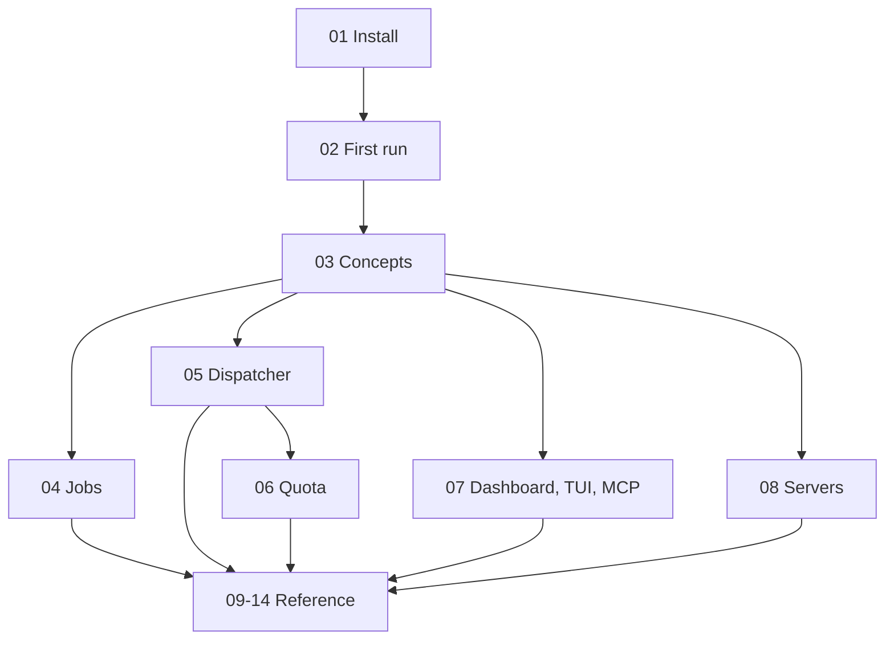

# The idlemax manual 📖

Welcome! This manual takes you from "what is this?" to running idlemax on every machine you own.
You do not need to be an expert.
If you can open a terminal and paste a command, you can follow it.

**What you will learn here:** where each topic lives, and which pages to read first.

## Start here

If you are new, read these four pages in order.
Together they take about 20 minutes.

1. [Install idlemax](01-install.md): get the `idlemax` program onto your Mac or Linux machine.
2. [Your first run](02-first-run.md): set up your device, run your first job and open the dashboard.
3. [How idlemax thinks](03-concepts.md): the handful of ideas everything else is built on.
4. [Jobs and schedules](04-jobs.md): hand your own commands to idle capacity.

## Going further

5. [The dispatcher](05-dispatcher.md): let AI coding workers pick up leftover tasks in your projects.
6. [Quota and the Budget](06-quota-and-budget.md): how idlemax spends AI quota that would otherwise expire.
7. [Dashboard, TUI and MCP](07-dashboard-tui-mcp.md): the screens, every key, and how to drive idlemax from an AI agent.
8. [Servers](08-servers.md): add a work server or a production server, safely.

## Reference

9. [Configuration](09-configuration.md): every setting, its default, and when to change it.
10. [CLI reference](10-cli-reference.md): every command and every flag.
11. [Troubleshooting](11-troubleshooting.md): real error messages and what to do about them.
12. [FAQ](12-faq.md): short answers to common questions.
13. [Glossary](13-glossary.md): every idlemax word in one place.
14. [Safety and privacy](14-safety-and-privacy.md): what idlemax never does, and where its fences end.

## The map

## How these pages are written

- Commands are ready to copy and paste.
  Lines that start with `#` inside a command block are comments; you do not type them.
- Output is shown trimmed, with `...` where lines were cut.
  Your device names, times and numbers will differ.
- Boxes like this one point out tips and traps:

> [!TIP]
> `idlemax <command> --help` always shows the exact flags of the version you have installed.

> [!NOTE]
> idlemax is at version 0.2.0.
> It is built and tested on macOS (Apple Silicon) and on Ubuntu 24.04.
> It has run live with real AI on a Linux server (Ubuntu, `workbox` profile): real statusline quota readings, real Opus orchestrator passes on real repos (sending owner and infra items to needs you), about 60 real Claude Sonnet and Haiku workers in Herdr with checks and verdicts, stop and start, and review keep.
> A production server rollout and a real install on a Mac (`idlemax setup` with its launchd services) are still unproven.

Next: [Install idlemax](01-install.md)
