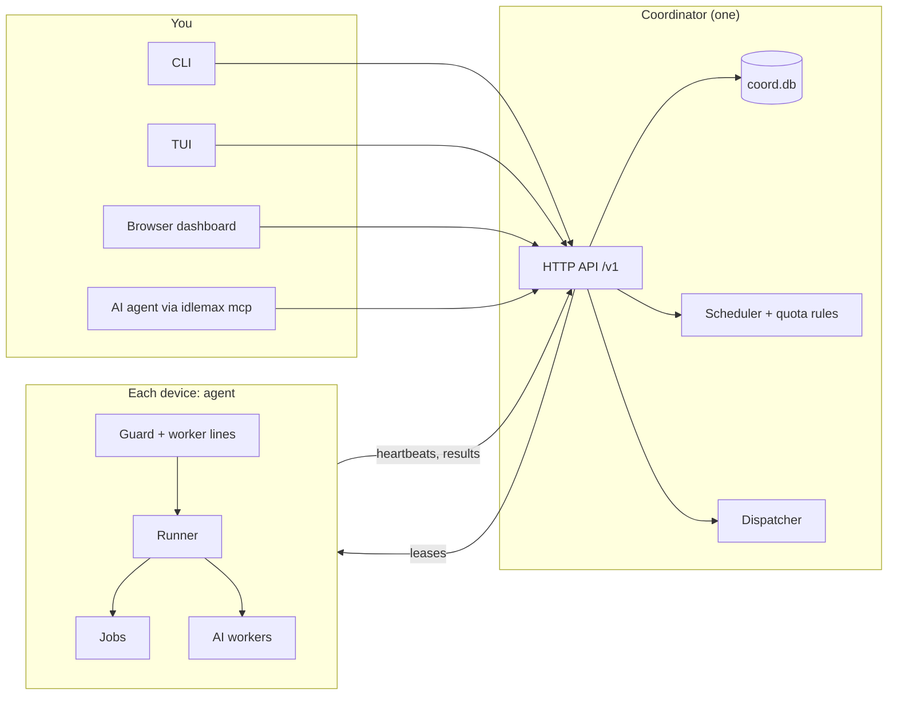
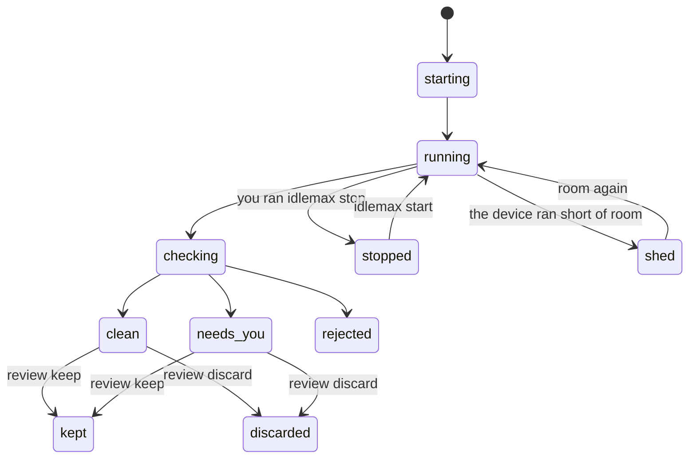

# 3. How idlemax thinks 🧠

**What you will learn:** the ideas everything in idlemax is built on: devices, jobs, the guard, profiles, the worker lines, quota windows, and the dispatcher with its projects, tasks, plans, runs, verdicts and review.

Read this once and the rest of the manual will feel obvious.

## The big picture



The coordinator decides **what** should run.
Each agent decides **whether now is a good moment** on its own machine, and has the last word.

## Devices

A device is any machine that runs an idlemax agent: your Mac, a Linux laptop, a server.
Each one has an id, by default its short lowercase hostname (`agent.device_id` changes it).

Every 30 seconds the agent samples its machine and sends a **heartbeat** to the coordinator.
A device with no heartbeat for 90 seconds (`coordinator.offline_after_secs`) shows as offline.

```sh
idlemax status        # every device, how full it is and why
idlemax device list   # every device and whether the dispatcher may use it
```

## Jobs

A job is a command you want run somewhere, sometime soon, without it bothering you.
The coordinator **leases** a job to a device that is idle now; jobs are leased, never pushed.
If a heartbeat does not renew the lease within 120 seconds (`coordinator.lease_secs`), the job goes back in the queue.

```sh
idlemax job add -- /bin/echo hi
```

Each job has a **cost class** that says what kind of load it is: `cpu_light` (the default), `cpu_heavy`, `io` or `ai`.
[Chapter 4](04-jobs.md) has everything about jobs.

## The guard

The guard is the agent's bouncer.
From every sample it gives one verdict:

| Verdict | Meaning |
|---|---|
| `run` | Go ahead. The number after it (`run 5`) is how many job slots are free. |
| `hold` | Start nothing new; running jobs carry on. |
| `pause` | Freeze running jobs (SIGSTOP). They resume by themselves later. |
| `kill` | Stop running jobs (SIGTERM, then SIGKILL after 15 s). |

How it reacts:

- A single breach pauses running jobs.
- Kill-level breaches on **2 samples in a row** kill them (`guard.kill_after_breaches`).
- After a pause or kill, jobs resume only after **2 clear samples** (`guard.resume_after_clear`).

What it watches: you at the keyboard, AC power and battery, thermal throttling, memory pressure and free memory, swap, load per CPU, memory and I/O pressure (PSI on Linux) and free disk.

> [!TIP]
> Example: you come back to your laptop.
> The next sample sees you typing, the guard says `pause`, and your nightly build freezes in place.
> You leave for lunch, ten minutes pass, and it carries on where it stopped.

Each job decides what happens when you come back with `on_user_active`: `pause` (the default), `continue` (only machine-health checks apply) or `kill`.

## Profiles

A profile is a preset of guard numbers for one kind of machine.

| Profile | For | In short |
|---|---|---|
| `laptop` | your own Mac or laptop (default on macOS) | you come first: waits for 10 minutes of idle time, needs AC power and 40% battery, sizes itself to half the CPUs and a quarter of the RAM |
| `workbox` | a work server with nobody at the keyboard and nothing else to protect | uses all CPUs but one and all RAM but a 1024 MiB reserve and 128 MiB for the agent (at least 1 job and 512 MiB), one slot per 512 MiB of that budget |
| `production` | a server that runs real services (default on Linux) | the services come first: a small, capped share; never takes `cpu_heavy` or `ai` jobs |

Pick one with `idlemax setup --profile workbox` (or `idlemax init --profile ...`), or later with `idlemax config set agent.profile workbox`.
Any single guard number can be changed on top of the preset; see [Configuration](09-configuration.md#guard).

> [!NOTE]
> A server idlemax knows nothing about starts as `production`, the safest choice.

## Pauses and the kill switch

You can hold work at four levels, from the whole cluster down to one job:

```sh
idlemax pause                       # everything
idlemax pause --device laptop       # one device
idlemax pause --account claude-max  # one AI account
idlemax pause --job 12              # one job
idlemax resume                      # lifts exactly the pause you name
```

Resuming the cluster does not clear a device, account or job pause; resume each scope you paused.
`idlemax stop-all` kills the running jobs in a scope and holds new ones until you resume.

The **kill switch** is a file.
`touch ~/.idlemax/PAUSE` pauses every job on that device within seconds, with no network.
Deleting it resumes them.

## The dispatcher

The dispatcher is idlemax's second kind of work.
Plain jobs are commands you queue.
The dispatcher puts **AI coding workers** on the leftover tasks of your own projects.

Who decides what:

- **idlemax rules** (fixed code, no AI): whether a worker may start, how many, and when one must stop.
- **The orchestrator** (one short Claude Opus pass): which project, task, provider and model fill each open slot.
- **You**: which projects and devices are on, the limits, and the big stop button.

### Modes

| Mode | What happens |
|---|---|
| `off` | plans nothing |
| `propose` | shows what it would launch and launches nothing (the default) |
| `auto` | launches the planned workers, one at a time |

### Projects

A project is a git repository on a device.
**Every project is off until you switch it on**, and so is every device.
idlemax writes nothing into your repositories; a project's settings (base branch, setup and check commands, off-limits paths, priority) live in the coordinator's database.

### Tasks

A task is one small piece of work with a check that proves it is done.
The dispatcher finds tasks in this order:

1. `broken_check`: the project's focused check fails on the base branch.
2. `roadmap`: an item in `ROADMAP.md` (or `docs/ROADMAP.md`) that has a "Done when" line.
3. `github_issue`: an open GitHub issue assigned to you.
4. `session`: unfinished work in your recent agent sessions (failing tests, an interrupted turn).

A task that is vague, has no check, or needs a decision from you goes on a **needs you** list with the reason.

### The plan

The plan says, per device, what the dispatcher would launch now and why:

```sh
idlemax plan
```

```text
dispatcher: propose (nothing is launched)
picked by: no orchestrator pass: no device has an open worker slot and a ready task
device my-server: run, 6 open slots: run: memory 12% of 30186 MiB used (hold at 90%), pressure some 0% full 0%, disk 354429 MiB free
  6 empty slots: no ready task
```

### Runs, verdicts and review

A **Run** is the record of one worker on one task, from start to verdict.
Its state moves like this:



idlemax checks every finished task itself before it tells you, and gives one **verdict**:

| Verdict | Means |
|---|---|
| `clean` | the diff stayed in the paths the task named, broke no check that passed before, and had an independent review when it was large or touched core code |
| `needs_you` | idlemax has one exact concern for you to look at |
| `rejected` | the branch is kept, but the task is never reported as done |

Then **you** review: `idlemax review` lists the finished tasks, and you keep, merge or discard each one.
[Chapter 5](05-dispatcher.md) covers all of it.

## The worker lines

AI workers do not follow the guard.
They follow three lines of their own, so they can work while you type:

| Line state | What idlemax does |
|---|---|
| `run` | a worker may start |
| `hold` | no new worker starts; running ones continue |
| `shed` | idlemax stops one worker at a time, newest first, until the device reads `run` again |
| `emergency` | every worker stops at once, with its state saved |

On a `laptop`, the lines sit at 90, 95 and 98 percent of memory used, and at 4, 2 and 1 GiB of free disk.
idlemax frees only what it owns; it never closes your apps.
It names the biggest memory users outside idlemax so you can decide.

## Quota windows

An AI subscription gives you quota in **windows** that reset: a 5-hour rolling window and a weekly window for Claude, a weekly window for Codex.
Whatever is unused at the reset is gone.

idlemax reads how much of each window is used and keeps a **reserve** for you.
For dispatcher workers it goes further and computes a daily **Budget**: the share of this week's quota that would expire unused, after your usual use and a safety margin, spread over the days left.
[Chapter 6](06-quota-and-budget.md) explains it with numbers.

## Owner sessions always win

Your own agent sessions and apps always come first:

- idlemax never stops, edits or shares the folder of a session you started.
- Workers run in their own git worktree and branch, never in your checkout.
- Under memory pressure idlemax stops its own newest worker first.
- Your own `idlemax review keep` and `discard`, `stop`, and every switch work whatever the line state, a pause or the kill switch says.

Next: [Jobs and schedules](04-jobs.md)
