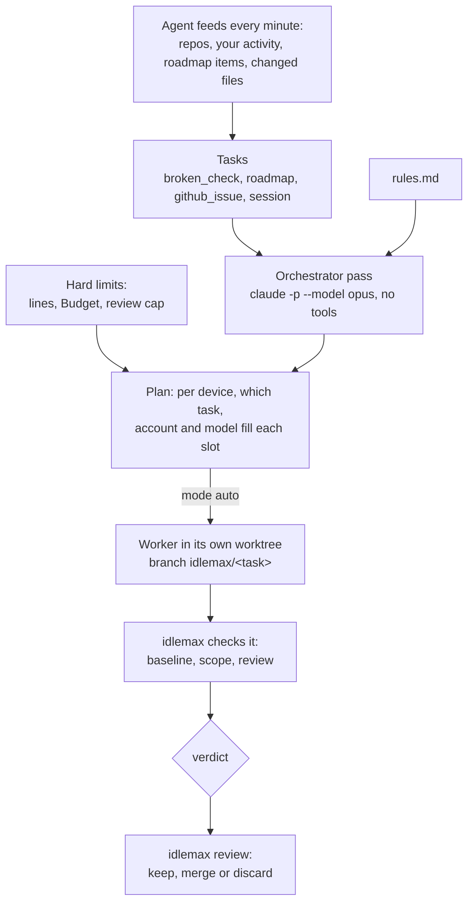

# 5. The dispatcher 🤖

**What you will learn:** how to let AI coding workers pick up leftover tasks in your own projects: switching projects and devices on, the three modes, `rules.md`, the orchestrator pass, where workers run, how to stop and start them, and how to review what they did.

> [!WARNING]
> Workers run as **your** user.
> Their fences are soft: they keep a worker away from pushes, your MCP servers and your secrets by default, but a worker that goes looking can still read files your user can read.
> Read [Safety and privacy](14-safety-and-privacy.md) before you switch on `auto`, and pass the checks in `docs/WORKER-PROOF.md` for each CLI you list in `workers.clis`.

## How it fits together



The orchestrator decides **which** task, provider and model fill a slot.
It cannot decide **whether** a slot exists; that is fixed code, from memory, disk and quota.

## The checklist

Before any worker can start, all of these must be true.
`idlemax plan` tells you which one is missing.

1. The device is on: `idlemax device on <id>`.
2. The project is on: `idlemax project on <name>`.
3. At least one agent CLI is listed: `idlemax config set workers.clis claude`.
4. An AI account is set up in `[[quota.accounts]]` and listed in that device's `agent.ai_accounts`, and its Budget for today is usable ([chapter 6](06-quota-and-budget.md)).
5. The mode is `auto`: `idlemax mode auto`.

Until then, `propose` mode shows you what it **would** do. Start there.

## Step 1: devices

Every device is off for the dispatcher until you switch it on, the Mac included.

```sh
idlemax device list
```

```text
DEVICE  DISPATCHER  SEEN    ROOM
laptop  off         online  run
```

```sh
idlemax device on laptop     # use the DEVICE id `device list` shows (your hostname); "laptop" is only the example
idlemax device off laptop    # stop its workers (state saved) and dispatcher jobs; plain jobs keep running
```

`ROOM` is the device's line state: `run`, `hold`, `shed` or `emergency`.

## Step 2: projects

A project is a git repository on a device.
idlemax finds the repositories your Herdr panes are in and lists them as projects that are off.
You can also add one yourself:

```sh
idlemax project add ~/code/app
```

```text
project app on laptop: added (off)
```

```sh
idlemax project list
```

```text
NAME  DEVICE  STATE  OWNER   BASE  CHECK  PATH
app   laptop  off    -       main  -      /Users/you/code/app
blog  laptop  off    active  main  -      /Users/you/code/blog
```

`OWNER active` means one of your own agent sessions is working there now or was recently.
The dispatcher prefers projects you are **not** active in.

`project add` takes `--name` (default: the folder name) and `--device` (default: the only device the coordinator knows).
It sets the base branch to the branch `origin/HEAD` names, else to the branch checked out now.

### Project settings

```sh
idlemax project set app base main                       # the branch tasks start from
idlemax project set app check -- cargo test -p core     # the focused check, as argv
idlemax project set app setup -- npm ci                 # installs dependencies in a fresh worktree
idlemax project set app priority 5                      # higher wins when tasks tie
idlemax project set app off-limits docs/legal vendor/   # paths a worker must not touch, besides the defaults below
idlemax project set app default-off-limits off          # drop the built-in CI, release and secret paths
idlemax project set app core-paths src/engine           # shared code: a diff here gets an independent review
idlemax project set app check                           # no value clears a setting
```

Lists take several words or commas.
The setup and check commands are argv, never a shell line, and their program must be on the device's allowlist; `project set` warns you when it is not.

> [!TIP]
> A good check is focused and fast: one crate's tests, one package's lint.
> Workers run focused tests only, and so should the check that proves their task done.

When the same project name exists on more than one device, add `--device <id>` to `project on`, `off`, `set` and `list`.

**How paths match.** A path covers the file it names, or everything in the folder it names.
`*` and `?` stay within one name, and `**` spans folders.

- **Off-limits and core paths** read the way `.gitignore` reads a pattern: one with `/` (a trailing one aside) is anchored at the repository root, and a plain name matches at any depth (`secrets` also covers `config/secrets`).
- **Scope paths**, which the orchestrator names for a task, are stricter: one with `/` is anchored at the root, a plain name is a top-level file or folder (`tests` is not `vendor/lib/tests`), and a glob without `/` matches a file name at any depth (`*.py` covers `calc/__init__.py`).
  A scope path that covers every file (`*`, `**`, `*/**` or empty) or holds more than 8 `*` is dropped from the pick.

### Switch it on

```sh
idlemax project on app
```

```text
project app on laptop: on
```

idlemax writes nothing into your repository.
Its settings live in the coordinator's database.

## Where tasks come from

For a switched-on project the dispatcher looks, in this order, for:

1. **A failing focused check** on the base branch (`broken_check`).
2. **Roadmap items** in `ROADMAP.md` or `docs/ROADMAP.md` on the base branch that have a "Done when" line (`roadmap`).
3. **Open GitHub issues assigned to you** (`github_issue`).
4. **Your recent sessions** with failing tests or an interrupted turn (`session`).

A task with no base branch or no check that proves it done, a roadmap item that says it needs the owner, and session work in a project you are active in go on the **needs you** list with the reason.

### The base check

To learn whether the check fails, the agent keeps a detached checkout of the base commit at `$IDLEMAX_HOME/checks/<project id>`, never your own folder.
The coordinator runs the project's setup and check commands there as dispatcher jobs named `dispatch-setup:<project>` and `dispatch-check:<project>`.
The checkout is made or moved only while the device reads `run` and no pause or kill switch is set, with repository hooks off.
Base checks do not run on a `production` device.

When a device has no quota left for today and the mode is `auto`, the same check runs again on each of its switched-on projects whose last check is more than 24 hours old.
It costs no quota, and the next day starts with a list of what is broken.

## Step 3: look at the plan

```sh
idlemax plan
```

Until the device is on, the plan only says so, with the fix, and shows no slots:

```text
dispatcher: propose (nothing is launched)
picked by: no orchestrator pass: no device has an open worker slot and a ready task
device laptop: held: device laptop is off: idlemax device on laptop
```

Once the device is on:

```text
dispatcher: propose (nothing is launched)
picked by: no orchestrator pass: no device has an open worker slot and a ready task
device laptop: run, 3 open slots: run: memory 61% used (hold at 90%), swap-in 0 pages/s, disk 51200 MiB free
  3 empty slots: no ready task
notes:
  ...
```

The plan lists, per device, the line state and its reason, the open slots, and for each slot the project, task, provider, account and model with the reason for the pick.

`idlemax plan --refresh` asks for an orchestrator pass now.
It is one `claude -p --model opus` job, so it **spends quota**.

## The orchestrator pass

The orchestrator is one short Claude Opus job.
It reads a compact summary of the offered tasks, projects (with the files each one tracks, at most 200) and usable accounts, plus the rules in `$IDLEMAX_HOME/rules.md`, and answers with picks: task, account, model, scope paths and a one-sentence reason, plus the tasks it sends to "needs you".
It also sees the start of the project's `AGENTS.md` (else `CLAUDE.md`), up to 2,000 characters, as the project's conventions.
It is told to build scope paths from the project's files, adding every file the task names and the new files the conventions call for.

- A named path that matches no file is kept as a new file when its folder exists, so a task can create `seqs/pascal.py` next to the other files in `seqs/`. A new top-level file counts too when its name has an extension, such as `pascal.py` (not a dot file such as `.envrc`).
- A file the task's title, roadmap detail or done check names joins the scope when its folder exists.
  A roadmap item's detail is its section's text before the "Done when" line, at most 600 characters, so write `Add seqs/pascal.py ...` there and the file is in scope.
- The project's top-level test folder (`tests`, `test`, `spec` or `__tests__`) joins the scope only when the task asks for tests in its title or roadmap text ("with two tests"); the done check does not count. It never joins under an off-limits path.
- Only text the owner wrote adds scope: roadmap items and broken checks. A GitHub issue title or session text never does, and no path in or of a dot folder (`.github/`, `.claude/`, `.env`) is added from any text.
- Every project starts with these off-limits paths besides its own: CI and release config, secret files, and agent or tool config that would run code for you later (hooks, MCP servers): `.github/`, `.gitlab-ci.yml`, `.circleci/`, `secrets/`, `*.env`, `.env.*`, `.envrc`, `*.pem`, `*.key`, `.claude/`, `.mcp.json`, `.husky/`, `.githooks/` and `.git/hooks/`. `idlemax project set app default-off-limits off` drops them for that project, and `on` brings them back.
- A named path that matches no file and sits in no existing folder is dropped on its own, and the pick's reason ends with `(scope paths that do not exist were dropped: <paths>)`. When none of the named paths is left, the pick is not used: its task waits for the next pass, and the empty slot says `none of its scope paths exist`. A pick with no scope path at all, because the pass named none or named only `*`, is refused the same way (`it names no scope path`). idlemax never widens a scope to the whole project.
- When the device reported no file list for the project (an older agent, for example), the named scope paths are kept as given. When the list was cut at 200 files, a named path missing from it may still exist, so it is kept if it is a plain relative path (not absolute, no `..`).

- It runs with no tools, no hooks and no MCP servers.
- It runs when its inputs changed, at most once an hour by itself, or on `idlemax plan --refresh`.
  New work does not wait for the hour: a ready task the newest pass was not offered makes a pass due at once.
- It runs only on a Claude account whose Budget is usable, while some account has room for one more Run today.
- A pick naming anything it was not offered is dropped.
- A task it sends to "needs you" stays there until the task changes.

> [!IMPORTANT]
> Nothing is ever picked without the orchestrator.
> A ready task that no pass has seen is listed as "not judged by the orchestrator" and fills no slot.

### rules.md: how it judges

`$IDLEMAX_HOME/rules.md` is written once with good defaults and read on every pass.
It is yours to edit.
The defaults start like this:

```markdown
# idlemax rules

These are the judgment rules the orchestrator reads on every pass.
Edit this file to change how idlemax picks and briefs work.
The hard limits (memory, disk, quota, which projects are on) are not here and cannot be changed here.

## How to pick a task

- Pick only tasks from the list you are given.
- Prefer a task that is small enough for one worker in one sitting.
...
## Rules for every worker

- Do the one task and nothing else.
- Run focused tests only, never a whole suite.
...
```

Example: you want docs typos left alone.
Add a line under "Never touch": `- Typos in docs/ unless the task is about docs.`

**Rule proposals.** After a task you rejected or discarded, a pass may propose one new line for `rules.md`, with its reason.
It waits for you on the dashboard's Rule proposals card and the TUI's rules pane; only your approval appends it to the file.

## Step 4: modes

```sh
idlemax mode off        # plan nothing
idlemax mode propose    # show what it would launch, launch nothing (the default)
idlemax mode auto       # launch the planned workers, one at a time
```

```text
dispatcher mode: auto
```

The mode lives in `config.toml` as `dispatcher.mode`, and every daemon picks a change up at once.

### What auto does

In `auto` idlemax launches each orchestrator pick by itself, with no approval per launch.
It runs one launch step every `workers.settle_secs`, at least every second and at most every 15 seconds (so every 15 s at the default of 60).
In each step, per device, it first continues the oldest worker that was shed, then starts the next pick, and only when:

- the device is online with no pause or kill switch, the account is not paused, and the line state is `run` with an open slot;
- no worker on the device is still starting, and the last launch there is at least `workers.settle_secs` (60) seconds old, so memory settles;
- the worker CLI is listed in `workers.clis` (empty by default, so nothing starts until you list one) and the account's Budget is usable;
- the project has fewer than `workers.review_cap` (3) tasks waiting for your review or in flight.

A task that already has a Run is not launched again until that Run is discarded, except that a single `rejected` Run leaves the task open for one more attempt (see [Model tiers](#model-tiers)).
A task whose last two Runs were rejected or discarded is never launched again: it needs you.
A Run you discarded whose worker never reached `running` counts as no try and no spend; one discarded mid-work still counts.
Every launch is an event that names the project, task, provider, model and the reason it was picked.

### Model tiers

A task whose type is in `quota.small_task_types` (by default only `broken_check`) starts on the **small** tier (`quota.claude_small_model`, `haiku`).
Every other task starts on the **standard** tier (`quota.claude_standard_model`, `sonnet`).
A task that failed its checks once gets one more try on the standard tier, in a new Run and a fresh session.
After a second failure it goes on "needs you" with `failed its checks twice`.
A provider whose tier model is not set gets no worker for that tier.

## Where workers run

Each worker gets its own branch `idlemax/<task>` in its own worktree under `$IDLEMAX_HOME/worktrees`, never in your checkout.
The worktree shows up in `git worktree list` of that repository, so you can look at the work from your own checkout at any time.

`workers.host` decides how a worker is shown:

| `workers.host` | Where |
|---|---|
| `auto` (default) | in Herdr when Herdr answers, else headless |
| `herdr` | a pane in the Herdr workspace `idlemax workers`, one tab per project named `im: <Project>`; your own workspaces stay as they were |
| `headless` | a child process of the agent; its output goes to the job log that `idlemax logs <job>` prints |

A `production` device always runs workers headless, so `herdr` is refused there.
On Linux with a systemd manager each worker runs in a transient scope of its own (`idlemax-w-<job>-…`): a headless worker starts in it, and a Herdr pane's shell is moved into it before the agent starts. A stop then also ends what the worker forked or `setsid`-ed out of its process group. Elsewhere, or when the move fails (logged at info), a stop ends the process group or the pane only.

**Claude's folder trust dialog.** An interactive Claude Code started in a folder it has not seen asks whether you trust it, and its default answer exits.
In Herdr, idlemax answers yes only when the dialog names exactly the worktree it made for that launch; any other dialog, or another folder, still fails the start.

A worker is stopped after `workers.max_runtime_secs` (3600) awake seconds per launch, and after `workers.blocked_secs` (120) waiting for input.

### What fences a worker

| Fence | How |
|---|---|
| No personal MCP servers | Claude starts with `--strict-mcp-config`; Codex gets `enabled=false` for each configured server |
| No idlemax token, no credential variables | the pane gets them empty, and a worker whose real environment still holds one is never briefed |
| No untracked files of yours such as `.env` | a fresh worktree holds tracked files only |
| No CI, release or secret paths | `.github/`, `.gitlab-ci.yml`, `*.env` and `secrets/` are off-limits in every project unless you set `default-off-limits off`; a change there rejects the task |
| No `git push` | every remote and every push URL (any scheme, a path, a remote added later) gets a dead push address, with no credential helper and no askpass helper, for the agent and for the setup and check commands; a worker that drops its environment gets past it, which only an OS sandbox stops (A13) |
| Codex writes and network | Codex's own `workspace-write` sandbox, approval `never` |
| No pull requests, deploys, databases, messages or spending | the brief and `rules.md` say so, and the credential variables are missing |

What is **not** fenced is in [Safety and privacy](14-safety-and-privacy.md#what-a-worker-can-still-reach).

## The lines while workers run

Workers follow the worker lines, never the guard, so they keep working while you type.
While a worker runs, the agent samples and heartbeats every 5 seconds.

- At `hold` no new worker starts.
- At `shed` idlemax stops one worker at a time: the most recently started first, then the lowest-priority project, then the biggest memory user, until the device reads `run` again.
  A shed worker goes back in the queue and continues by itself when there is room.
- At `emergency` every worker stops at once, with its state saved.

The reason names the biggest memory users outside idlemax; idlemax never closes your apps.
The kill switch, a local pause and `stop-all` still hold and stop workers like any job.
The numbers per profile are in [Configuration](09-configuration.md#dispatcher).

## Stop and start

```sh
idlemax stop --reason "need the CPU for a demo"
idlemax start
```

- `stop` cuts every worker's current turn within seconds, each agent exits so its memory is freed, its pane closes, and nothing new launches.
  Uncommitted edits stay in the worktree.
- Saved per worker: project, task, branch, worktree, provider, account, model and session id.
- A stop survives a reboot, and idlemax never resumes your stop by itself.
- `start` lets the stopped workers continue their sessions, one at a time, after memory and quota are checked again.
  It names any pause still in force.

```text
$ idlemax stop
nothing to do: no worker was running; nothing launches until `idlemax start`
$ idlemax start
workers may launch again; no worker was stopped
```

The same switch is the `x` key in the TUI and the **Stop workers** button on the dashboard.

## Review the work

When a worker finishes, idlemax checks the result before it tells you:

- **Baseline:** the project's focused checks, recorded on the base branch before the worker started, must still pass on the worker's branch.
- **Scope:** the diff touches only what the task needs.
  A change under an off-limits path (yours or the defaults) rejects the task; a change outside the scope paths, or a task that named no scope paths, makes it `needs_you`.
- **Independent review**, only when risk is high: an agent from a different provider (from `workers.reviewers`) reads the diff.
  Risk is high when the diff has more than `workers.review_diff_lines` (300) added plus removed lines, or touches the project's `core-paths`.

Then it gives a verdict, `clean`, `needs_you` or `rejected`, and sends you one notice.

```sh
idlemax review
```

It lists every finished task per project with its verdict and concern, a one-line summary, the diff size and the branch, and how many workers are stopped or wait to restart.

```sh
idlemax review keep 12            # keep the branch, remove the worktree folder
idlemax review keep 12 --merge    # also merge into your current branch
idlemax review discard 12         # delete the branch and the worktree (asks once)
idlemax review discard 12 --yes   # no question; needed when no terminal is attached
```

- `--merge` merges only when your checkout is clean and the merge has no conflict; otherwise it stops and says why.
- idlemax never merges into your branches unless you ask, for that task.
- Worktrees are removed with git's safe removal, without force, so git refuses while uncommitted work is left in the folder, and nothing is deleted.
- Your `keep` and `discard` are never held by a line, a pause or the kill switch.

### The review cap

Per project, the finished tasks waiting for your review **plus** the Runs still in flight (starting, running, checking, shed or stopped) may number at most `workers.review_cap` (3).
At the cap, idlemax moves its workers to another switched-on project, or stops.
A `rejected` Run does not count toward the cap.

```sh
idlemax config set workers.review_cap 5
```

## A full first session, start to finish

First add an AI account: a `[[quota.accounts]]` entry and `agent.ai_accounts` on this device, then restart the agent ([chapter 6, step 1](06-quota-and-budget.md#step-1-tell-idlemax-about-your-accounts)).
Without one, the plan never launches anything.

```sh
idlemax device list                 # note your DEVICE id (the hostname); "laptop" below is an example
idlemax device on laptop
idlemax project add ~/code/app
idlemax project set app check -- cargo test -p core
idlemax config set agent.command_allowlist git,cargo,claude   # the worker CLI, and every setup and check program, must be allowed too
idlemax project on app
idlemax plan                        # propose mode: read what it would do
idlemax config set workers.clis claude
idlemax mode auto                   # only after WORKER-PROOF passed for claude
idlemax status                      # watch the workers
idlemax review                      # later: keep, merge or discard
```

Next: [Quota and the Budget](06-quota-and-budget.md)
