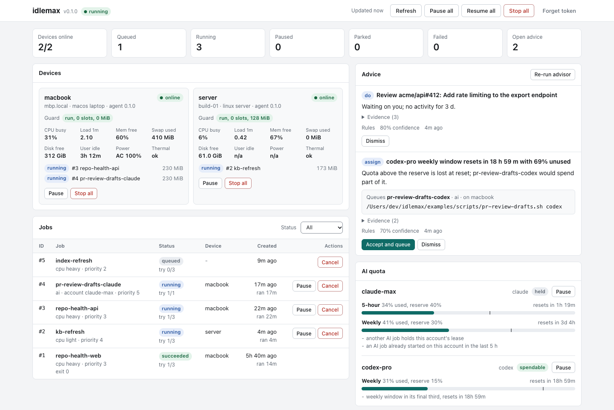

# 7. Dashboard, TUI and MCP 🖥️

**What you will learn:** the four ways to watch and steer idlemax (the web dashboard, the terminal dashboard, the CLI and an AI agent over MCP), every key in the TUI, how to hook idlemax into Claude Code, Codex and OpenCode, and the output formats an agent can read.

All four call the same coordinator API, so a switch flipped in one shows up in the others.

## The web dashboard

Open `http://127.0.0.1:7878/` (or your coordinator's address).
It asks for the token once (`cat ~/.idlemax/token`, or `cat "$IDLEMAX_HOME/token"` if you set `IDLEMAX_HOME`) and keeps it in that browser's local storage until you press **Forget token**.
A wrong token brings you back to the token box with `That token was rejected.`; a token that stops working later (say, after you made a new one) shows `The coordinator rejected this token. Paste the current one.`

<picture>
  <source media="(prefers-color-scheme: dark)" srcset="../assets/dashboard-dark.png">
  <source media="(prefers-color-scheme: light)" srcset="../assets/dashboard-light.png">
  
</picture>

- It is one self-contained page: no remote scripts, fonts or styles.
- It refreshes every 5 seconds while the tab is visible (it pauses while the tab is hidden) and follows your system's light or dark theme.
- On a phone the jobs table becomes stacked cards.

### The cards

| Card | What it shows and what you can do |
|---|---|
| **Dispatcher** | the mode switch (`off`, `propose`, `auto`; switching to `auto` asks first, `off` and `propose` apply at once), each device's line state and reason, **Stop workers** (and **Start** while workers are stopped by you), the workers with their label, summary, model and a `why` line, what would launch next and who picked it |
| **Needs you** | tasks idlemax could not do alone, with the reason |
| **Waiting for review** | read-only: each task ready for review or needing you, with its label, summary and branch; keep, merge or discard with `idlemax review` |
| **Budget** | today's spend of the day's share per account, then the earlier days |
| **Projects** | each device's switch, then each project's; switching on asks first, off does not |
| **Limits** | headed with the device whose `config.toml` it changes: each owner limit with its default, **Save** and `default`; every other device's own limits read-only |
| **Rule proposals** | proposed lines for `rules.md`; **Approve** asks first |
| **Did it help?** | the same lines as `idlemax report` |
| **Devices** | guard verdicts and metrics, slot and RAM meters, the reason the device is not doing more, and the AI accounts it may spend |
| **Jobs** | every job; each waiting job carries a `waiting:` line with its headline reason (`+N more` when there are others); click it for the full list of reasons and fixes |
| **Schedules** | pause, resume or remove a schedule |
| **Advice** | accept or dismiss advice |
| **AI quota** | AI quota per window |
| **Events** | recent events |

You can pause, resume, stop-all or cancel per scope from the page.
A coordinator without the dispatcher shows none of the dispatcher cards.

## The terminal dashboard (TUI)

```sh
idlemax tui
```

Seven tabs: **1 Devices**, **2 Jobs**, **3 Quota**, **4 Advice**, **5 Events**, **6 Schedules**, **7 Dispatch**.
It is built for 80x24 and up: long names are cut with an ellipsis and narrow screens drop the least useful columns first.

```text
idlemax http://127.0.0.1:7878   running   updated 2s ago
global: running | paused accounts: claude-work
jobs: 1 running, 1 paused, 1 queued, 1 parked, 1 failed | advice: 1 open
 1 Devices │ 2 Jobs │ 3 Quota │ 4 Advice │ 5 Events │ 6 Schedules │ 7 Dispatch
┌──────────────────────────────────────────────────────────────────────────────┐
│  DEVICE               STATE             SLOTS  RAM        WHY                │
│> laptop               online            1/3    512M/4.5G  starting 1 queued… │
│  build-server         local-paused      1      512M       held: a local pau… │
│  old-mini             offline 2d1h ago  -      -          -                  │
└──────────────────────────────────────────────────────────────────────────────┘
┌ AI quota ────────────────────────────────────────────────────────────────────┐
│ claude-work: paused by you, 18% left (5h), resets in 1h35m                   │
│ codex-personal-with-a-very-long-account-name: not spendable now (no usage    │
│ data yet), quota left unknown (week)                                         │
└──────────────────────────────────────────────────────────────────────────────┘
p/r pause/resume device laptop  x stop workers  s stop-all  q quit
```

(The TUI's own 80x24 test snapshot, with the device names changed.)
On a wide terminal the tab bar also shows counts (`1 Devices (2) │ 2 Jobs (6) │ ...`), and the Devices table adds `IDLE`, `CPU`, `LOAD`, `MEM FREE`, `SWAP`, `DISK` and `POWER` columns.
The footer lists the most useful keys that fit: on a narrow screen it drops the less important hints first (at 80x24, `P/R all` and `tab/1-7 switch` go), so the [key table](#every-key) below is the full list.

On the **Jobs** tab, the last column `RESULT / WHY` says why a waiting job waits, and `w` opens the full reasons with the fix for each:

```text
┌ why job 3 (nightly-make) ────────────────────────────────────────────────────────────────────────┐
│Job 3 (nightly-make) is queued but not starting.                                                  │
│                                                                                                  │
│laptop (online, heartbeat 2s ago):                                                                │
│  - "make" is not in laptop's agent.command_allowlist, so it would refuse the job                 │
│    fix: on laptop, run `idlemax config set agent.command_allowlist <programs>` and list "make" w…│
└──────────────────────────────────────────────────────────────────────────────────────────────────┘
```

Against a coordinator too old to have the dispatcher, the **Dispatch** tab shows only `this coordinator has no dispatcher view; update it to use this tab`, and its keys send nothing.

The **Dispatch** tab shows one pane at a time, and `v` moves to the next: workers, would launch (then the ready tasks the orchestrator did not judge), needs you, review, budget, projects, devices, limits and rules.
The title carries the dispatcher mode and each device's line state, and the box underneath explains the selected row.

### Every key

| Key | Action |
|---|---|
| `1`-`7`, `Tab`, `Left`, `Right` | switch tabs |
| `Up`, `Down` | select a row |
| `p`, `r` | pause or resume the selected device, job, account or schedule; everything on Advice, Events and Dispatch |
| `P`, `R` | pause or resume everything |
| `s` | stop-all everywhere (asks first) |
| `x` | stop every worker, on any tab (asks first); they continue only after `g` or `idlemax start` |
| `k` | cancel the selected job (asks first) |
| `w` | on Jobs, show or hide the reasons for the selected waiting job |
| `PgUp`, `PgDn` | scroll the reasons |
| `a`, `d` | accept or dismiss the selected advice; on Schedules, `d` removes the selected schedule (asks first) |
| `f` | re-run the advisor (Advice tab) |
| `v` | on Dispatch, show the next pane |
| `m` | on Dispatch, move to the next mode: off, propose, auto (asks first, except toward off) |
| `g` | on Dispatch, start the stopped workers (asks first) |
| `t` | on the projects or devices pane, switch the selected project or device (on asks first; a device switched off stops its workers with their state saved) |
| `e` | on the limits pane, type a new value in the footer: `Enter` saves, the word `default` puts back the default, `Esc` closes |
| `a`, `d` | on the rules pane, approve (asks first) or reject the selected proposal |
| `y`, `Enter` | confirm a prompt; any other key cancels it |
| `q`, `Esc`, `Ctrl-C` | quit |

## The CLI as a dashboard

```sh
idlemax              # home view: devices, guard verdicts, job counts, open advice, spendable accounts, next commands
idlemax status       # per device: slots, RAM, why it is not doing more; then the dispatcher block
idlemax report       # did it help?
idlemax events       # recent events (--limit N)
```

`idlemax` with no arguments waits at most 3 seconds for the coordinator and always exits 0.
When the device is not set up or the coordinator is down, it prints one note with the fix.

`idlemax status` columns:

- `SLOTS`: jobs holding a slot out of the most the guard allows (`guard.max_jobs`).
- `RAM`: memory those jobs budget out of `guard.ram_budget_mib`.
- `WHY`: the main reason the device is not doing more, such as `queue empty`, `held: memory pressure`, `2 queued jobs cannot run here: no git`, or `1 queued job waiting: AI quota`.
- A `dispatcher` block follows: the mode, each device's line state, the workers (`STATE  PROJECT  TASK  MODEL  AGE  SUMMARY`) and the counts `needs you` and `waiting for review`.
- With accounts configured, an `accounts` table says whether each may be spent now.

## Drive idlemax from an AI agent

idlemax is built to be driven by an agent such as Claude Code or Codex.
Nothing here is required.

### The MCP server

`idlemax mcp` speaks the Model Context Protocol on stdin and stdout.
It is a thin client of the coordinator with six tools:

| Tool | Argument | Does |
|---|---|---|
| `status` | none | what idlemax is doing now: devices, the dispatcher and its workers |
| `start` | none | start the dispatcher's workers again after a stop |
| `stop` | none | stop every dispatcher worker; each keeps its state |
| `project_on` | `name` | let the dispatcher plan work in a project |
| `project_off` | `name` | stop the dispatcher planning work in a project |
| `finished_work` | none | finished tasks waiting for your review |

Add it once per agent CLI:

| CLI | Command |
|---|---|
| Claude Code | `claude mcp add --scope user idlemax -- idlemax mcp` |
| Codex | `codex mcp add idlemax -- idlemax mcp` |
| OpenCode | `opencode mcp add --global idlemax -- idlemax mcp` |
| agy | `agy mcp add idlemax idlemax mcp` |

Then just ask: "idlemax, what are my workers doing?" or "switch the blog project off".

> [!NOTE]
> A job or worker that idlemax started cannot `start` or `project_on` through MCP, and the coordinator refuses those again.
> Only your own sessions can switch idlemax on.

### The session hook

`idlemax hooks install` makes every Claude Code, Codex and OpenCode session start with a few lines of idlemax state, so the agent knows what is running before it does anything.

```sh
idlemax hooks install --dry-run   # shows the diff, writes nothing
idlemax hooks install
idlemax hooks status              # per agent: installed, stale, not installed or not found
idlemax hooks uninstall           # removes only idlemax's entry
idlemax hooks summary             # what the hook prints (always exits 0)
```

| Agent | File | What is added |
|---|---|---|
| Claude Code | `~/.claude/settings.json` (or `$CLAUDE_CONFIG_DIR`) | a `hooks.SessionStart` entry running `idlemax hooks summary` |
| Codex | `~/.codex/hooks.json` (or `$CODEX_HOME`) | the same entry, plus `[features] hooks = true` in `config.toml` |
| OpenCode | `~/.config/opencode/plugins/idlemax.js` | a managed plugin that adds the summary to the system prompt |

- With `IDLEMAX_HOME` set, the hook runs `idlemax hooks summary --home <that folder>`, since a new agent session does not inherit the variable and would otherwise read `~/.idlemax`.
- With no flag, `install` acts on the agents whose config folder exists; `--claude`, `--codex` and `--opencode` pick exactly the ones you name.
- It edits only its own entry, keeps the old file as `<file>.idlemax.bak`, and running it again changes nothing.
- A file it cannot understand (invalid JSON, a `hooks` key that is not an object) is reported as `refused`, left alone, and the exit code is 1.
- OpenCode hooks use `$OPENCODE_CONFIG_DIR/plugins` when set, then `$XDG_CONFIG_HOME/opencode/plugins` for an absolute XDG path, otherwise `~/.config/opencode/plugins`.

### The skill

`skills/idlemax/SKILL.md` is a generated [Agent Skill](https://agentskills.io).
It tells your coding agent what idlemax is, which command answers which question, and how to review the work workers finished: read each task's diff with the `read` command from `idlemax review --json`, tell you what it found, and leave keep or discard to you.

`idlemax setup` installs it for Claude Code, Codex and OpenCode, and `idlemax skill install` does the same by hand, for example after an upgrade; `idlemax doctor` warns when a copy is missing or older than the binary.
`idlemax skill` prints it, and `idlemax skill --check` exits 1 when a committed copy is stale.

The skill and the hook do different jobs, and they work together.
The skill is how the agent knows what to do when you ask about idlemax.
The hook is how the agent hears, at the start of every session, that something waits for you: when finished tasks wait for review, the summary says how many and asks the agent to offer a review.

### One line to hand work to idle capacity

```sh
idlemax job add --wait --key pr-42-tests -- cargo test
```

## Output an agent can read

Every command prints in one of three formats, chosen with the global `--format table|toon|json`:

| Format | Default when | For |
|---|---|---|
| `table` | output is a terminal | people |
| `toon` | output is a pipe or a file | agents and scripts that read text |
| `json` | you ask; `--json` is the same as `--format json` | scripts that parse; the API body unchanged |

[TOON](https://toonformat.dev) states a table's shape once instead of repeating every key, about 40% fewer tokens than JSON:

```text
$ idlemax jobs | cat
count: 5
jobs[5]{id,name,status,device}:
  5,sh,failed,laptop
  4,sh,failed,laptop
  3,echo,succeeded,laptop
  2,echo,succeeded,laptop
  1,echo,succeeded,laptop
help[3]:
  - Run `idlemax why <id>` to see why a job is not running
  - Run `idlemax logs <id>` to read a job's output
  - Run `idlemax job cancel <id>` to stop a job
```

- `--fields cost,age,result` adds list columns; `--fields all` adds every one.
- A list longer than shown says so (`count: 2 of 8`), and an empty list says what is empty.
- Text over 500 characters is cut and ends with `(truncated, 700 chars total)`; `--full` prints it all.
- `--utc` shows event times in UTC instead of this machine's local time.
- These are global flags and work before or after the command.

Errors are two lines with the fix:

```text
$ idlemax status | cat
error: "coordinator unreachable at http://127.0.0.1:7878"
help: idlemax coord (or pass --coord <URL> for a running one); `idlemax local stop-all` works without it
```

| Exit code | Meaning |
|---|---|
| 0 | success, including "nothing to do" |
| 1 | runtime error: the server is down, the job is not found, the command failed |
| 2 | usage error: an unknown flag or command, a missing argument, a bad `--fields` |

Repeating a command is safe: `pause` on a paused cluster answers `already paused (no-op)` and exits 0.

## The advisor

The advisor turns cluster state, your open PRs and review requests, and your recent sessions into recommendations.
Nothing runs on its word alone.

```sh
idlemax advise              # list, open ones first
idlemax advise accept 4     # queue the suggested job
idlemax advise dismiss 4    # close it without acting
idlemax advise refresh      # re-run the advisor now
```

- Each agent reads `gh` and the metadata of recent Claude and Codex sessions (never message text) every 15 minutes (`agent.advisor_inputs_secs`) and sends only that metadata.
- The rules engine flags parked or failed jobs, offline devices, idle devices with an empty queue, quota about to reset unused, PRs waiting on you for 2+ days, and unfinished sessions.
- An optional AI pass runs as an ordinary `ai` job through `claude -p` with a strict JSON schema, only when `advisor.ai_account` is spendable.
  Its prompt goes on stdin, and the run disables all hooks and starts none of your MCP servers.
- Suggested jobs can only name templates in `$IDLEMAX_HOME/jobs/` on the coordinator.
  A template is queued without asking only if its name is in `advisor.auto_accept`.

Next: [Servers](08-servers.md)
