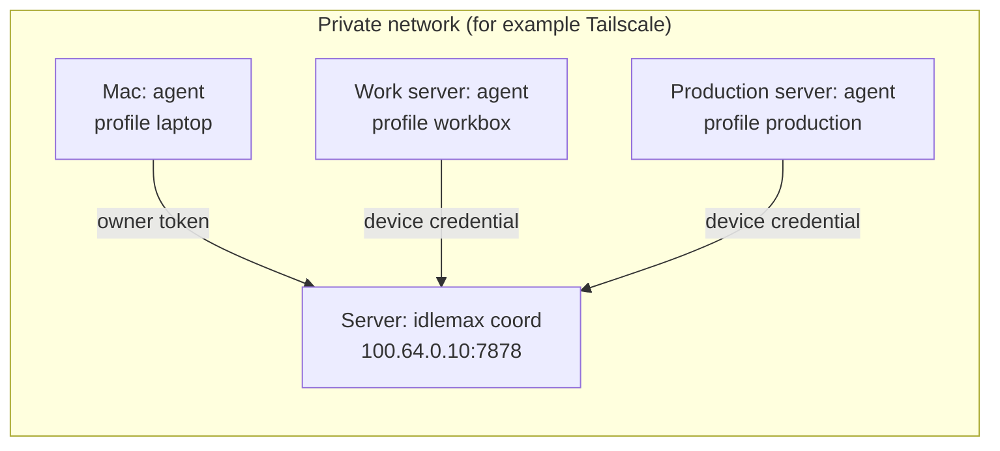

# 8. Servers 🗄️

**What you will learn:** how to grow from one laptop to a cluster: moving the coordinator to an always-on server on a private network, joining work servers and production servers as agents, giving each device its own credential, and switching devices on and off for the dispatcher.

The full step-by-step runbook, with every verification command, is [docs/ROLLOUT.md](../ROLLOUT.md).
This chapter explains the shape and the safe defaults.

## The shape



- **One coordinator for all.**
  It moves to an always-on server, because a laptop sleeps.
- **One agent per device.**
  Each agent measures its own machine and acts on its own lines within seconds, so servers are never driven from the laptop.

## Pick a profile per server

| Profile | Use it for | What idlemax may use |
|---|---|---|
| `workbox` | a work server with no live services and nobody at the keyboard | all CPUs but one, all RAM but a 1024 MiB reserve (at least 1 job and 512 MiB); works around the clock |
| `production` | a server that runs real services | a small capped share: a reserve of one CPU and 1536 MiB for the services plus 128 MiB for the agent, job RAM at most a quarter of the host, `cpu_light` and `io` jobs only, workers always headless, no base checks |

A server idlemax knows nothing about starts as `production`.
Example sizes on `production`: a 4-vCPU VPS reporting 1950 MiB keeps 1 job and 512 MiB; a 16-CPU, 16 GiB server gets 8 job slots and 4096 MiB.

## Step 1: a private network

The coordinator speaks plain HTTP, so it must live on a private network that encrypts traffic, such as a Tailscale tailnet.

- It refuses to bind `0.0.0.0` or `[::]`.
- It answers only to IP addresses, `localhost`, the host of `coordinator.url` and the names in `coordinator.allowed_hosts`; any other `Host` header gets HTTP 421.
  If devices reach it by a MagicDNS name, list that name:

  ```toml
  [coordinator]
  allowed_hosts = ["server.tail1234.ts.net"]
  ```

> [!WARNING]
> Never open port 7878 in a host or cloud firewall.
> Use the tailnet ACL to limit which devices may reach it.

## Step 2: the coordinator on the server

On Linux, run it as a system service under its own user, from the shipped unit in `packaging/linux/`:

```sh
cargo build --release -p idlemax
sudo install -m 0755 target/release/idlemax /usr/local/bin/idlemax
sudo useradd --system --home-dir /var/lib/idlemax --shell /usr/sbin/nologin idlemax
sudo install -d -o idlemax -g idlemax -m 0700 /var/lib/idlemax
sudo install -o idlemax -g idlemax -m 0600 examples/config.server.toml /var/lib/idlemax/config.toml
sudo -u idlemax env IDLEMAX_HOME=/var/lib/idlemax idlemax init
```

Edit `/var/lib/idlemax/config.toml`: set `coordinator.listen` and `coordinator.url` to the tailnet address (`tailscale ip -4`), and `agent.device_id` to the server's name.

```toml
[coordinator]
listen = "100.64.0.10:7878"
url = "http://100.64.0.10:7878"
```

Then render the agent unit for this host, install both units and start them:

```sh
sudo -u idlemax env IDLEMAX_HOME=/var/lib/idlemax idlemax service render agent --bin /usr/local/bin/idlemax --format table > idlemax-agent.service
sudo install -m 0644 packaging/linux/idlemax-coord.service idlemax-agent.service /etc/systemd/system/
sudo systemctl daemon-reload
sudo systemctl enable --now idlemax-coord idlemax-agent
curl -fsS http://100.64.0.10:7878/healthz      # prints: ok
```

> [!TIP]
> Building on a busy production server? Build inside a capped transient unit so the build cannot starve the sites.
> [ROLLOUT.md section 1](../ROLLOUT.md#1-get-a-linux-binary-onto-the-server-without-starving-the-sites) has the exact `systemd-run` line.

### What the units cap

| Unit | Caps and settings |
|---|---|
| `idlemax-coord.service` | `MemoryHigh=192M`, `MemoryMax=256M`, `MemorySwapMax=0`, `CPUQuota=20%`, `CPUWeight=10`, `IOWeight=10`, a strict sandbox that writes only `/var/lib/idlemax`, restarts until the private IP exists |
| `idlemax-agent.service` | the shipped reference has `MemoryMax=640M` (one 512 MiB job plus the agent) and `CPUQuota=100%`; `service render agent` sizes these from the host's budget; no swap, low CPU and I/O weight, `Nice=19`, idle I/O class and the write sandbox |
| `com.idlemax.agent.plist`, `com.idlemax.coord.plist` (macOS) | `ProcessType` Background, `LowPriorityIO`, `LowPriorityBackgroundIO`, `Nice` 20, restart after a crash, logs in `<state dir>/logs/` |
| `idlemax-agent.user.service`, `idlemax-coord.user.service` | the system units' caps, applied only if your user manager delegates those cgroup controllers, without the system units' sandbox |

On the server, jobs run under `nice` and `ionice` inside the agent unit's cgroup unless the `idlemax` user has a systemd user manager.
Keep lingering off for that user so every job stays inside those caps.
If a job needs to write outside `/var/lib/idlemax`, add `ReadWritePaths=` with `systemctl edit idlemax-agent`.

### Rendering a unit offline

`idlemax service render` prints a Linux root unit without writing or starting anything:

```sh
idlemax service render agent --cpus 4 --memory-mib 4096 --config ./target-config.toml --format table
```

- Off-host rendering needs both `--cpus` and `--memory-mib`, and takes a target config only through `--config`.
- Explicit facts use `/var/lib/idlemax` as the state folder unless you pass `--state-dir`, and do not copy the build host's `PATH`.
- `--bin` picks the target executable.
- After changing capacity settings, render again and restart the unit.

## Step 3: point every other device at it

A device that already holds the owner token (your Mac):

```sh
ssh <server> sudo cat /var/lib/idlemax/token | idlemax setup --role agent --coord-url http://100.64.0.10:7878 --token-stdin
```

Add `--dry-run` first to see every file and command.
The token travels on stdin, never in argv, and is written with mode 0600.

## Step 4: a credential per server

A server should not hold the owner token.
Give it its own credential, which opens only the routes an agent uses and speaks only for that device:

```sh
idlemax device credential my-workbox --raw | ssh my-workbox idlemax setup --role agent --profile workbox --coord-url http://100.64.0.10:7878 --token-stdin
```

```text
$ idlemax device credential my-workbox
device my-workbox: credential 62fc...3e63 (shown once; it replaces any older one)
```

- It is shown once and replaces any older one.
- `idlemax device credential my-workbox --revoke` removes it; that agent is refused from then on.
- A server set up this way keeps no owner token, so nothing a job finds on it opens an owner route.
- The dispatcher holds a server until its agent uses its own credential.
- An agent on the coordinator's own host keeps the owner token only while it reaches the coordinator on `127.0.0.1`; over another address it counts as remote and needs a credential too.

## Step 5: switch it on for the dispatcher

A device joins with the dispatcher off.

```sh
idlemax device list
idlemax device on my-workbox
idlemax project on app --device my-workbox
idlemax device off my-workbox     # stops its workers (state saved) and dispatcher jobs; plain jobs keep running
```

An off device with switched-on projects raises a "needs you" entry.

## Work servers in detail

- Run the agent as **your login user**, not a system user, because workers need your repositories, agent CLI logins and Herdr session.
- Keep it running from boot with `loginctl enable-linger $USER` (the step `idlemax service install` names).
- Log in to each agent CLI on the server yourself; `idlemax doctor` shows the `login` checks.
- A server whose Herdr session is not running after a reboot runs its workers headless until you start the session again.
- When a server's Budget for today is spent, it runs each switched-on project's checks instead, so tomorrow starts with a list of what is broken.

## Production servers in detail

- The packaged root unit, with its own system user and `ProtectHome=read-only`, is the `production` route.
  Such a device has no agent CLI login and cannot write your repositories, so it starts no worker, and its login check says why.
- A production server never takes `cpu_heavy` or `ai` jobs.
- Keep `agent.ai_accounts = []` there unless the server has its own CLI logins.

## Moving the coordinator from your Mac to a server

1. **Upgrade order:** upgrade the coordinator before any agent; an older coordinator cannot read the profile names `laptop`, `workbox` and `production`.
   (The older names `linux_server` and `macos_laptop` are still accepted on input.)
2. **Copy the settings the coordinator reads:** `[[quota.accounts]]`, the other `[quota]` keys, `[workers]`, `[dispatcher]`, `[advisor]` and the file `rules.md`, from the old state folder to the new one.
   A fresh server config has no account and an empty `workers.clis`.
3. **Time zone:** the daily summary goes out at 09:00 in the coordinator's local time.
   On a host with other services, a drop-in sets `Environment=TZ=<zone>` for the coordinator unit alone; on a work server you may set the system zone with `timedatectl set-timezone`.
4. **Keep the mode at `off` or `propose`** after the move until you are happy with the worker fences.

## Rotating a token

If the token leaked: stop the agents, remove `/var/lib/idlemax/token`, run `sudo -u idlemax env IDLEMAX_HOME=/var/lib/idlemax idlemax init` to make a new one, and give it to each device with `--token-stdin`.
On a device that already has a token, `init` and `setup` keep it and refuse a different one, so move the old one aside first:

```sh
mv ~/.idlemax/token ~/.idlemax/token.bak
ssh <server> sudo cat /var/lib/idlemax/token | idlemax init --token-stdin
rm ~/.idlemax/token.bak
```

`init` never overwrites an existing config either; to point an existing device at a new coordinator, edit `coordinator.url` in its `config.toml` first.

Next: [Configuration](09-configuration.md)
