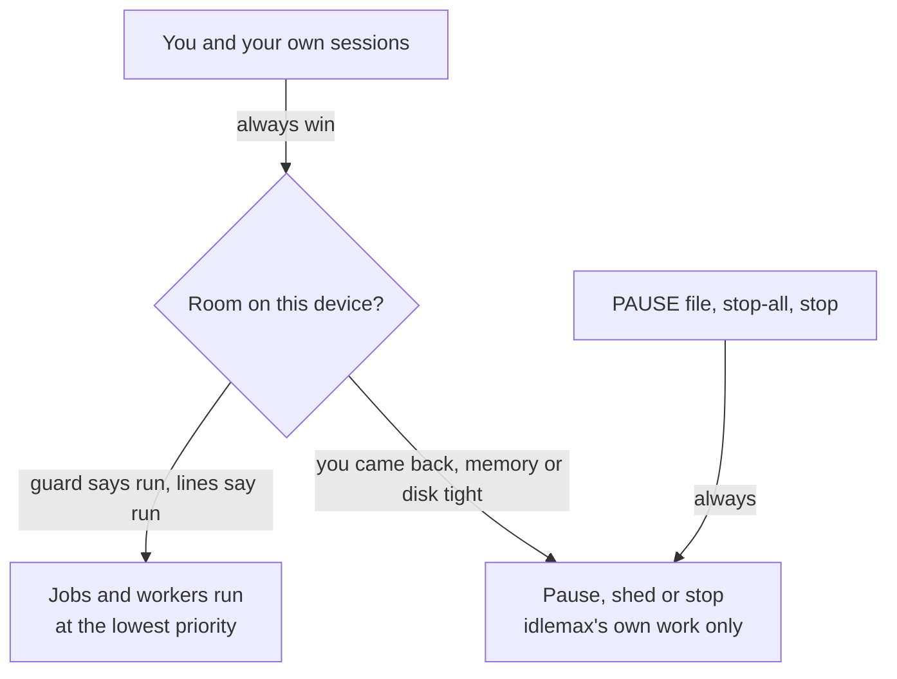

# 14. Safety and privacy 🔐

**What you will learn:** what idlemax promises never to do, how it keeps jobs and workers in their lane, what data leaves each device, and, honestly, where its fences end.

## The promise in one picture



## What idlemax never does

- **Never gets in your way on purpose.** A job that slows your machine is a bug, and so is a guard that holds work while there is room to spare.
- **Never stops, edits or shares the folder of a session you started.** Under pressure it stops its own newest worker first.
- **Never closes your apps.** It names the biggest memory users so you can decide.
- **Never works in your checkout.** Workers get their own worktree and branch; base checks use a separate detached checkout.
- **Never pushes, opens or merges a pull request, deploys, touches a database, sends a message or spends money** on a worker's behalf.
- **Never merges into your branch** unless you run `idlemax review keep <run> --merge` for that task, and then only the commit its check judged.
- **Never force-removes a worktree.** git refuses while uncommitted work is left, and nothing is deleted.
- **Never reads or copies an AI login.** It launches only the official CLIs with the login already on that device, and reads `claude auth status --json` (no token) to tell logins apart.
- **Never retries an AI job,** and stops spending an account after any limit message.
- **Never resumes your `idlemax stop` by itself,** also after a reboot.
- **Never binds the coordinator to every interface** (`0.0.0.0` or `[::]` is refused).

## Your controls always work

| Control | Scope | Needs the network? |
|---|---|---|
| `touch $IDLEMAX_HOME/PAUSE` | freezes every running job and worker on that device within seconds, and starts nothing new | no |
| `idlemax local stop-all` | kill every job on this device and hold new ones | no |
| `idlemax stop` | every AI worker, state saved, until `idlemax start` | yes |
| `idlemax stop-all [--device/--account/--job]` | kill running jobs in the scope and hold new ones | yes |
| `idlemax pause [...]` | freeze work in the scope | yes |
| `idlemax device off <id>` | stop a device's workers and dispatcher jobs; plain jobs keep running | yes |

Your own `review keep`, `review discard`, `stop` and every switch work whatever the line state, the guard or a pause says.

## How jobs are fenced

- **The allowlist.** A job runs only an exact program listed in `agent.command_allowlist`.
  Every agent reports its allowlist, so the scheduler never leases a job to a device that would refuse it.
- **No shell.** The command is argv and never goes through a shell.
- **A clean environment.** A job gets a short list of variables, its spec's `env` and `IDLEMAX_JOB_ID`.
  API keys, tokens and the ssh-agent socket in the agent's environment never reach it, and it never gets the idlemax token.
  `LD_*` and `DYLD_*` variables are refused.
- **The lowest priority the OS offers, with caps:**

| OS | Wrapper | Memory cap |
|---|---|---|
| macOS | `taskpolicy -c background -d throttle -b -m <mem_mb> -P kill nice -n 20 <command>` | the runner kills the job when its process tree's memory exceeds `mem_mb` (the `taskpolicy` limit is soft) |
| Linux, as root or with a reachable systemd user manager | `systemd-run [--user] --scope --nice=19 -p CPUQuota=100% -p CPUWeight=10 -p IOWeight=10 -p MemoryMax=<mem_mb>M -p MemorySwapMax=0 -- <command>` | cgroup `MemoryMax` with no swap: a job over its cap is killed and ends as "killed by the N MiB memory cap" |
| Linux, otherwise | `nice -n 19 ionice -c3 <command>` | the runner's memory check, plus the agent unit's cgroup caps |

On Linux, systemd 253 or newer also gets `-p OOMPolicy=kill`, so the whole job dies even when the kernel picks a child of a shell, and systemd 254 or newer gets `--expand-environment=no`, so `${VAR}` and `$$` in a job's argv reach it unchanged.
At agent startup on Linux, the agent's own cgroup memory limit (minus 128 MiB) also caps the job RAM budget.

- **A runtime cap.** The runner kills a job after `max_runtime_secs` (default 1800) of awake, unpaused time; sleep does not count.
- **Profiles.** A `production` server never takes `cpu_heavy` or `ai` jobs.

## How workers are fenced

| Fence | How |
|---|---|
| No personal MCP servers | Claude starts with `--strict-mcp-config`; Codex gets `enabled=false` for each configured server |
| No idlemax token, no credential variables | the pane gets them empty, and a worker whose real environment still holds one is never briefed |
| No untracked files of yours such as `.env` | a fresh worktree holds tracked files only |
| No CI, release, secret or agent-config paths | every project's off-limits paths include `.github/`, `.gitlab-ci.yml`, `*.env`, `secrets/`, `.claude/`, `.mcp.json`, `.husky/`, `.githooks/`, `.git/hooks/`, `.envrc`, `.circleci/`, `.env.*`, `*.pem` and `*.key` (unless you set `default-off-limits off`); the brief names them, no scope ever includes them, and a change there rejects the task |
| No changes to your git config or hooks | a worktree shares `.git/config` and `hooks/` with your checkout, so every git command idlemax runs on a project passes `-c core.fsmonitor=false -c core.hooksPath=/dev/null`; the agent snapshots both before a launch, compares them when the worker ends and after the check, puts any change back, rejects the Run and raises a needs-you entry |
| Nothing outlives a stop (Linux with a systemd manager) | each worker runs in a transient systemd scope of its own (`idlemax-w-<job>-...`): a headless worker starts in it, and a Herdr pane's shell is moved into it before the agent starts; a stop ends every process in the scope, including what the worker forked or `setsid`-ed; elsewhere, or when the move fails, a stop ends the process group or the pane only |
| No `git push` | every remote and every push URL (any scheme, a path, a remote added later) gets a dead push address, with no credential helper and no askpass helper, for the agent and for the setup and check commands; a worker that drops its environment gets past it, which only an OS sandbox stops (A13) |
| Codex writes and network | Codex's own `workspace-write` sandbox, approval `never` |
| No pull requests, deploys, databases, messages or spending | the brief and `rules.md` say so, and the credential variables are missing |

And a finished task is checked by idlemax, not taken on the worker's word: the baseline checks must still pass, the diff must stay in scope, and a large or core diff gets a review by another provider.

### The sandbox

Where bubblewrap works (`idlemax doctor` shows `ok  sandbox`), each worker runs inside it (`workers.sandbox`, default `auto`):

- it can write only its worktree, the git objects and refs its commits need, and a temp folder; the repository's `.git/config` and `.git/hooks` stay read-only;
- of the rest of the machine it sees only the system folders (`/usr`, `/etc`, `/bin`, `/sbin`, the `/lib` folders and `/nix`), read-only; other data folders such as `/srv`, `/opt`, `/var` or `/data` are absent, and a CLI installed outside them comes back through its own install folder;
- it sees none of your home: every home folder (`/home`, `/root`, `/mnt`, `/media`) is empty inside, its own `$HOME` is a fresh temporary one, and only the toolchains (such as `~/.local/bin`, `~/.cargo/bin`, `~/.rustup`, `~/.nvm`), `~/.gitconfig`, your repository's git objects and the CLI's own install folder come back, read-only; your other repositories, `~/.config`, keys, shell history, the idlemax state folder and every git credential store (`~/.git-credentials`, `~/.config/git/credentials` and the `--file` of any `credential.helper store`) stay out; Claude gets idlemax's own Claude home with your login only, never your MCP servers or projects;
- its only network is a proxy that opens port 443 of the model hosts (`workers.sandbox_hosts`);
- every process of the worker ends with it, a detached one included.

#### Switching the sandbox on (Linux)

The sandbox needs bubblewrap, and on Ubuntu 24.04 and later also a one-line AppArmor rule that lets bubblewrap build its sandbox.
Run these once on each Linux device, in a real terminal (sudo asks for your password):

```sh
# 1. Install bubblewrap
sudo apt install -y bubblewrap

# 2. Ubuntu 24.04+ only: allow /usr/bin/bwrap to make user namespaces
sudo tee /etc/apparmor.d/bwrap >/dev/null <<'RULE'
abi <abi/4.0>,
include <tunables/global>

profile bwrap /usr/bin/bwrap flags=(unconfined) {
  userns,

  include if exists <local/bwrap>
}
RULE
sudo apparmor_parser -r /etc/apparmor.d/bwrap

# 3. Check
idlemax doctor        # wants: ok  sandbox  workers run inside bubblewrap ...
```

Why step 2: Ubuntu 24.04 stops ordinary programs from making user namespaces (`kernel.apparmor_restrict_unprivileged_userns = 1`), and the `bubblewrap` package ships no rule for itself.
The rule names `/usr/bin/bwrap` alone, the same kind of rule Flatpak relies on; every other program stays restricted.
You need it when `idlemax doctor` says `bwrap cannot make its namespaces` (for example `Failed RTM_NEWADDR` or `setting up uid map: Permission denied`), and its fix then names the AppArmor profile.
Other distributions that allow user namespaces need step 1 only.

Then each worker's Run says how it ran: `wrapped` inside the sandbox, or `bare` with the reason.
A worker the sandbox should wrap but did not is refused, never run loose (`the sandbox did not take`).

#### One step for Claude workers: a worker token

A sandboxed Claude worker should sign in with a token of its own, so it never needs your `~/.claude`:

```sh
claude setup-token                                    # prints a long-lived token
install -m 600 /dev/null ~/.idlemax-worker-token      # a file only you can read
$EDITOR ~/.idlemax-worker-token                       # paste the token, save
idlemax config set workers.claude_token_file ~/.idlemax-worker-token
```

The worker then gets the token in its environment only, never on a command line or in a log, and nothing of your `~/.claude` is bound into its sandbox.
A file that others can read stops every Claude worker until you `chmod 600` it.
Without the setting, the worker reads your credentials file read-only; its token refresh may then fail inside the sandbox, and each such Run says so (`Claude token refresh may fail inside the sandbox; set workers.claude_token_file`).
`idlemax doctor` says which of the two a sandboxed Claude uses.

### What a worker can still reach

Without the sandbox (no bubblewrap, `workers.sandbox = off`, or macOS until its sandbox is built) these fences are **soft**: a worker runs as your own user.

- Credentials on disk or in the keychain (ssh keys, the `gh` login, cloud CLI logins) stay readable to a worker that goes looking.
- The idlemax token file and `coord.db` stay readable too.
- The push block lives in git's environment and config: a worker that drops its environment gets past it, and only an OS sandbox stops that.

Inside the sandbox a worker can still read your project and toolchains, use your Claude login against the model hosts, and change anything in its own worktree.

> [!WARNING]
> Switch on `auto` only after the checks in [docs/WORKER-PROOF.md](../WORKER-PROOF.md) passed for each CLI you list in `workers.clis`.

## Who may switch idlemax on

A job or worker that idlemax started can stop and pause work, but it cannot resume it, reload the agent's settings, switch the dispatcher out of `off`, add, switch on or change a project, change a limit, ask for an orchestrator pass, start the workers you stopped, or keep, merge or discard a finished task, even when it reads the token file.

- The CLI refuses those commands when its environment has `IDLEMAX_JOB_ID`.
- The coordinator and the agent answer 403 when the calling process, or any process above it, carries the marker of this idlemax home.
- On Linux with a systemd manager, every process in a worker's systemd scope (`idlemax-w-...`) also counts as launched, whatever its environment, because `setsid` and double forks keep the scope.
- `idlemax mcp` gives a job or worker no `start` or `project_on`.

### What this lock does not stop

The lock stops accidents and a launched process that tries the documented switches.
**It is not a sandbox.** Without the worker sandbox above it does not stop:

- A write to `config.toml` in the state folder: every `[dispatcher]` key, the mode included, and every quota key except `quota.accounts` apply at once, because the daemons re-read them when the file changes; `[workers]` keys apply at the coordinator's next launch step; `[guard]` keys and the other live agent keys apply at the agent's next reload (which `idlemax config set` asks for); every other key, `quota.accounts` included, applies at the next restart.
- A write to `rules.md`, the database or the token file, or deleting the `PAUSE` file: it is the same OS user. A worker's change to `config.toml`, `rules.md` or the token file that no owner command made is detected when its turn is checked: the Run is rejected and the owner gets a needs-you notice.
- Detaching, where a worker has no systemd scope (macOS, or Linux without a systemd manager): one line such as `( env -u IDLEMAX_JOB_ID curl ... & )` leaves a caller with a clean environment under pid 1. On Linux with a systemd manager a worker runs in a scope (`idlemax-w-…`) and every process in one counts as launched whatever its environment, so detaching does not get past the check; a process the worker gets the owner's own session to start still does.
- A call to a coordinator on another machine: a caller that is not on the coordinator's host is judged by the token alone.
- Acting through your own session: a shell start-up file, a git hook or a service file that your session runs later, or a script that drives your browser.
- Replacing the `idlemax` binary.

## Network and tokens

- One bearer token (32 random bytes as hex, file mode 0600) guards every API call except `/healthz`, `/` and `/dashboard.js` (the dashboard page and its script), and is compared in constant time.
- **Anyone holding the token can run any allowlisted program with any arguments on your devices.** Treat it like an SSH key, and keep allowlists narrow: allowlisting `sh` or `python3` allows any code.
- The coordinator's traffic is plain HTTP, so bind it to a private network such as a tailnet, which encrypts it.
- It answers only to IP addresses, `localhost`, the host of `coordinator.url` and `coordinator.allowed_hosts` (a defence against DNS rebinding).
- The local agent API listens on loopback only.
- A server gets its own credential (`idlemax device credential`), which opens only the agent routes and speaks only for that device, so a server keeps no owner token.

## The dashboard

- One self-contained page: it loads nothing remote, sends a strict Content-Security-Policy, and writes every API string as text, never HTML.
- It keeps the token in the browser's local storage until you press **Forget token**.

## What data leaves a device

| Data | Goes to | Turn it off |
|---|---|---|
| Machine metrics and guard verdicts | your coordinator | (needed) |
| Job results and logs metadata | your coordinator; full logs stay on the device | (needed) |
| `gh` summary and session **metadata** (never message text) | your coordinator, for the advisor | `agent.advisor_inputs_secs = 0` |
| Paths of git repositories, your activity, and for switched-on projects the roadmap items, your changed files, the tracked file list (at most 200) and the start of `AGENTS.md` or `CLAUDE.md` (at most 2,000 characters) | your coordinator, for the dispatcher | `agent.dispatch_inputs_secs = 0` |
| A compact summary of tasks and projects, with their file lists and the start of their conventions file | Anthropic, via your own `claude -p` orchestrator pass | `idlemax mode off` |
| The code a worker works on | the worker's AI provider, via its official CLI | keep projects off |
| Quota readings | read from local CLI files only; never sent to a provider | |

Nothing goes to the idlemax authors.
There is no telemetry.

## Reporting a vulnerability

Report it privately, as [SECURITY.md](../../SECURITY.md) describes, not in a public issue.

Back to: [the manual index](00-index.md)
